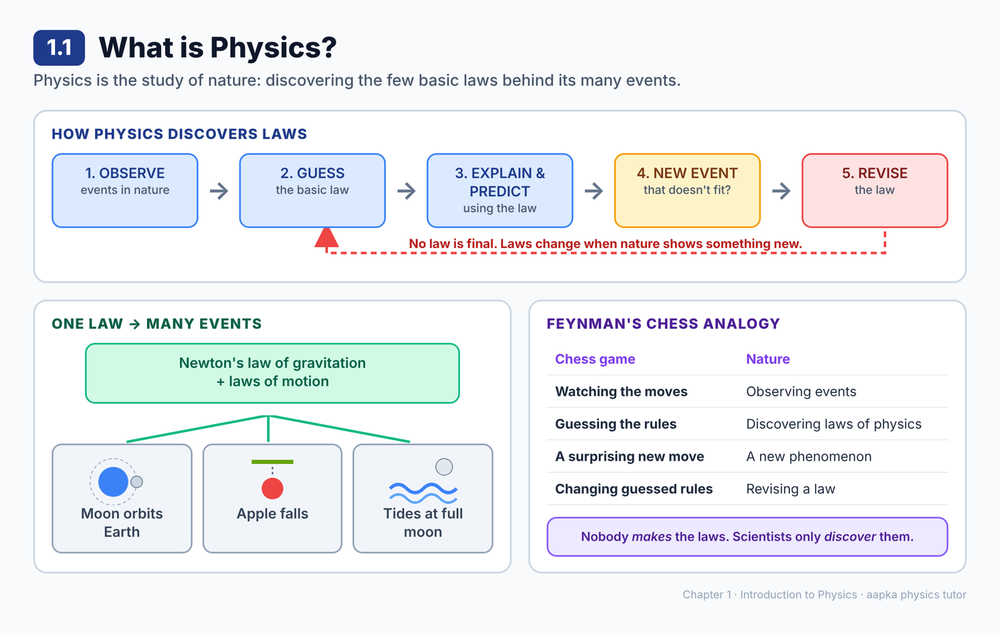
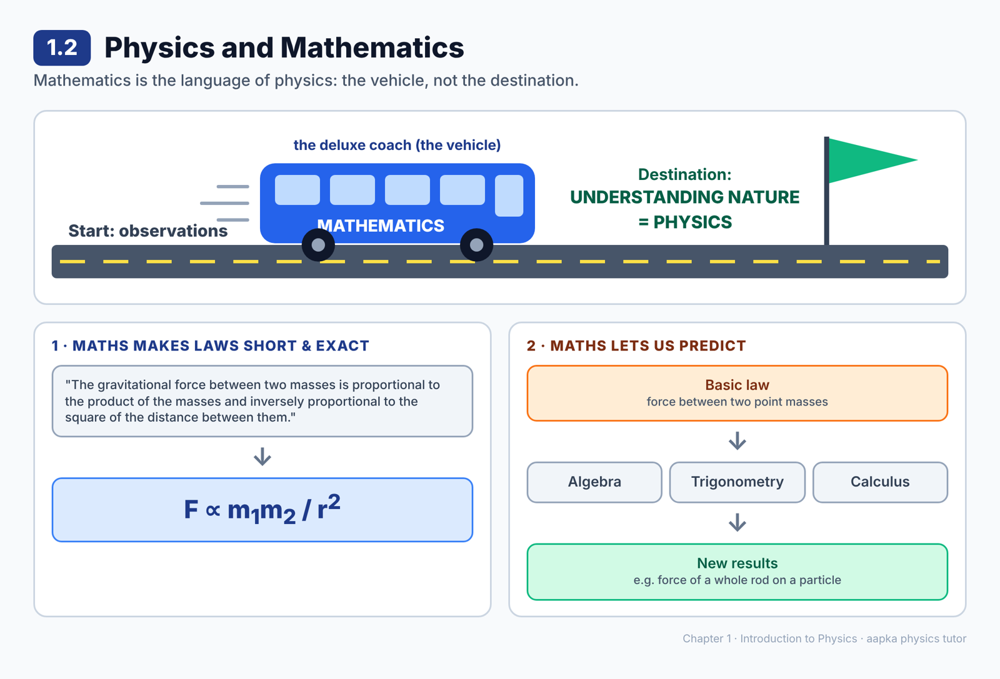
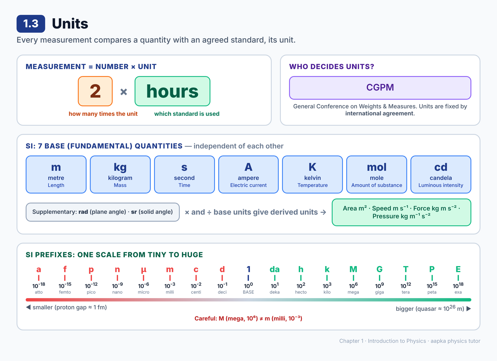
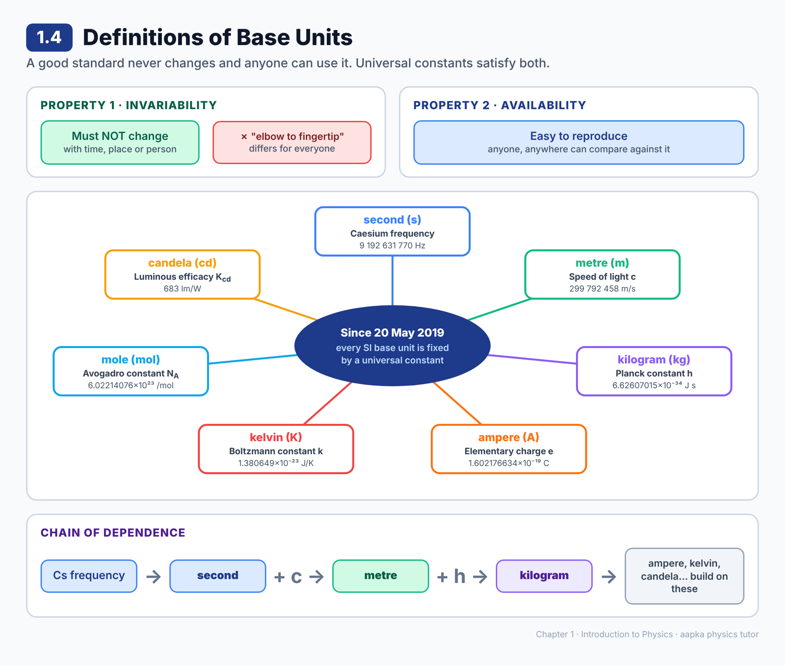
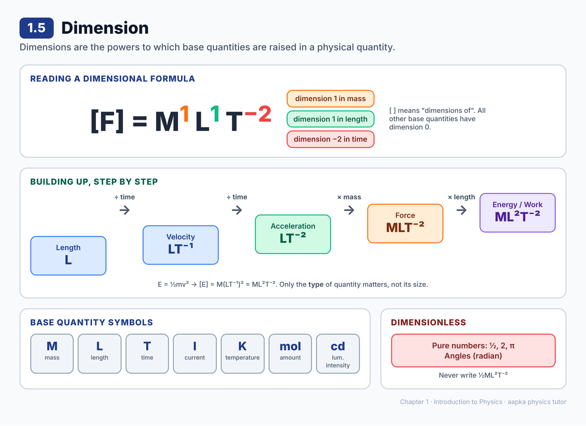
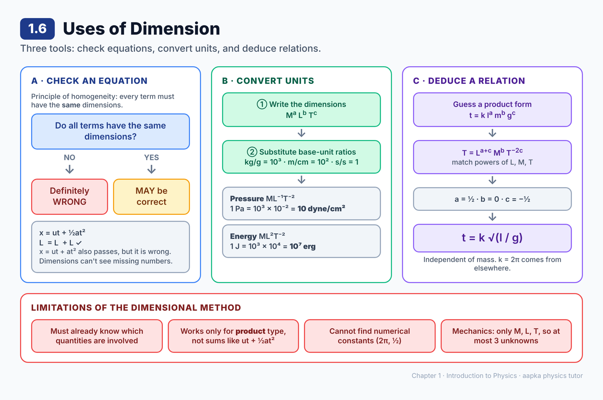
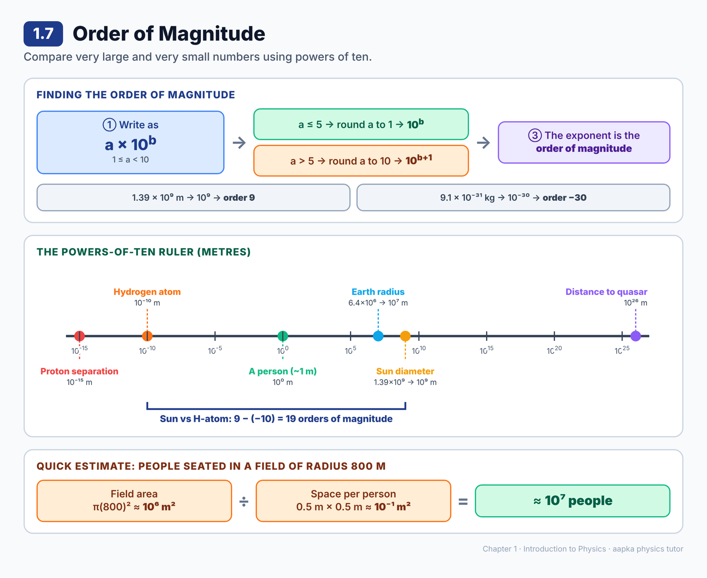
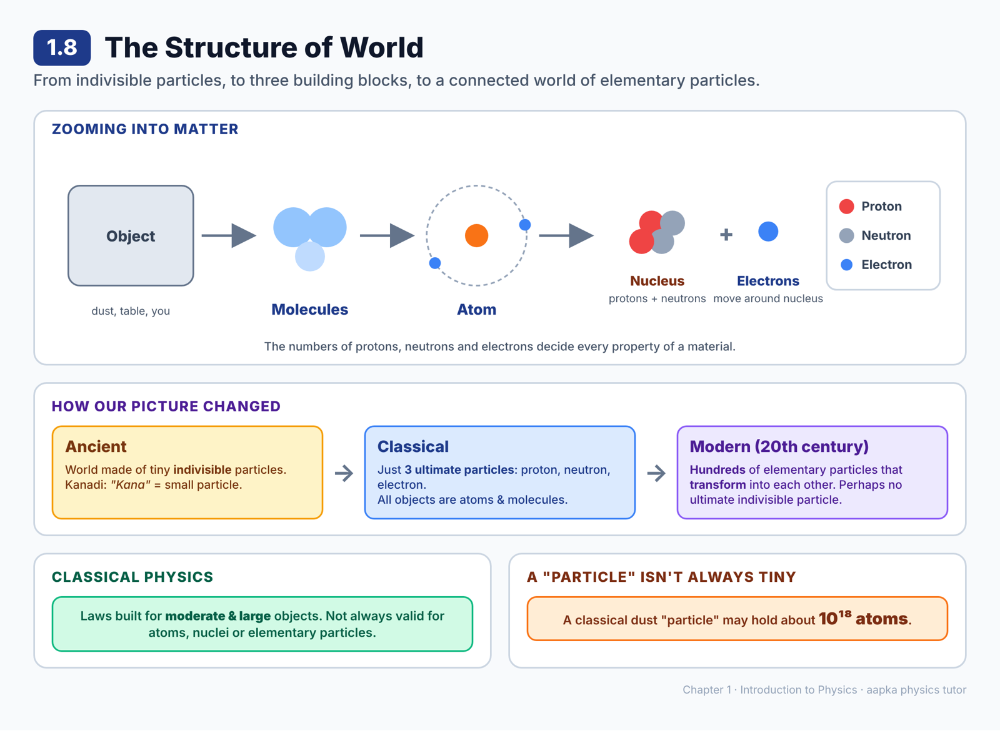

# Chapter 1 — Introduction to Physics
### Learning Material + MCQ Practice Set (based on H.C. Verma, *Concepts of Physics* Vol. 1)

**How to use:** Each section opens with a **summary diagram**, then **📘 Learning Material** (key ideas, formulas, worked examples, common mistakes). Then come the **MCQs**, followed by an answer key with short explanations. Difficulty is marked: 🟢 Recall · 🟡 Understanding · 🔴 Application.

---

## 1.1 What is Physics?

### 📘 Learning Material

**Big idea:** Physics is the study of nature and the basic laws behind everything that happens in it.

Nature is full of very different-looking events: wind, rainbows, planets moving, things getting hot when rubbed, sunlight, the nucleus of an atom. Physics assumes that behind all this variety there is a **small set of basic laws**. Finding those laws from what we observe is the job of physics.

**One law, many events.** Newton's law of gravitation, together with his laws of motion, explains:
- the moon orbiting the earth
- an apple falling from a tree
- high tides on a full-moon night

Three events that look unrelated turn out to share one explanation. That is the power of physics.

**Feynman's chess analogy**
| Chess game | Nature |
|---|---|
| Watching the players' moves | Observing events in nature |
| Guessing the rules of chess | Discovering the laws of physics |
| A surprising new move that breaks a guessed rule | A new phenomenon that old laws can't explain |
| Changing your guessed rules | Revising or replacing a physical law |

Two lessons from the analogy:
1. Knowing the rules is the *minimum* requirement. Even with all the rules, predicting a complicated situation can still be hard.
2. Rules guessed from partial observation can be wrong, and we must be ready to change them.

**Physics is real, not invented.** No one has the authority to *make* the laws of nature. Scientists like Aryabhata, Newton, Einstein and Feynman are great because they *discovered* rules that convincingly explained the observations of their time. If a new observation contradicts a law, the law gets changed, no matter how famous its discoverer.

**Why it matters:** Because physics deals with the basic rules underlying everything, it feeds into many other fields, including biology and medicine.

> ⚠️ **Common misconception:** "Laws of physics are permanent truths." They are our best current description of nature and can be revised when new evidence appears.

### ❓ MCQs

**Q1.** 🟢 Physics is best described as:
- (A) The study of numbers and their relationships
- (B) The study of nature and the basic laws behind natural events
- (C) The study of machines and how to build them
- (D) The study of living organisms

**Q2.** 🟡 In Feynman's chess analogy, watching the players' moves corresponds to observing events in nature. What do the *rules of chess* correspond to?
- (A) The experiments done in a laboratory
- (B) The mathematical equations used by scientists
- (C) The basic laws of nature
- (D) The scientists who discover the laws

**Q3.** 🟢 The orbiting of the moon around the earth, the falling of an apple and tides on a full-moon night can all be explained using:
- (A) Newton's law of gravitation and Newton's laws of motion
- (B) The laws of thermodynamics
- (C) The laws of reflection of light
- (D) Ohm's law

**Q4.** 🟡 A new phenomenon is observed that the existing laws of physics cannot explain. According to the spirit of physics, what should happen?
- (A) The observation should be ignored as an error
- (B) The existing laws should be kept because great scientists framed them
- (C) The laws should be revised or replaced by new ones that explain it
- (D) The phenomenon should be declared outside the scope of physics

**Q5.** 🟡 Which statement about the laws of physics is correct?
- (A) Physicists have the authority to decide what the laws of nature should be
- (B) Physicists only discover the rules that are already operating in nature
- (C) Laws of physics apply only inside a laboratory
- (D) Once discovered, a law of physics can never be changed

### Answer Key — 1.1
| Q | Ans | Explanation |
|---|---|---|
| 1 | B | Physics reveals the basic laws of nature from observed events. |
| 2 | C | The rules of the game are the laws of nature that we try to guess by watching. |
| 3 | A | All three are explained by gravitation plus the laws of motion. |
| 4 | C | If old rules fail to explain a new event, no one hesitates to change them. |
| 5 | B | No one frames the rules. We discover the rules nature already follows. |

---

## 1.2 Physics and Mathematics

### 📘 Learning Material

**Big idea:** Mathematics is the *language* of physics, but it is not physics itself.

**1. Maths makes descriptions short and exact.**
Compare these two ways of saying the same thing:
- In words: "The gravitational force between two masses is proportional to the product of the masses and inversely proportional to the square of the distance between them."
- In maths: **F ∝ m₁m₂ / r²**

The equation is shorter, clearer, and you can calculate with it.

**2. Maths lets us make predictions.**
Starting from one basic law, tools like algebra, trigonometry and calculus let us work out results for new situations. For example, if we know the force between two point masses, *integral calculus* lets us find the force a whole uniform rod exerts on a particle. We do this by splitting the rod into tiny pieces and adding up their effects.

**3. But maths is the vehicle, not the destination.**
The Delhi → Agra analogy:
- 🎯 **Destination (Agra)** = understanding nature, which is **physics**
- 🚌 **Deluxe coach** = **mathematics**, a comfortable way to get there

Just as language is a tool for expressing ideas (the idea matters most), mathematics is a tool for expressing physical laws.

**🧮 Worked example: using proportionality**
If m₁ is tripled and r is doubled, what happens to F?
F' ∝ (3m₁)(m₂)/(2r)² = (3/4)·m₁m₂/r², so **F' = ¾ F**.

> 💡 **Tip for proportionality problems:** Replace each quantity by "(factor) × original", then simplify the factors only.

> ⚠️ **Common mistake:** Being able to solve the equations without understanding the physics behind them. Always ask yourself what the equation means physically.

### ❓ MCQs

**Q1.** 🟢 According to the chapter, mathematics is the ______ of physics.
- (A) goal
- (B) language
- (C) opposite
- (D) substitute

**Q2.** 🟡 In the "deluxe coach from Delhi to Agra" analogy, the deluxe coach represents:
- (A) Physics
- (B) Nature
- (C) Mathematics
- (D) Experiments

**Q3.** 🔴 The gravitational force between two masses is F ∝ m₁m₂ / r². If **both** masses are doubled and the distance between them is also doubled, the force becomes:
- (A) 4 times
- (B) 2 times
- (C) Half
- (D) Unchanged

**Q4.** 🟢 Knowing the basic force law between two particles, which mathematical technique can be used to find the force exerted by a uniform rod on a particle placed on its perpendicular bisector?
- (A) Integral calculus
- (B) Trigonometry only
- (C) Simple addition
- (D) Probability

### Answer Key — 1.2
| Q | Ans | Explanation |
|---|---|---|
| 1 | B | Mathematics is the language used to describe and predict nature. |
| 2 | C | Mathematics is the comfortable coach. Reaching Agra ("understanding nature") is the real goal, which is physics. |
| 3 | D | F' ∝ (2m₁)(2m₂)/(2r)² = 4m₁m₂/4r², which is the same as before. |
| 4 | A | The rod is split into tiny parts and their forces are added using integration. |

---

## 1.3 Units

### 📘 Learning Material

**Big idea:** To measure anything, we compare it with a chosen standard called a **unit**.

**Measurement = Number × Unit**
"Study for **2 hours**":
- **2** is the numerical value (how many times the unit)
- **hour** is the unit

Without a unit, a number in physics is meaningless. "The rod is 5 long" tells you nothing.

**Who decides the units?**
For people across the world to communicate, units need *international agreement*. That authority is the **CGPM** (Conférence Générale des Poids et Mesures, the General Conference on Weights and Measures).

**Fundamental vs Derived Quantities**
Many quantities depend on others. Once you define a unit of length, a unit of area follows automatically (a square of side 1 unit). Once you define length and time, a unit of speed follows.

Fundamental (base) quantities are chosen so that:
1. They are **independent** of each other, and
2. **All other** quantities can be built from them by multiplying and dividing.

Units of base quantities are **fundamental units**. All others are **derived units**.

> 💡 The choice is not unique. You could take *speed and time* as fundamental, and then length = speed × time would be derived. Different unit systems make different choices.

**SI: the International System of Units.** It has 7 base quantities:

| Quantity | Unit | Symbol |
|---|---|---|
| Length | metre | m |
| Mass | kilogram | kg |
| Time | second | s |
| Electric current | ampere | A |
| Thermodynamic temperature | kelvin | K |
| Amount of substance | mole | mol |
| Luminous intensity | candela | cd |

🧠 **Memory trick:** "**M**y **K**ind **S**ister **A**lways **K**eeps **M**y **C**andy" (m, kg, s, A, K, mol, cd)

**Supplementary units:** radian (rad) for plane angle, steradian (sr) for solid angle.

**SI Prefixes**
Physical quantities range from tiny (proton separation ~10⁻¹⁵ m) to huge (distance to a quasar ~10²⁶ m), so prefixes are used:

| Prefix | Symbol | Power | | Prefix | Symbol | Power |
|---|---|---|---|---|---|---|
| exa | E | 10¹⁸ | | deci | d | 10⁻¹ |
| peta | P | 10¹⁵ | | centi | c | 10⁻² |
| tera | T | 10¹² | | milli | m | 10⁻³ |
| giga | G | 10⁹ | | micro | μ | 10⁻⁶ |
| mega | M | 10⁶ | | nano | n | 10⁻⁹ |
| kilo | k | 10³ | | pico | p | 10⁻¹² |
| hecto | h | 10² | | femto | f | 10⁻¹⁵ |
| deka | da | 10¹ | | atto | a | 10⁻¹⁸ |

**🧮 Worked example:** Express 4.7 μs in seconds.
4.7 μs = 4.7 × 10⁻⁶ s.

> ⚠️ **Common mistakes:**
> - **M** (mega, 10⁶) vs **m** (milli, 10⁻³): capital vs small matters!
> - Force, velocity, energy and pressure are **derived**, not base quantities.
> - The unit symbol for kelvin is **K**, not °K.

### ❓ MCQs

**Q1.** 🟢 The measurement of a physical quantity is expressed in two parts. These are:
- (A) Magnitude and direction
- (B) A numerical value and the unit
- (C) Dimension and unit
- (D) Base unit and derived unit

**Q2.** 🟢 The international body that has the authority to decide standard units is:
- (A) ISRO
- (B) NASA
- (C) CGPM (General Conference on Weights and Measures)
- (D) UNESCO

**Q3.** 🟡 A set of fundamental quantities must satisfy which condition(s)?
- (A) They should be independent of each other
- (B) All other quantities should be expressible in terms of them
- (C) Both (A) and (B)
- (D) They must all be mechanical quantities

**Q4.** 🟢 How many base (fundamental) quantities are there in SI?
- (A) 3
- (B) 5
- (C) 7
- (D) 9

**Q5.** 🟡 Which of the following is **not** a base quantity in SI?
- (A) Luminous intensity
- (B) Force
- (C) Amount of substance
- (D) Electric current

**Q6.** 🟢 The two supplementary SI units are:
- (A) Radian and steradian
- (B) Degree and radian
- (C) Kelvin and candela
- (D) Mole and steradian

**Q7.** 🟡 If *speed* and *time* are chosen as fundamental quantities, then *length* becomes:
- (A) A fundamental quantity
- (B) A supplementary quantity
- (C) A dimensionless quantity
- (D) A derived quantity

**Q8.** 🔴 The separation between two protons in a nucleus is about 10⁻¹⁵ m. Using SI prefixes, this is:
- (A) 1 nanometre (nm)
- (B) 1 picometre (pm)
- (C) 1 femtometre (fm)
- (D) 1 attometre (am)

**Q9.** 🔴 A mobile processor runs at 3 GHz. In hertz, this is:
- (A) 3 × 10⁶ Hz
- (B) 3 × 10⁹ Hz
- (C) 3 × 10¹² Hz
- (D) 3 × 10³ Hz

### Answer Key — 1.3
| Q | Ans | Explanation |
|---|---|---|
| 1 | B | E.g. "2 hours": 2 is how many times the unit, and hour is the unit. |
| 2 | C | CGPM decides units by international agreement. |
| 3 | C | Fundamental quantities must be independent, and everything else must be derivable from them. |
| 4 | C | Length, mass, time, electric current, temperature, amount of substance and luminous intensity. |
| 5 | B | Force is derived (mass × acceleration). |
| 6 | A | Radian (rad) is for plane angle and steradian (sr) is for solid angle. |
| 7 | D | Length = speed × time, so it is derived. |
| 8 | C | femto = 10⁻¹⁵ (nano = 10⁻⁹, pico = 10⁻¹², atto = 10⁻¹⁸). |
| 9 | B | giga = 10⁹. |

---

## 1.4 Definitions of Base Units

### 📘 Learning Material

**Big idea:** A good standard unit must never change and must be available to everyone. Since 2019, SI achieves this by defining every base unit through fixed values of universal constants.

**Two essential properties of a standard unit**
1. **Invariability:** it must not change with time, place or person.
   ❌ "Elbow to middle fingertip" as a unit of length fails, because everyone's arm is different.
2. **Availability:** anyone, anywhere, should be able to reproduce it to compare against.

**The 2019 redefinition (effective 20 May 2019)**
The CGPM decided (2018) that each SI base unit would be defined by **fixing the exact numerical value of a universal constant**. Constants of nature are the same everywhere and forever, so both properties are satisfied automatically.

| Base unit | Defined by fixing… | Exact fixed value |
|---|---|---|
| second (s) | Caesium hyperfine frequency Δν_Cs | 9 192 631 770 Hz |
| metre (m) | Speed of light in vacuum c | 299 792 458 m s⁻¹ |
| kilogram (kg) | Planck constant h | 6.62607015 × 10⁻³⁴ J s |
| ampere (A) | Elementary charge e | 1.602176634 × 10⁻¹⁹ C |
| kelvin (K) | Boltzmann constant k | 1.380649 × 10⁻²³ J K⁻¹ |
| mole (mol) | Avogadro constant N_A | 6.02214076 × 10²³ mol⁻¹ |
| candela (cd) | Luminous efficacy K_cd of 540 × 10¹² Hz light | 683 lm W⁻¹ |

**The chain of dependence:** the second comes first (from caesium). The metre uses the second and c. The kilogram uses the metre, the second and h. Other units build on these.

🧠 **Memory pairs:** **S**econd–**C**aesium · **M**etre–**L**ight · **K**ilogram–**P**lanck · **A**mpere–**C**harge · **K**elvin–**B**oltzmann · **M**ole–**A**vogadro

> 💡 You don't need to understand the physics inside each definition yet. Just know *which constant* defines *which unit*.

> ⚠️ **Common mistake:** Saying c = 3 × 10⁸ m/s is the *defined* value. It's only an approximation. The exact defined value is 299 792 458 m/s.

### ❓ MCQs

**Q1.** 🟢 Any standard unit should have which two properties?
- (A) Invariability and availability
- (B) Simplicity and cheapness
- (C) Large size and small size
- (D) Accuracy and colour

**Q2.** 🟡 Defining the distance from the elbow to the tip of the middle finger as the unit of length is a poor choice mainly because it lacks:
- (A) Availability
- (B) Invariability
- (C) A name
- (D) A symbol

**Q3.** 🟢 Since 20 May 2019, all SI base units are defined in terms of:
- (A) Physical objects kept in Paris
- (B) Fixed numerical values of certain universal constants
- (C) The size and rotation of the earth
- (D) The human body

**Q4.** 🟡 The kilogram is now defined by fixing the numerical value of:
- (A) The speed of light
- (B) The Boltzmann constant
- (C) The Planck constant h
- (D) The elementary charge e

**Q5.** 🟢 The second is defined using the hyperfine transition frequency of which atom?
- (A) Hydrogen
- (B) Caesium
- (C) Carbon
- (D) Krypton

**Q6.** 🔴 Which pairing of SI base unit and the constant used to define it is **incorrect**?
- (A) Kelvin – Boltzmann constant
- (B) Ampere – Elementary charge
- (C) Mole – Avogadro constant
- (D) Metre – Planck constant

**Q7.** 🟡 The metre is defined so that the speed of light in vacuum is exactly:
- (A) 3 × 10⁸ m s⁻¹
- (B) 299 792 458 m s⁻¹
- (C) 9 192 631 770 m s⁻¹
- (D) 6.02214076 × 10²³ m s⁻¹

### Answer Key — 1.4
| Q | Ans | Explanation |
|---|---|---|
| 1 | A | A standard must not change, and must be easy to compare against. |
| 2 | B | Arm lengths differ from person to person, so the unit is not invariable. |
| 3 | B | Fixing constants satisfies both invariability and availability automatically. |
| 4 | C | h = 6.62607015 × 10⁻³⁴ J s. |
| 5 | B | Δν_Cs = 9 192 631 770 Hz. |
| 6 | D | The metre is defined through the speed of light c, not Planck's constant. |
| 7 | B | 3 × 10⁸ is only an approximation. 9 192 631 770 is the caesium frequency, and 6.022… × 10²³ is Avogadro's number. |

---

## 1.5 Dimension

### 📘 Learning Material

**Big idea:** Every physical quantity can be written as a product of powers of base quantities. Those powers are its **dimensions**.

**Symbols for base quantities**
| Base quantity | Symbol |
|---|---|
| Mass | M |
| Length | L |
| Time | T |
| Electric current | I |
| Temperature | K |
| Amount of substance | mol |
| Luminous intensity | cd |

**Building a dimensional formula, step by step (force)**
- velocity = length / time, so **[v] = LT⁻¹**
- acceleration = velocity / time, so **[a] = LT⁻²**
- force = mass × acceleration, so **[F] = MLT⁻²**

We say: *the dimensions of force are 1 in mass, 1 in length, and –2 in time* (and 0 in all other base quantities). Square brackets [ ] mean "dimensions of".

**Key rules**
- Only the **type** of quantity matters, not its size. Initial velocity, final velocity, change in velocity and average velocity all have dimensions LT⁻¹.
- **Pure numbers** (½, 2, π) and ratios like angles are **dimensionless**.

**🧮 Worked example:** Find the dimensions of kinetic energy, E = ½mv².
[E] = [m][v]² = M (LT⁻¹)² = **ML²T⁻²**. (The ½ is dropped because it is just a number.)

**📋 Quick reference: common dimensional formulas**
| Quantity | Formula | Dimensions |
|---|---|---|
| Area | l × b | L² |
| Volume | l × b × h | L³ |
| Density | mass/volume | ML⁻³ |
| Velocity | distance/time | LT⁻¹ |
| Acceleration | velocity/time | LT⁻² |
| Force | ma | MLT⁻² |
| Momentum | mv | MLT⁻¹ |
| Work / Energy | F × d | ML²T⁻² |
| Power | work/time | ML²T⁻³ |
| Pressure | force/area | ML⁻¹T⁻² |
| Frequency | 1/time | T⁻¹ |

> ⚠️ **Common mistakes:**
> - Writing ½ML²T⁻². Numbers never appear in dimensional formulas.
> - Mixing up a *unit* (newton, kg m s⁻²) with *dimensions* (MLT⁻²). Units depend on the system, but dimensions don't.

### ❓ MCQs

**Q1.** 🟢 The *dimension* of a physical quantity in a particular base quantity is:
- (A) The unit of that base quantity
- (B) The exponent (power) of that base quantity in its expression
- (C) The numerical value of the quantity
- (D) The magnitude of the base quantity

**Q2.** 🟢 The dimensional formula of force is:
- (A) MLT⁻¹
- (B) ML²T⁻²
- (C) MLT⁻²
- (D) ML⁻¹T⁻²

**Q3.** 🟡 Using E = ½mv², the dimensional formula of energy is:
- (A) ML²T⁻²
- (B) ½ ML²T⁻²
- (C) MLT⁻²
- (D) ML²T⁻¹

**Q4.** 🟡 In finding the dimensions of energy from E = ½mv², the factor ½ is ignored because:
- (A) It is too small
- (B) It is a pure number and has no dimensions
- (C) It cancels with the mass
- (D) Energy is always rounded off

**Q5.** 🟡 The dimensions of force are ______ in time.
- (A) 1
- (B) 2
- (C) 0
- (D) –2

**Q6.** 🔴 For dimensional purposes, which of these is treated as having the **same** dimensions as initial velocity?
- (A) Change in velocity
- (B) Acceleration
- (C) Momentum
- (D) Displacement

### Answer Key — 1.5
| Q | Ans | Explanation |
|---|---|---|
| 1 | B | E.g. force = M¹L¹T⁻², so its dimension in time is –2. |
| 2 | C | Force = mass × acceleration = M × LT⁻². |
| 3 | A | [M][LT⁻¹]² = ML²T⁻². |
| 4 | B | Pure numbers are dimensionless. |
| 5 | D | MLT⁻² has T raised to –2. |
| 6 | A | Change in velocity, average velocity and final velocity all have dimensions of length/time. Magnitude doesn't matter. |

---

## 1.6 Uses of Dimension

### 📘 Learning Material

**Big idea:** Dimensions give us three powerful tools: (A) checking equations, (B) converting units, and (C) guessing relationships between quantities.

---

**A. Checking equations: the principle of homogeneity**

You can only add, subtract or equate quantities of the **same kind**. You can't add a velocity to a force! So in any correct equation, **every term must have the same dimensions**.

**🧮 Check:** x = ut + ½at²
- [x] = L
- [ut] = LT⁻¹ · T = L
- [½at²] = LT⁻² · T² = L

All terms are L ✔, so the equation is dimensionally correct.

**⚠️ The one-way rule**
- Dimensionally **wrong** → equation is **definitely wrong** ❌
- Dimensionally **correct** → equation **may or may not** be right ❓

Example: x = ut + at² passes the check but is wrong (the ½ is missing). Dimensions can't detect missing numbers.

**🧮 Check:** t = 2π√(m / (F/x))
[F/x] = MLT⁻² / L = MT⁻², so [m/(F/x)] = M / MT⁻² = T², and √T² = **T** ✔. This may be correct.

---

**B. Converting units between systems**

Method: write the dimensional formula, then substitute the conversion factor for each base unit.

**🧮 Example: 1 pascal → CGS (dyne/cm²)**
[P] = ML⁻¹T⁻²
1 Pa / 1 CGS unit = (1 kg / 1 g)¹ × (1 m / 1 cm)⁻¹ × (1 s / 1 s)⁻²
= (10³)(10²)⁻¹(1) = **10**, so 1 Pa = 10 dyne/cm².

**🧮 Example: 1 joule → erg**
[E] = ML²T⁻², giving (10³)(10²)² = 10³ × 10⁴ = **10⁷**, so 1 J = 10⁷ erg.

> 💡 **General formula:** n₂ = n₁ (M₁/M₂)ᵃ (L₁/L₂)ᵇ (T₁/T₂)ᶜ for a quantity with dimensions MᵃLᵇTᶜ.

---

**C. Deducing a relation (the "method of dimensions")**

If you know *what* a quantity depends on, and that the dependence is a **product of powers**, you can find the powers.

**🧮 Example: time period of a simple pendulum**
Suppose t depends on length l, mass m and gravity g: t = k lᵃ mᵇ gᶜ
Dimensions: T = Lᵃ Mᵇ (LT⁻²)ᶜ = Lᵃ⁺ᶜ Mᵇ T⁻²ᶜ

Compare the powers:
- L: a + c = 0
- M: b = 0
- T: –2c = 1, so c = –½ and a = ½

Therefore **t = k√(l/g)**. The period doesn't depend on mass, grows as √length, and falls as 1/√g. (The true value k = 2π must come from theory or experiment.)

---

**🚫 Limitations of the dimensional method**
1. You must already know which quantities are involved.
2. It works **only for product-type** relations. It can't derive sums like x = ut + ½at².
3. It **can't find dimensionless constants** (2π, ½, etc.).
4. In mechanics there are only 3 base dimensions (M, L, T), so you get **at most 3 equations**. If a quantity depends on more than 3 others, the powers can't be found uniquely.

> ⚠️ **Common mistake:** Concluding an equation is correct just because the dimensions match. Matching dimensions is necessary, but it is not enough.

### ❓ MCQs

### A. Homogeneity of Dimensions

**Q1.** 🟢 The principle of homogeneity of dimensions states that:
- (A) All terms in a physical equation must have the same dimensions
- (B) All physical quantities have the same dimensions
- (C) Only the left-hand side of an equation needs dimensions
- (D) Dimensions and units are the same thing

**Q2.** 🔴 Which of the following equations is **dimensionally incorrect**? (v, u = velocity; a = acceleration; t = time; x = distance)
- (A) v = u + at
- (B) v² = u² + 2ax
- (C) x = ut + ½at³
- (D) x = ½(u + v)t

**Q3.** 🟡 The equation x = ut + at² is dimensionally correct, yet the true relation is x = ut + ½at². This shows that:
- (A) Dimensional analysis is always wrong
- (B) A dimensionally correct equation need not be physically correct
- (C) A dimensionally wrong equation can still be correct
- (D) The factor ½ has dimensions

**Q4.** 🔴 Which formula for a time period t is dimensionally consistent? (m = mass, F = force, x = distance)
- (A) t = 2π√(mF / x)
- (B) t = 2π√(m / (F/x))
- (C) t = 2π√(F / (mx))
- (D) t = 2π√(m / (Fx))

### B. Conversion of Units

**Q5.** 🔴 Using dimensions of pressure (ML⁻¹T⁻²), 1 pascal equals how many CGS units of pressure (dyne/cm²)?
- (A) 0.1
- (B) 10
- (C) 100
- (D) 1000

**Q6.** 🔴 Energy has dimensions ML²T⁻². 1 joule (SI) equals how many ergs (CGS)?
- (A) 10³
- (B) 10⁵
- (C) 10⁷
- (D) 10⁻⁷

### C. Deducing Relations Among Quantities

**Q7.** 🟡 Assuming the time period of a simple pendulum depends on length l, mass m and g, dimensional analysis gives:
- (A) t = k √(l/g), independent of mass
- (B) t = k √(g/l)
- (C) t = k m √(l/g)
- (D) t = k l g

**Q8.** 🟢 Which of the following **cannot** be found by dimensional analysis?
- (A) Whether an equation might be correct
- (B) Conversion factors between unit systems
- (C) The value of dimensionless constants like 2π
- (D) How a quantity depends on other quantities (product type)

**Q9.** 🟡 Dimensional analysis cannot give the correct expression x = ut + ½at² because:
- (A) Distance has no dimensions
- (B) The relation is a sum of terms, not of product type
- (C) Acceleration is not a mechanical quantity
- (D) Time is not a base quantity

**Q10.** 🔴 In mechanics, dimensional analysis fails to give a unique relation when a quantity depends on more than three other quantities. Why?
- (A) Mechanical quantities have no dimensions
- (B) Only M, L and T are involved, giving at most three equations for more than three unknown exponents
- (C) Calculations become too long
- (D) Dimensions change with units

### Answer Key — 1.6
| Q | Ans | Explanation |
|---|---|---|
| 1 | A | You can only add, subtract or equate quantities of the same kind. |
| 2 | C | at³ has dimensions LT⁻²·T³ = LT, not L. |
| 3 | B | Dimensions ignore pure numbers, so the wrong factor isn't detected. A dimensionally wrong equation, however, must be wrong. |
| 4 | B | m/(F/x) = M / (MLT⁻²/L) = T², and √T² = T. ✔ |
| 5 | B | (10³ g/kg)(10² cm/m)⁻¹ = 10³ × 10⁻² = 10. |
| 6 | C | (10³)(10²)² = 10³ × 10⁴ = 10⁷. |
| 7 | A | Solving L: a + c = 0, M: b = 0, T: –2c = 1 gives a = ½, b = 0, c = –½. |
| 8 | C | The constant 2π must be known from elsewhere (theory or experiment). |
| 9 | B | The method works only for product-type dependence. |
| 10 | B | More unknowns than equations means the exponents can't be determined uniquely. |

---

## 1.7 Order of Magnitude

### 📘 Learning Material

**Big idea:** When numbers range from tiny to gigantic, we compare them using powers of 10. The power of 10 is the **order of magnitude**.

**Step 1: Write in scientific notation:** a × 10ᵇ, where **1 ≤ a < 10** and b is an integer.
- Diameter of the sun = 1.39 × 10⁹ m
- Diameter of a hydrogen atom = 1.06 × 10⁻¹⁰ m

**Step 2: Round *a* (H.C. Verma's rule)**
- If a ≤ 5, round a to **1**, giving 10ᵇ
- If a > 5, round a to **10**, giving 10ᵇ⁺¹

**Step 3: The exponent you get is the order of magnitude.**

| Number | a ≤ 5 or > 5? | Approx. | Order |
|---|---|---|---|
| 1.39 × 10⁹ m | ≤ 5 | 10⁹ | 9 |
| 1.06 × 10⁻¹⁰ m | ≤ 5 | 10⁻¹⁰ | –10 |
| 9.1 × 10⁻³¹ kg | > 5 | 10⁻³⁰ | –30 |
| 6.4 × 10⁶ m | > 5 | 10⁷ | 7 |

**Comparing sizes:** the sun is 9 – (–10) = **19 orders of magnitude** larger than a hydrogen atom (about 10¹⁹ times).

**Order-of-magnitude estimation ("rough calculation")**
Round every number to a power of 10 and calculate quickly. This is great for sanity checks.

**🧮 Example: How many people can sit in a circular field of radius 800 m?**
- Field area = πr² = 3.14 × (800)² ≈ 2 × 10⁶, roughly **10⁶ m²**
- Space per seated person ≈ 50 cm × 50 cm = 0.25 m², roughly **10⁻¹ m²**
- N ≈ 10⁶ / 10⁻¹ = **10⁷ people**

> 💡 Estimation questions don't have one exact answer. The aim is to get the right *power of 10*.

> ⚠️ **Common mistakes:**
> - Forgetting to round up when a > 5 (9.1 × 10⁻³¹ is order –30, not –31).
> - Subtracting negative exponents wrongly: 9 – (–10) = 19, not –1.
> - Other books sometimes round at √10 ≈ 3.16 instead of 5. For HC Verma-based work, use the 5 rule.

### ❓ MCQs

**Q1.** 🟢 In the powers-of-ten method, a number is written as a × 10ᵇ where:
- (A) 0 < a < 1
- (B) 1 ≤ a < 10
- (C) 10 ≤ a < 100
- (D) a can be any number

**Q2.** 🟡 The diameter of the sun is 1.39 × 10⁹ m. Its order of magnitude is:
- (A) 8
- (B) 9
- (C) 10
- (D) 1.39

**Q3.** 🔴 Using the rule "round *a* to 1 if a ≤ 5, and to 10 if a > 5", the order of magnitude of the mass of an electron, 9.1 × 10⁻³¹ kg, is:
- (A) –31
- (B) –32
- (C) –30
- (D) 9

**Q4.** 🔴 The sun's diameter is of order 10⁹ m and a hydrogen atom's is of order 10⁻¹⁰ m. The sun is larger by how many orders of magnitude?
- (A) 1
- (B) 19
- (C) –1
- (D) 90

**Q5.** 🔴 A circular field has radius 800 m (area ≈ 10⁶ m²). If each seated person needs about 10⁻¹ m², the number of people who can sit is of the order of:
- (A) 10⁵
- (B) 10⁶
- (C) 10⁷
- (D) 10⁸

### Answer Key — 1.7
| Q | Ans | Explanation |
|---|---|---|
| 1 | B | This is standard scientific notation. |
| 2 | B | 1.39 ≤ 5 rounds to 1, giving 10⁹, so the order is 9. |
| 3 | C | 9.1 > 5 rounds to 10, so 10 × 10⁻³¹ = 10⁻³⁰, and the order is –30. |
| 4 | B | 9 – (–10) = 19. |
| 5 | C | 10⁶ / 10⁻¹ = 10⁷. |

---

## 1.8 The Structure of World

### 📘 Learning Material

**Big idea:** Our understanding of what matter is made of has evolved from "indivisible particles" to a world of many interconnected elementary particles.

**Ancient idea: tiny indivisible particles**
Long ago, thinkers proposed that everything is made of small indivisible particles. They are huge in number but few in variety. The Indian philosopher **Kanadi** (Kanada) takes his name from this idea: *Kana* means "small particle" in Sanskrit/Hindi.

**The classical picture: three building blocks**
Experiments led to the view that all ordinary matter is built from just **three particles**:
- **Protons** and **neutrons**, which form the nucleus
- **Electrons**, which move around the nucleus in special arrangements

The hierarchy is:
**Object → Molecules → Atoms → Nucleus (protons + neutrons) + Electrons**

The numbers of protons, neutrons and electrons decide the properties and behaviour of every material.

**Classical physics and its limits**
- Laws we discover from everyday-size (**macroscopic**) objects make up **classical physics**.
- These laws do **not always work** for atoms, molecules, nuclei or elementary particles.
- A "particle" in classical physics just means something small compared to the other objects in the problem. A dust particle may still contain about **10¹⁸ atoms**!

**Modern (20th-century) picture**
- Perhaps there are **no ultimate indivisible particles**.
- **Hundreds** of elementary particles have been discovered.
- Particles can **transform** into one another.
- Nature is a **well-connected whole**, not a set of separate pieces.

> 💡 This is a preview. Students will meet quantum physics and nuclear physics later, where classical laws are replaced.

> ⚠️ **Common misconception:** "A particle in physics means something atom-sized." In classical mechanics, even a car can be treated as a particle when we track its motion over long distances.

### ❓ MCQs

**Q1.** 🟢 According to the chapter, ordinary matter is made up of which three types of particles?
- (A) Proton, neutron, electron
- (B) Atom, molecule, ion
- (C) Proton, photon, positron
- (D) Quark, electron, neutrino

**Q2.** 🟢 The ancient Indian philosopher Kanadi derives his name from "Kana", which means:
- (A) Energy
- (B) A small particle
- (C) Light
- (D) The universe

**Q3.** 🟡 The laws of classical physics are generally valid for:
- (A) Atoms and nuclei only
- (B) Elementary particles only
- (C) Moderate and large-size (macroscopic) objects
- (D) All objects without exception

**Q4.** 🟡 A "particle" of dust treated in classical physics may contain about:
- (A) 1 atom
- (B) 10³ atoms
- (C) 10¹⁸ atoms
- (D) 10⁵⁰ atoms

**Q5.** 🟡 What did twentieth-century experiments reveal about the structure of the world?
- (A) Protons, neutrons and electrons are the only particles that exist
- (B) Hundreds of elementary particles exist and can transform into one another
- (C) Atoms are truly indivisible
- (D) Nature consists of unconnected, unrelated parts

### Answer Key — 1.8
| Q | Ans | Explanation |
|---|---|---|
| 1 | A | Atoms have a nucleus of protons and neutrons, with electrons around it. |
| 2 | B | Kana means small particle in Sanskrit/Hindi. |
| 3 | C | Laws for macroscopic objects don't always apply to atoms, nuclei or elementary particles. |
| 4 | C | A classical "particle" can still hold millions of millions of atoms (~10¹⁸). |
| 5 | B | There are perhaps no ultimate indivisible particles. Nature is a well-connected entity. |

---

**Total: 51 questions** · 1.1 (5) · 1.2 (4) · 1.3 (9) · 1.4 (7) · 1.5 (6) · 1.6 (10) · 1.7 (5) · 1.8 (5)
