# Chapter 2 — Physics and Mathematics
### Learning Material + MCQ Practice Set (based on H.C. Verma, *Concepts of Physics* Vol. 1)

**How to use:** Each section opens with a **summary diagram**, then **📘 Learning Material** (key ideas, formulas, worked examples, common mistakes). Then come the **MCQs**, followed by an answer key with short explanations. Difficulty is marked: 🟢 Recall · 🟡 Understanding · 🔴 Application.

**Notation:** vectors are written in **bold** (**a**, **F**), just as in printed books. A plain letter (a, F) means the magnitude. **i**, **j**, **k** are unit vectors along the X, Y and Z axes.

---

## 2.1 Vectors and Scalars

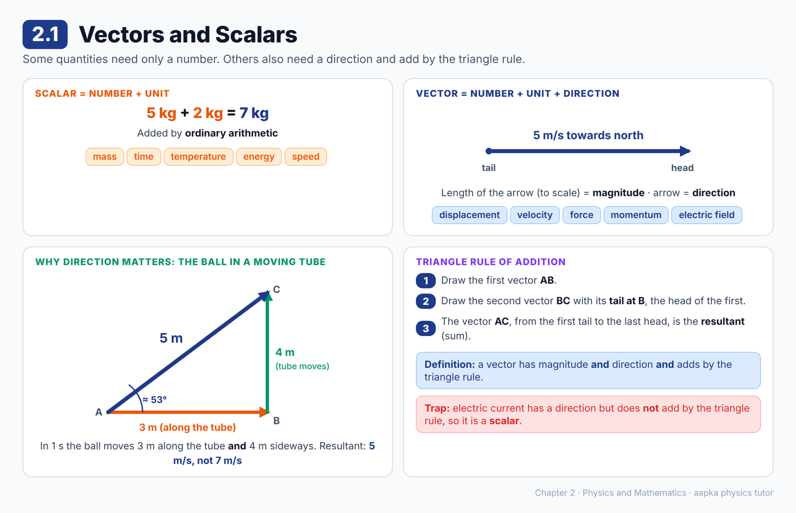

### 📘 Learning Material

**Big idea:** Some quantities need only a number (with a unit). Others also need a direction, and they add by a special rule.

**Scalars:** described completely by a number and a unit, and added by ordinary arithmetic.
- Mass: 5 kg + 2 kg = 7 kg
- Other examples: time, temperature, energy, speed

**Vectors:** need a number (magnitude) *and* a direction in space.
- Velocity: "5 m/s" tells you how fast, but only "5 m/s towards north" tells you the whole story.
- Other examples: displacement, force, linear momentum, electric field, magnetic field

**Drawing a vector:** draw an arrow parallel to the direction. Choose a scale first (say 1 cm for 1 m/s), so a 5 m/s velocity is an arrow 5 cm long. The arrow end is the **head**, and the other end is the **tail**.

**Why the addition rule matters (the ball-in-a-tube example)**
A ball moves at 3 m/s along a long tube, and the tube itself moves at 4 m/s perpendicular to its length. In 1 s the ball moves 3 m along the tube while the tube carries it 4 m sideways. Seen from the room, the ball has moved √(3² + 4²) = **5 m**, so its velocity is **5 m/s**, at about 53° to the tube. That's not 3 + 4 = 7!

**Triangle rule of addition:** draw the first vector AB. Draw the second vector BC with its tail at B (the head of the first). Then AC, from the first tail to the last head, is the **resultant** or **sum**.

**The real definition of a vector:** a quantity that has magnitude and direction **and** adds by the triangle rule.

> ⚠️ **Common misconception:** "Anything with a direction is a vector." Electric current in a wire has a magnitude and a direction, but currents don't add by the triangle rule, so current is a **scalar**.

> 💡 It is more accurate to say "force is a vector *because* forces add by the triangle rule" than the other way round. The adding rule is what decides it.

### ❓ MCQs

**Q1.** 🟢 Which of the following is a scalar quantity?
- (A) Velocity
- (B) Force
- (C) Mass
- (D) Linear momentum

**Q2.** 🟡 Electric current has both magnitude and direction, yet it is not a vector because:
- (A) It has no SI unit
- (B) It cannot be measured accurately
- (C) It is always positive
- (D) It does not add according to the triangle rule

**Q3.** 🔴 A ball moves at 3 m/s along a tube while the tube moves at 4 m/s perpendicular to its length. The speed of the ball as seen from the room is:
- (A) 7 m/s
- (B) 1 m/s
- (C) 5 m/s
- (D) 12 m/s

**Q4.** 🟡 Which statement is more appropriate?
- (A) Two forces are added by the triangle rule because force is a vector
- (B) Force is a vector because two forces are added by the triangle rule
- (C) Both statements mean exactly the same thing
- (D) Neither statement is correct

**Q5.** 🟢 When a vector is drawn as an arrow to a chosen scale, the length of the arrow represents its:
- (A) Direction
- (B) Point of application
- (C) Unit
- (D) Magnitude

### Answer Key — 2.1
| Q | Ans | Explanation |
|---|---|---|
| 1 | C | Mass needs only a number and a unit (5 kg), and masses add by ordinary arithmetic. |
| 2 | D | A vector must have magnitude and direction and also add by the triangle rule. Current does not. |
| 3 | C | The two velocities are perpendicular, so the resultant is √(3² + 4²) = 5 m/s. |
| 4 | B | Obeying the triangle rule is what makes a quantity a vector. |
| 5 | D | The direction is shown by the arrow's orientation. Its length, to scale, gives the magnitude. |

---

## 2.2 Equality of Vectors

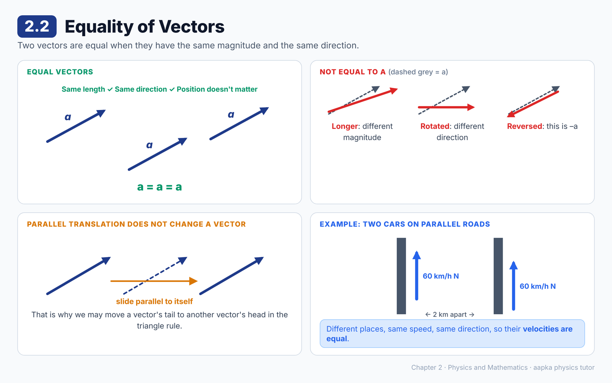

### 📘 Learning Material

**Big idea:** Two vectors are equal when they have the **same magnitude and the same direction**. Where they start does not matter.

**The rule**
- Same magnitude ✔ and same direction ✔, so the vectors are **equal**
- Same magnitude but a different direction, so they are **not** equal
- Same direction but a different magnitude, so they are **not** equal

**Parallel translation:** sliding a vector parallel to itself, without rotating or stretching it, does **not** change the vector. This is why we can move a vector's tail to the head of another when using the triangle rule.

**Example:** Two cars each move at 60 km/h towards north on two different parallel roads. Their positions differ, but their **velocities are equal**.

**What *does* change a vector**
- Rotating it (its direction changes)
- Stretching or shrinking it (its magnitude changes)
- Reversing it (its direction flips)

> ⚠️ **Common mistake:** Thinking two arrows must start from the same point to be equal. Equal vectors can sit anywhere. Only their length and direction matter.

> 💡 Equality only makes sense for two values of the **same physical quantity**. A velocity can never be equal to a force.

### ❓ MCQs

**Q1.** 🟢 Two vectors are called equal if they have:
- (A) The same magnitude only
- (B) The same direction only
- (C) The same magnitude and the same direction
- (D) The same starting point

**Q2.** 🟡 A vector is **not** changed if it is:
- (A) Rotated through an angle
- (B) Multiplied by a number other than 1
- (C) Slid parallel to itself
- (D) Reversed in direction

**Q3.** 🔴 Car 1 moves at 60 km/h towards north on one road. Car 2 moves at 60 km/h towards north on a parallel road 2 km away. Their velocities are:
- (A) Equal
- (B) Unequal, because their positions are different
- (C) Unequal, because they are on different roads
- (D) Impossible to compare

**Q4.** 🟡 Two vectors have equal magnitudes but opposite directions. They are:
- (A) Equal vectors
- (B) Both zero vectors
- (C) Negatives of each other
- (D) Perpendicular to each other

### Answer Key — 2.2
| Q | Ans | Explanation |
|---|---|---|
| 1 | C | Both magnitude and direction must match. |
| 2 | C | Parallel translation keeps both the length and the direction, so the vector is unchanged. |
| 3 | A | Same magnitude and same direction. Position does not matter for equality. |
| 4 | C | If **b** has the same size as **a** but points the opposite way, then **b** = –**a**. |

---

## 2.3 Addition of Vectors

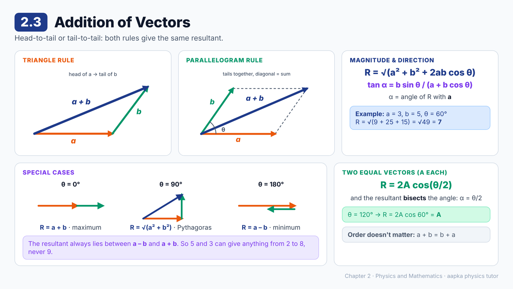

### 📘 Learning Material

**Big idea:** Vectors add head-to-tail (triangle rule) or tail-to-tail (parallelogram rule). Both give the same resultant.

**Triangle rule:** put the tail of **b** at the head of **a**. The arrow from the tail of **a** to the head of **b** is **a** + **b**.

**Parallelogram rule:** draw **a** and **b** with their tails together. Complete the parallelogram. The diagonal **through the common tails** is **a** + **b**.

**Magnitude and direction of the resultant**
If **a** and **b** have magnitudes a and b, with angle θ between them:

- Magnitude: **R = √(a² + b² + 2ab cos θ)**
- Angle α of the resultant with **a**: **tan α = b sin θ / (a + b cos θ)**

**Special cases to remember**
| Angle θ | Resultant R | What it means |
|---|---|---|
| 0° (same direction) | a + b | Maximum possible |
| 90° (perpendicular) | √(a² + b²) | Pythagoras |
| 180° (opposite) | difference of a and b | Minimum possible |

So the resultant always lies between the difference of the magnitudes and their sum.

**Two equal vectors (magnitude A each) at angle θ:**
R = 2A cos(θ/2), and α = θ/2. The resultant **bisects** the angle between them.

**🧮 Worked example:** a = 3 units, b = 5 units, θ = 60°.
R = √(9 + 25 + 2 × 3 × 5 × ½) = √(9 + 25 + 15) = √49 = **7 units**.

**Properties:** **a** + **b** = **b** + **a** (order doesn't matter), and (**a** + **b**) + **c** = **a** + (**b** + **c**).

**Can three vectors add to zero?** Yes, if they form a closed triangle. That needs the largest magnitude to be no more than the sum of the other two (e.g. 3, 4, 5 works, but 2, 4, 8 doesn't).

> ⚠️ **Common mistake:** Adding magnitudes directly. 3 N + 4 N is 7 N only if the forces point the same way.

### ❓ MCQs

**Q1.** 🟢 In the parallelogram rule, the resultant of **a** and **b** is given by:
- (A) The diagonal passing through the common tails
- (B) The other diagonal
- (C) The longer side of the parallelogram
- (D) The shorter side of the parallelogram

**Q2.** 🟡 Forces of 6 N and 8 N act on a body at right angles to each other. The magnitude of their resultant is:
- (A) 14 N
- (B) 2 N
- (C) 10 N
- (D) 48 N

**Q3.** 🔴 Two vectors, each of magnitude 10 units, are inclined at 120° to each other. The magnitude of their resultant is:
- (A) 20 units
- (B) 10 units
- (C) 10√3 units
- (D) 0

**Q4.** 🟡 Which set of magnitudes could belong to three vectors that add up to zero?
- (A) 2, 4, 8
- (B) 1, 2, 4
- (C) 3, 4, 5
- (D) 1, 1, 3

**Q5.** 🟡 Two vectors have magnitudes 5 units and 3 units. Their resultant **cannot** be:
- (A) 2 units
- (B) 5 units
- (C) 8 units
- (D) 9 units

**Q6.** 🔴 Two vectors of equal magnitude make an angle θ with each other. Their resultant makes an angle with the first vector equal to:
- (A) θ
- (B) 90°
- (C) 2θ
- (D) θ/2

**Q7.** 🔴 Vectors of magnitude 3 units and 5 units are inclined at 60°. The magnitude of their resultant is:
- (A) 7 units
- (B) 8 units
- (C) 2 units
- (D) √34 units

### Answer Key — 2.3
| Q | Ans | Explanation |
|---|---|---|
| 1 | A | The diagonal starting from the common tail point is the sum. |
| 2 | C | √(6² + 8²) = √100 = 10 N. |
| 3 | B | For equal vectors R = 2A cos(θ/2) = 2 × 10 × cos 60° = 10 units. |
| 4 | C | 3, 4, 5 can form a closed triangle. In the others the largest is more than the sum of the other two. |
| 5 | D | The resultant must lie between 5 – 3 = 2 and 5 + 3 = 8. |
| 6 | D | The resultant of two equal vectors bisects the angle between them. |
| 7 | A | √(9 + 25 + 2 × 3 × 5 × cos 60°) = √49 = 7 units. |

---

## 2.4 Multiplication of a Vector by a Number

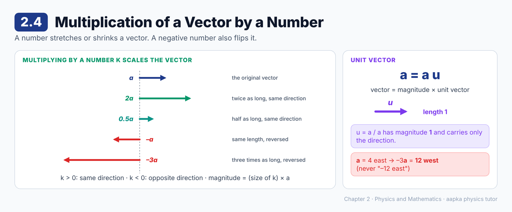

### 📘 Learning Material

**Big idea:** Multiplying a vector by a number scales its length. A negative number also flips its direction.

If **a** has magnitude a and k is a number, then **b** = k**a** is a vector with:
- **Magnitude:** (size of k) × a
- **Direction:** the same as **a** if k is positive, and opposite to **a** if k is negative

| Multiplier k | Result |
|---|---|
| 2 | Twice as long, same direction |
| 0.5 | Half as long, same direction |
| –1 | Same length, opposite direction |
| –3 | Three times as long, opposite direction |

**Multiplying by –1** just reverses the vector. **a** and –**a** have equal magnitudes and opposite directions.

**Unit vectors:** a vector of magnitude **1** is a unit vector. If **u** is the unit vector along **a**, then
**a = a u**
(magnitude × direction). So **u** = **a** / a.

**🧮 Worked example:** **a** is 4 units towards east.
- 3**a** = 12 units towards east
- –3**a** = 12 units towards **west**

> 💡 A unit vector carries only direction information. Its magnitude is always 1, with no unit.

> ⚠️ **Common mistake:** Writing –3**a** as "–12 units east". Magnitudes are never negative. The minus sign goes into the **direction**: 12 units west.

### ❓ MCQs

**Q1.** 🟢 Multiplying a vector **a** by –1 gives a vector that:
- (A) Is twice as long as **a**
- (B) Has zero magnitude
- (C) Has the same magnitude as **a** but the opposite direction
- (D) Is rotated by 90° from **a**

**Q2.** 🟡 **a** is a vector of magnitude 4 units pointing east. The vector –3**a** is:
- (A) 12 units towards east
- (B) 12 units towards west
- (C) 3 units towards west
- (D) 7 units towards west

**Q3.** 🟢 If **u** is the unit vector in the direction of **a**, and a is the magnitude of **a**, then:
- (A) **a** = a**u**
- (B) **a** = **u**/a
- (C) **a** = a + **u**
- (D) **u** = a**a**

**Q4.** 🟡 The magnitude of the unit vector along a vector of magnitude 5 m pointing east is:
- (A) 1
- (B) 5 m
- (C) 1/5
- (D) 0

### Answer Key — 2.4
| Q | Ans | Explanation |
|---|---|---|
| 1 | C | Multiplying by –1 keeps the magnitude and reverses the direction. |
| 2 | B | The magnitude is 3 × 4 = 12 units, and the negative sign reverses the direction to west. |
| 3 | A | Any vector equals its magnitude times the unit vector along it. |
| 4 | A | A unit vector always has magnitude 1, whatever vector it comes from. |

---

## 2.5 Subtraction of Vectors

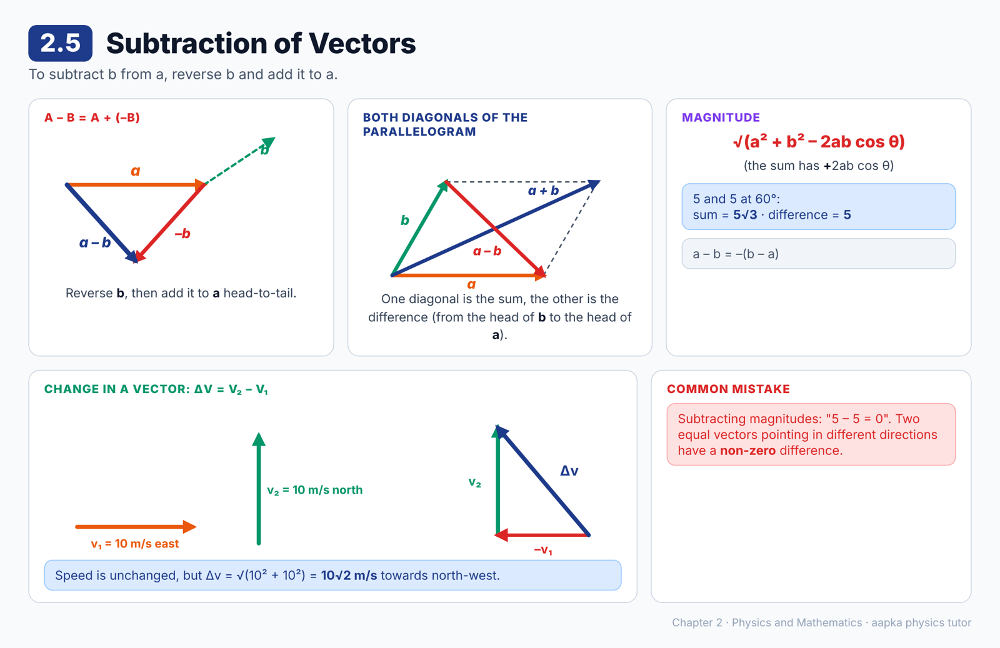

### 📘 Learning Material

**Big idea:** To subtract **b** from **a**, reverse **b** and add it to **a**.

**Definition:** **a** – **b** = **a** + (–**b**)

**Steps**
1. Draw **a**.
2. Draw –**b** (same length as **b**, opposite direction) with its tail at the head of **a**.
3. The arrow from the tail of **a** to the head of –**b** is **a** – **b**.

**Shortcut with the parallelogram:** if **a** and **b** are drawn tail-to-tail, one diagonal is **a** + **b**, and the **other diagonal** (from the head of **b** to the head of **a**) is **a** – **b**.

**Magnitude:** since –**b** makes an angle (180° – θ) with **a**,
**magnitude of a – b = √(a² + b² – 2ab cos θ)**

**🧮 Worked example:** Two vectors, each 5 units, at 60° to each other.
- Sum: √(25 + 25 + 2 × 25 × ½) = √75 = **5√3 units**
- Difference: √(25 + 25 – 2 × 25 × ½) = √25 = **5 units**

**Change in a vector:** the change from **v₁** to **v₂** is **Δv = v₂ – v₁**.
Example: a car's velocity changes from 10 m/s east to 10 m/s north. The change is √(10² + 10²) = **10√2 m/s**, towards north-west, even though the speed did not change!

**Order matters:** **a** – **b** = –(**b** – **a**). The two have the same magnitude and opposite directions.

> ⚠️ **Common mistake:** Subtracting magnitudes (5 – 5 = 0). Two equal vectors in different directions have a non-zero difference.

### ❓ MCQs

**Q1.** 🟢 To find **a** – **b**:
- (A) Add **b** to **a**
- (B) Subtract the magnitude of **b** from that of **a**
- (C) Reverse the direction of **a** and add it to **b**
- (D) Reverse the direction of **b** and add it to **a**

**Q2.** 🔴 Two vectors, each of magnitude 5 units, have an angle of 60° between them. The magnitude of their difference is:
- (A) 0
- (B) 5 units
- (C) 5√3 units
- (D) 10 units

**Q3.** 🟡 The vector **a** – **b** is equal to:
- (A) **b** – **a**
- (B) **a** + **b**
- (C) –(**b** – **a**)
- (D) –**a** – **b**

**Q4.** 🔴 A car's velocity changes from 10 m/s towards east to 10 m/s towards north. The magnitude of the change in velocity is:
- (A) 0
- (B) 10 m/s
- (C) 10√2 m/s
- (D) 20 m/s

### Answer Key — 2.5
| Q | Ans | Explanation |
|---|---|---|
| 1 | D | **a** – **b** is defined as **a** + (–**b**). |
| 2 | B | √(25 + 25 – 2 × 5 × 5 × cos 60°) = √25 = 5 units. |
| 3 | C | Reversing the order reverses the direction, so **a** – **b** = –(**b** – **a**). |
| 4 | C | Δ**v** = **v₂** – **v₁**. The two velocities are perpendicular, so the change is √(10² + 10²) = 10√2 m/s. |

---

## 2.6 Resolution of Vectors

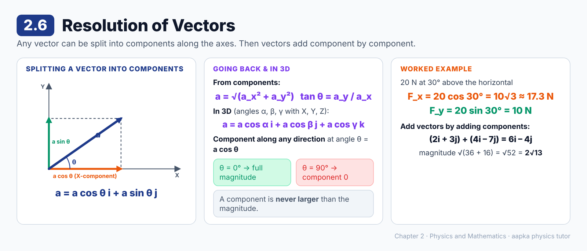

### 📘 Learning Material

**Big idea:** Any vector can be split into parts along the coordinate axes. These parts are its **components**, and they make vector work much easier.

**In two dimensions:** a vector **a** = OA makes angle α with the X-axis and β with the Y-axis. Drop perpendiculars from A to the axes.
- Projection on X-axis: **a cos α**
- Projection on Y-axis: **a cos β**

So **a = a cos α i + a cos β j**. If θ is the angle with the X-axis (so β = 90° – θ), this is the familiar **a = a cos θ i + a sin θ j**.

**In three dimensions:** with angles α, β, γ to the X, Y, Z axes,
**a = a cos α i + a cos β j + a cos γ k**

**Component along any direction:** the component of **a** along a direction making angle θ with it is **a cos θ**, which is its projection on that line.
- θ = 0°: the component equals the full magnitude.
- θ = 90°: the component is zero, even though the vector is not zero.
- So a component can never be bigger than the magnitude.

**🧮 Worked example:** A force of 20 N acts at 30° above the horizontal.
- Horizontal component = 20 cos 30° = 10√3 ≈ 17.3 N
- Vertical component = 20 sin 30° = 10 N

**From components back to the vector:** if **a** = a_x**i** + a_y**j**, then
- magnitude a = √(a_x² + a_y²)
- angle with X-axis: tan θ = a_y / a_x

**Adding vectors with components:** just add the matching components.
(a_x + b_x + c_x)**i** + (a_y + b_y + c_y)**j** + (a_z + b_z + c_z)**k**

**🧮 Worked example:** (2**i** + 3**j**) + (4**i** – 7**j**) = 6**i** – 4**j**, with magnitude √(36 + 16) = √52 = 2√13.

> 💡 Components are the easiest way to add three or more vectors. You avoid drawing big triangles.

> ⚠️ **Common mistake:** Using sin where cos belongs. The component is always **(magnitude) × cos(angle between the vector and that direction)**. Use sin only when the angle you know is measured from the *other* axis.

### ❓ MCQs

**Q1.** 🟢 The component of a vector **a** along a direction making an angle θ with it is:
- (A) a sin θ
- (B) a / cos θ
- (C) a tan θ
- (D) a cos θ

**Q2.** 🔴 A force of 20 N acts at 30° above the horizontal. Its horizontal component is:
- (A) 10 N
- (B) 40 N
- (C) 20√3 N
- (D) 10√3 N

**Q3.** 🟡 The magnitude of the vector 3**i** + 4**j** is:
- (A) 7
- (B) 5
- (C) 1
- (D) 25

**Q4.** 🔴 The magnitude of the sum of (2**i** + 3**j**) and (4**i** – 7**j**) is:
- (A) 2√13
- (B) 10
- (C) √20
- (D) 6

**Q5.** 🟡 Can a vector have zero component along a line and still have non-zero magnitude?
- (A) No, never
- (B) Only in three dimensions
- (C) Only if it is a unit vector
- (D) Yes, if the vector is perpendicular to that line

**Q6.** 🟡 The component of a vector along any direction is:
- (A) Always less than its magnitude
- (B) Always greater than its magnitude
- (C) Always equal to its magnitude
- (D) Never greater than its magnitude, but it can be less than or equal to it

### Answer Key — 2.6
| Q | Ans | Explanation |
|---|---|---|
| 1 | D | The component is the projection, a cos θ. |
| 2 | D | 20 cos 30° = 20 × (√3/2) = 10√3 ≈ 17.3 N. |
| 3 | B | √(3² + 4²) = 5. |
| 4 | A | The sum is 6**i** – 4**j**, with magnitude √(36 + 16) = √52 = 2√13. |
| 5 | D | At 90°, cos 90° = 0, so the component is zero while the vector is not. |
| 6 | D | cos θ is never more than 1. The component equals the magnitude when θ = 0°. |

---

## 2.7 Dot Product or Scalar Product

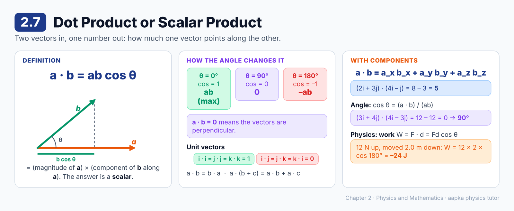

### 📘 Learning Material

**Big idea:** The dot product combines two vectors into a **scalar**. It measures how much one vector points along the other.

**Definition:** **a · b = ab cos θ**
where a and b are the magnitudes and θ is the angle between the vectors.

**Reading it:** a cos θ is the component of **a** along **b**. So **a · b** = (component of **a** along **b**) × b.

**Key results**
| Angle θ | cos θ | a · b |
|---|---|---|
| 0° | 1 | ab (maximum) |
| 90° | 0 | **0** (perpendicular vectors) |
| 180° | –1 | –ab (minimum) |

**Properties**
- Commutative: **a · b** = **b · a**
- Distributive: **a** · (**b** + **c**) = **a · b** + **a · c**

**Unit vectors**
- **i · i** = **j · j** = **k · k** = 1
- **i · j** = **j · k** = **k · i** = 0

**In components:** if **a** = a_x**i** + a_y**j** + a_z**k** and **b** = b_x**i** + b_y**j** + b_z**k**,
**a · b = a_xb_x + a_yb_y + a_zb_z**

**Finding an angle:** cos θ = (**a · b**) / (ab). If the dot product is zero, the vectors are perpendicular.

**Physics use: work done.** W = **F · d** = Fd cos θ.

**🧮 Worked example:** A force of 12 N acts vertically upward, while the particle moves 2.0 m vertically downward. The angle is 180°, so W = 12 × 2.0 × cos 180° = **–24 J**.

**🧮 Worked example:** (2**i** + 3**j**) · (4**i** – **j**) = 2 × 4 + 3 × (–1) = 8 – 3 = **5**.

> ⚠️ **Common mistake:** Writing the answer of a dot product with **i**, **j** or **k** in it. The dot product is a plain number.

### ❓ MCQs

**Q1.** 🟢 The dot product of two mutually perpendicular vectors is:
- (A) ab
- (B) 1
- (C) 0
- (D) –ab

**Q2.** 🔴 If **a** = 2**i** + 3**j** and **b** = 4**i** – **j**, then **a · b** is:
- (A) 5
- (B) 11
- (C) 7
- (D) –5

**Q3.** 🟡 The values of **i · i** and **i · j** are respectively:
- (A) 1 and 0
- (B) 0 and 1
- (C) 1 and 1
- (D) 0 and 0

**Q4.** 🔴 A force of 10 N moves a body through 4 m in a direction making 60° with the force. The work done is:
- (A) 40 J
- (B) 20 J
- (C) 20√3 J
- (D) 0

**Q5.** 🟢 The dot product of two vectors is:
- (A) A vector
- (B) Always zero
- (C) Always a unit vector
- (D) A scalar

**Q6.** 🔴 The angle between 3**i** + 4**j** and 4**i** – 3**j** is:
- (A) 0°
- (B) 45°
- (C) 90°
- (D) 180°

### Answer Key — 2.7
| Q | Ans | Explanation |
|---|---|---|
| 1 | C | cos 90° = 0, so ab cos θ = 0. |
| 2 | A | 2 × 4 + 3 × (–1) = 5. |
| 3 | A | The angle between **i** and itself is 0° (cos = 1). Between **i** and **j** it is 90° (cos = 0). |
| 4 | B | W = Fd cos θ = 10 × 4 × ½ = 20 J. |
| 5 | D | ab cos θ is just a number, so it is a scalar. That's why it's also called the scalar product. |
| 6 | C | 3 × 4 + 4 × (–3) = 0. A zero dot product means the vectors are perpendicular. |

---

## 2.8 Cross Product or Vector Product

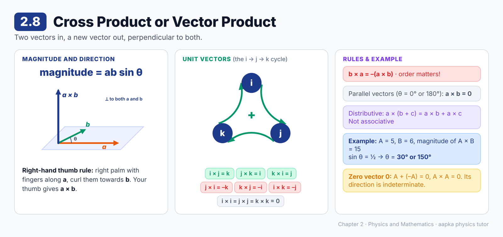

### 📘 Learning Material

**Big idea:** The cross product of two vectors is a **new vector**, perpendicular to both of them.

**Magnitude:** **magnitude of a × b = ab sin θ**
θ is the **smaller** angle between the vectors (the one below 180°) when they are drawn tail to tail.

**Direction: the right-hand thumb rule.** Draw **a** and **b** tail to tail. Place your stretched right palm perpendicular to their plane so that your fingers point along **a**. Curl your fingers towards **b**. Your thumb points along **a × b**. (Left-handers: use your *right* hand!)

**Key results**
| Situation | a × b |
|---|---|
| θ = 0° or 180° (parallel or antiparallel) | Zero vector |
| θ = 90° (perpendicular) | Magnitude ab (maximum) |
| Order reversed | **b × a = –(a × b)** |

**Properties**
- **Not commutative:** **a × b** = –**b × a**
- **Distributive:** **a** × (**b** + **c**) = **a × b** + **a × c**
- **Not associative:** **a** × (**b** × **c**) is generally not equal to (**a** × **b**) × **c**

**Right-handed axes:** we always choose the Z-axis so that **i × j = k**. Then
- **j × k = i** and **k × i = j** (going around the cycle i → j → k → i gives +)
- **j × i = –k**, **k × j = –i**, **i × k = –j** (going backwards gives –)
- **i × i = j × j = k × k = 0**

**In components:**
**a × b** = (a_yb_z – a_zb_y)**i** + (a_zb_x – a_xb_z)**j** + (a_xb_y – a_yb_x)**k**

**🧮 Worked example:** **A** has magnitude 5 units, **B** has magnitude 6 units, and the magnitude of **A × B** is 15 units.
15 = 5 × 6 × sin θ, so sin θ = ½, which gives θ = **30° or 150°**. Both are possible!

**The zero vector:** **A** + (–**A**) is a vector with zero magnitude. It is called the **zero vector**, written **0**, and its direction is indeterminate. **A × A** is also the zero vector.

> 💡 The magnitude of **a × b** equals the area of the parallelogram formed by **a** and **b**.

> ⚠️ **Common mistake:** Forgetting the minus sign when the order is reversed. **j × i** is **–k**, not **k**.

### ❓ MCQs

**Q1.** 🟢 The cross product of two parallel vectors is:
- (A) The zero vector
- (B) A vector of magnitude ab
- (C) The number 1
- (D) A vector along their sum

**Q2.** 🟡 For any two vectors, **b × a** is equal to:
- (A) **a × b**
- (B) –(**a × b**)
- (C) Zero, always
- (D) **a · b**

**Q3.** 🟢 In a right-handed coordinate system, **i × j** equals:
- (A) **k**
- (B) –**k**
- (C) 0
- (D) 1

**Q4.** 🔴 Two vectors have magnitudes 4 units and 5 units, and the magnitude of their cross product is 10 units. The angle between them is:
- (A) 30° only
- (B) 60° only
- (C) 30° or 150°
- (D) 90°

**Q5.** 🔴 **A** points vertically upward and **B** points towards north. The direction of **A × B** is:
- (A) Towards east
- (B) Vertically downward
- (C) It is zero
- (D) Towards west

**Q6.** 🟡 The direction of **a × b** is:
- (A) Along **a**
- (B) Along **b**
- (C) Perpendicular to the plane containing **a** and **b**
- (D) Along the bisector of **a** and **b**

**Q7.** 🔴 The value of (3**j**) × (2**i**) is:
- (A) 6**k**
- (B) –6**k**
- (C) 6
- (D) 0

**Q8.** 🟡 For two non-zero vectors, the magnitude of **a × b** equals **a · b** when the angle between them is:
- (A) 0°
- (B) 90°
- (C) 45°
- (D) 180°

### Answer Key — 2.8
| Q | Ans | Explanation |
|---|---|---|
| 1 | A | sin 0° = sin 180° = 0, so the magnitude is zero. |
| 2 | B | Reversing the order reverses the direction given by the right-hand rule. |
| 3 | A | This is how a right-handed system is defined. |
| 4 | C | sin θ = 10 / (4 × 5) = ½, so θ = 30° or 150°. |
| 5 | D | Take east as **i**, north as **j** and up as **k**. Then **k** × **j** = –**i**, which is west. |
| 6 | C | **a × b** is perpendicular to both **a** and **b**, so it is perpendicular to their plane. |
| 7 | B | (3**j**) × (2**i**) = 6(**j × i**) = 6(–**k**) = –6**k**. |
| 8 | C | ab sin θ = ab cos θ means tan θ = 1, so θ = 45°. |

---

## 2.9 Differential Calculus as Rate Measurer

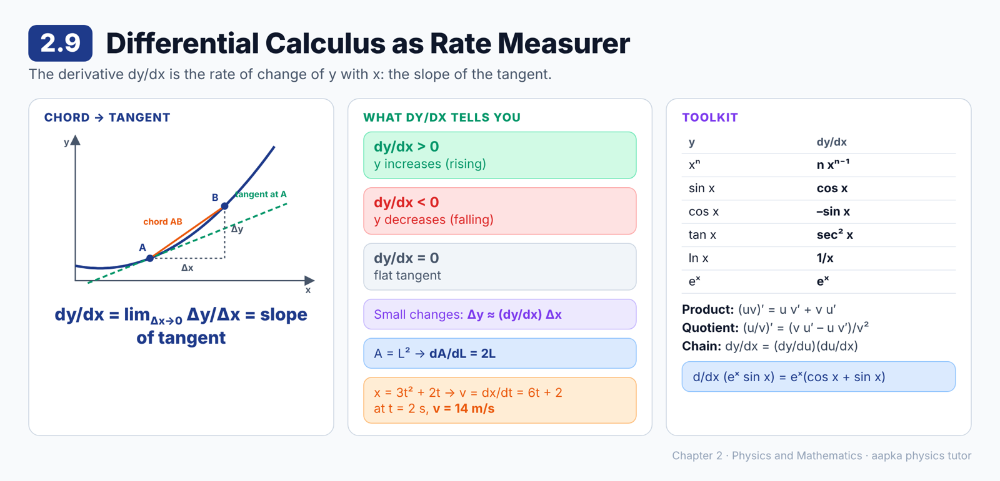

### 📘 Learning Material

**Big idea:** The derivative dy/dx tells you **how fast y changes with x** at a point. On a graph, it is the **slope of the tangent** at that point.

**From average rate to exact rate**
- When x changes by Δx, y changes by Δy. The average rate is Δy/Δx, which is the slope of the chord AB.
- But the curve can bend between A and B. So bring B closer and closer to A.
- As Δx → 0, the chord becomes the **tangent** at A.

**dy/dx = lim (Δx → 0) Δy/Δx = slope of the tangent**

dy/dx is called the **derivative** or **differential coefficient** of y with respect to x.

**What the sign tells you**
- dy/dx > 0: y **increases** as x increases (the graph rises)
- dy/dx < 0: y **decreases** as x increases (the graph falls)
- dy/dx = 0: the tangent is flat (horizontal)

**Approximation for small changes:** Δy ≈ (dy/dx) Δx

**🧮 Worked example: area of a square, A = L²**
A + ΔA = (L + ΔL)² = L² + 2LΔL + (ΔL)², so ΔA/ΔL = 2L + ΔL.
As ΔL → 0, **dA/dL = 2L**.

**📋 Common derivatives**
| y | dy/dx |
|---|---|
| xⁿ | n xⁿ⁻¹ |
| sin x | cos x |
| cos x | –sin x |
| tan x | sec² x |
| cot x | –cosec² x |
| sec x | sec x tan x |
| cosec x | –cosec x cot x |
| ln x | 1/x |
| eˣ | eˣ |

**📋 Rules**
- Constant multiple: d(cy)/dx = c (dy/dx)
- Sum: d(u + v)/dx = du/dx + dv/dx
- Product: d(uv)/dx = u (dv/dx) + v (du/dx)
- Quotient: d(u/v)/dx = [v (du/dx) – u (dv/dx)] / v²
- Chain: dy/dx = (dy/du)(du/dx)

**🧮 Worked example:** y = eˣ sin x. By the product rule,
dy/dx = eˣ cos x + sin x · eˣ = **eˣ (cos x + sin x)**.

**🧮 Physics example:** x = 3t² + 2t (in metres). Velocity v = dx/dt = 6t + 2. At t = 2 s, v = **14 m/s**.

> ⚠️ **Common mistake:** Treating dy/dx as a fraction "d × y over d × x". It is one symbol meaning "the rate of change of y with x".

### ❓ MCQs

**Q1.** 🟢 Geometrically, dy/dx at a point on a y–x graph is:
- (A) The area under the curve
- (B) The length of the curve
- (C) The y-intercept
- (D) The slope of the tangent at that point

**Q2.** 🟡 The derivative of x⁵ with respect to x is:
- (A) 5x⁴
- (B) x⁴
- (C) 5x⁶
- (D) x⁶/6

**Q3.** 🔴 The position of a particle is x = 3t² + 2t, where x is in metres and t in seconds. Its velocity at t = 2 s is:
- (A) 16 m/s
- (B) 10 m/s
- (C) 12 m/s
- (D) 14 m/s

**Q4.** 🟡 The derivatives of sin x and cos x with respect to x are respectively:
- (A) cos x and –sin x
- (B) –cos x and sin x
- (C) cos x and sin x
- (D) sin x and cos x

**Q5.** 🔴 The derivative of x² sin x with respect to x is:
- (A) 2x cos x
- (B) 2x sin x + x² cos x
- (C) x² cos x
- (D) 2x sin x – x² cos x

**Q6.** 🟡 At a point where y decreases as x increases, dy/dx is:
- (A) Positive
- (B) Infinite
- (C) Zero
- (D) Negative

**Q7.** 🔴 The side of a square is 10 cm. If the side increases by 0.1 cm, the approximate increase in area (using ΔA ≈ (dA/dL) ΔL) is:
- (A) 0.01 cm²
- (B) 1 cm²
- (C) 2 cm²
- (D) 20 cm²

**Q8.** 🔴 The derivative of sin 3x with respect to x is:
- (A) cos 3x
- (B) –3 cos 3x
- (C) 3 sin 3x
- (D) 3 cos 3x

### Answer Key — 2.9
| Q | Ans | Explanation |
|---|---|---|
| 1 | D | As Δx → 0, the chord becomes the tangent, so dy/dx is the tangent's slope. |
| 2 | A | d(xⁿ)/dx = n xⁿ⁻¹, so the answer is 5x⁴. |
| 3 | D | v = dx/dt = 6t + 2 = 6 × 2 + 2 = 14 m/s. |
| 4 | A | These are standard results from the derivatives table. |
| 5 | B | Product rule: x² cos x + sin x · 2x. |
| 6 | D | Δy is negative while Δx is positive, so the rate is negative. |
| 7 | C | dA/dL = 2L = 20 cm, so ΔA ≈ 20 × 0.1 = 2 cm². |
| 8 | D | Chain rule with u = 3x: cos 3x × 3 = 3 cos 3x. |

---

## 2.10 Maxima and Minima

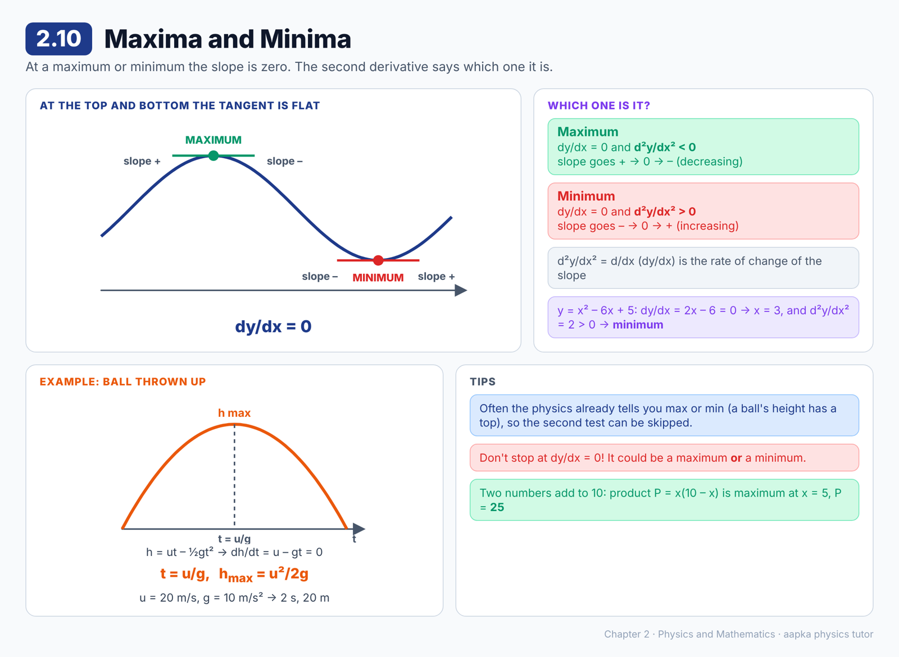

### 📘 Learning Material

**Big idea:** At a maximum or a minimum, the graph is momentarily flat, so **dy/dx = 0**. The second derivative tells you which one it is.

**Why dy/dx = 0:** at the top of a hill or the bottom of a valley, the tangent is parallel to the X-axis. Its slope is tan 0° = 0.

**Telling a maximum from a minimum**
- **Maximum:** the slope goes from positive, to zero, to negative. The slope is *decreasing*, so d²y/dx² < 0.
- **Minimum:** the slope goes from negative, to zero, to positive. The slope is *increasing*, so d²y/dx² > 0.

| Condition | Result |
|---|---|
| dy/dx = 0 and d²y/dx² < 0 | **Maximum** |
| dy/dx = 0 and d²y/dx² > 0 | **Minimum** |

Here d²y/dx² means d/dx (dy/dx), the rate of change of the slope.

**🧮 Worked example: highest point of a thrown ball**
A ball thrown up with speed u reaches height h = ut – ½gt² after time t.
- dh/dt = u – gt. Setting it to 0 gives **t = u/g**.
- d²h/dt² = –g, which is negative, so this is a maximum ✔.
- Maximum height = u(u/g) – ½g(u/g)² = **u²/2g**.

With u = 20 m/s and g = 10 m/s², the ball rises for t = 2 s, up to a height of 20 m.

**🧮 Worked example:** y = x² – 6x + 5.
dy/dx = 2x – 6 = 0, which gives x = 3. d²y/dx² = 2 > 0, so this is a **minimum**, with y = 9 – 18 + 5 = –4.

> 💡 Often the physical situation already tells you whether it is a maximum or a minimum (a ball's height has a top, not a bottom). Then you can skip the second-derivative test.

> ⚠️ **Common mistake:** Stopping at dy/dx = 0 and assuming it's a maximum. Always check with d²y/dx² or with the physical situation.

### ❓ MCQs

**Q1.** 🟢 At a maximum or a minimum of y(x), the value of dy/dx is:
- (A) 1
- (B) Infinite
- (C) 0
- (D) –1

**Q2.** 🟡 The conditions for y to be a maximum are:
- (A) dy/dx = 0 and d²y/dx² < 0
- (B) dy/dx = 0 and d²y/dx² > 0
- (C) dy/dx > 0
- (D) d²y/dx² = 0

**Q3.** 🔴 The height of a ball is h = 20t – 5t² (in metres, t in seconds). The maximum height reached is:
- (A) 10 m
- (B) 20 m
- (C) 40 m
- (D) 80 m

**Q4.** 🔴 For y = x² – 6x + 5, the value of x at which y is minimum is:
- (A) 6
- (B) –3
- (C) 3
- (D) 5

**Q5.** 🟡 Just before a maximum the slope dy/dx is ______, and just after it the slope is ______.
- (A) positive, negative
- (B) negative, positive
- (C) zero, zero
- (D) positive, positive

**Q6.** 🔴 Two positive numbers add up to 10. The maximum possible value of their product is:
- (A) 21
- (B) 24
- (C) 25
- (D) 16

### Answer Key — 2.10
| Q | Ans | Explanation |
|---|---|---|
| 1 | C | The tangent is horizontal at a maximum or minimum, so its slope is zero. |
| 2 | A | At a maximum the slope is decreasing, so the second derivative is negative. |
| 3 | B | dh/dt = 20 – 10t = 0 gives t = 2 s, and h = 40 – 20 = 20 m. |
| 4 | C | dy/dx = 2x – 6 = 0 gives x = 3, and d²y/dx² = 2 > 0 confirms a minimum. |
| 5 | A | Rising before the top, falling after it. |
| 6 | C | P = x(10 – x). dP/dx = 10 – 2x = 0 gives x = 5, so P = 5 × 5 = 25. |

---

## 2.11 Integral Calculus

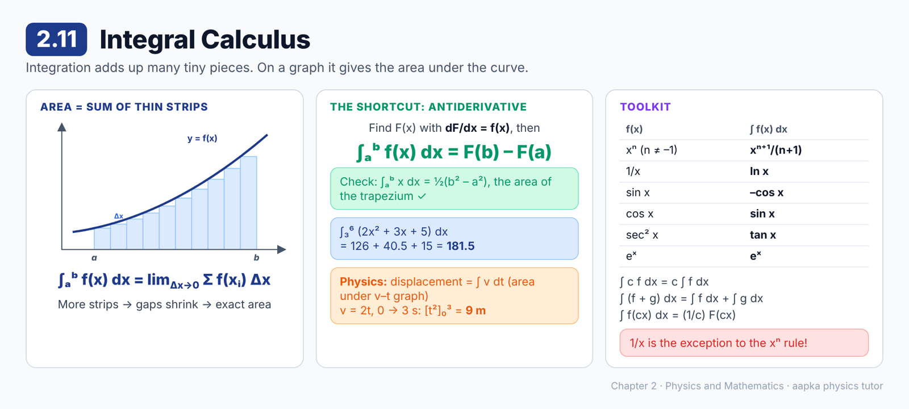

### 📘 Learning Material

**Big idea:** Integration adds up a huge number of tiny pieces. On a graph, it gives the **area under the curve**.

**Area as a sum of strips**
To find the area under y = f(x) from x = a to x = b:
1. Split the interval into N equal strips, each of width Δx = (b – a)/N.
2. Each strip is nearly a rectangle with area f(x) Δx.
3. Add them: I′ = Σ f(xᵢ) Δx.
4. As N → ∞ (Δx → 0), the small gaps vanish and the sum becomes the exact area.

**∫ₐᵇ f(x) dx = lim (Δx → 0) Σ f(xᵢ) Δx**
Read it as "the integral of f(x) with respect to x from a to b". Here a is the **lower limit** and b is the **upper limit**.

**The shortcut: the antiderivative**
Find a function F(x) whose derivative is f(x), i.e. dF/dx = f(x). Then
**∫ₐᵇ f(x) dx = F(b) – F(a)**, also written [F(x)]ₐᵇ.
F(x) is called the **indefinite integral** or **antiderivative**: ∫ f(x) dx = F(x).

**🧮 Check with a shape you know:** the area under y = x from a to b is a trapezium.
∫ₐᵇ x dx = [x²/2]ₐᵇ = ½(b² – a²), the same as the trapezium formula ½(a + b)(b – a) ✔.

**📋 Common integrals**
| f(x) | ∫ f(x) dx |
|---|---|
| xⁿ (n ≠ –1) | xⁿ⁺¹/(n + 1) |
| 1/x | ln x |
| sin x | –cos x |
| cos x | sin x |
| sec² x | tan x |
| cosec² x | –cot x |
| sec x tan x | sec x |
| cosec x cot x | –cosec x |
| eˣ | eˣ |
| 1/(x² + a²) | (1/a) tan⁻¹(x/a) |
| 1/√(a² – x²) | sin⁻¹(x/a) |

**📋 Rules**
- ∫ c f(x) dx = c ∫ f(x) dx (c is a constant)
- ∫ [f(x) + g(x)] dx = ∫ f(x) dx + ∫ g(x) dx
- If ∫ f(x) dx = F(x), then ∫ f(cx) dx = (1/c) F(cx)

**🧮 Worked example:** ∫₃⁶ (2x² + 3x + 5) dx
= [ (2/3)x³ + (3/2)x² + 5x ] from 3 to 6
= (2/3)(216 – 27) + (3/2)(36 – 9) + 5(6 – 3)
= 126 + 40.5 + 15 = **181.5**

**Physics uses:** displacement = ∫ v dt (the area under a velocity–time graph), and work = ∫ F dx.
Example: v = 2t m/s from t = 0 to t = 3 s gives displacement [t²]₀³ = **9 m**.

> ⚠️ **Common mistake:** Using the xⁿ⁺¹/(n + 1) rule for 1/x. When n = –1 you would divide by zero. ∫ (1/x) dx = ln x.

### ❓ MCQs

**Q1.** 🟢 The definite integral ∫ₐᵇ f(x) dx represents:
- (A) The slope of the curve at x = a
- (B) The average slope between a and b
- (C) The maximum value of f(x)
- (D) The area under the curve y = f(x) between x = a and x = b

**Q2.** 🟡 For n ≠ –1, ∫ xⁿ dx equals:
- (A) xⁿ⁺¹/(n + 1)
- (B) n xⁿ⁻¹
- (C) xⁿ⁺¹
- (D) xⁿ/n

**Q3.** 🔴 The value of ∫₀² 3x² dx is:
- (A) 12
- (B) 6
- (C) 8
- (D) 4

**Q4.** 🟡 ∫ (1/x) dx equals:
- (A) ln x
- (B) –1/x²
- (C) x⁰
- (D) 1/x²

**Q5.** 🔴 The velocity of a particle is v = 2t m/s. Its displacement from t = 0 to t = 3 s is:
- (A) 6 m
- (B) 18 m
- (C) 3 m
- (D) 9 m

**Q6.** 🟡 ∫ cos x dx equals:
- (A) sin x
- (B) –sin x
- (C) tan x
- (D) –cos x

**Q7.** 🟡 If dF(x)/dx = f(x), then ∫ₐᵇ f(x) dx equals:
- (A) F(a) – F(b)
- (B) F(b) – F(a)
- (C) F(b) + F(a)
- (D) f(b) – f(a)

### Answer Key — 2.11
| Q | Ans | Explanation |
|---|---|---|
| 1 | D | The integral is the limit of the sum of strips f(x) Δx, which is the area under the curve. |
| 2 | A | Check: the derivative of xⁿ⁺¹/(n + 1) is xⁿ. |
| 3 | C | [x³]₀² = 8 – 0 = 8. |
| 4 | A | The derivative of ln x is 1/x. |
| 5 | D | ∫₀³ 2t dt = [t²]₀³ = 9 m. |
| 6 | A | The derivative of sin x is cos x. |
| 7 | B | Upper limit minus lower limit: F(b) – F(a). |

---

## 2.12 Significant Digits

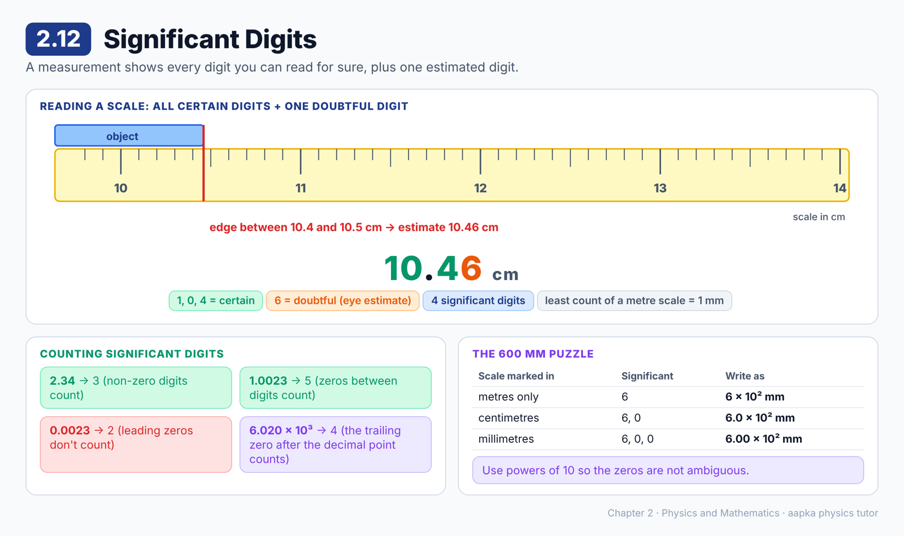

### 📘 Learning Material

**Big idea:** A measurement shows every digit you can read for sure **plus one estimated (doubtful) digit**. All of these are significant digits.

**Reading a scale**
- The smallest division on an instrument is its **least count**. A metre scale has 1 mm divisions.
- Suppose an object's edge falls between the 10.4 cm and 10.5 cm marks. Mentally split that 1 mm into 10 parts and estimate: **10.46 cm**.
- 1, 0 and 4 are **certain**, and 6 is **doubtful** (an eye estimate). So the reading has **4 significant digits**.
- The leftmost digit (1) is the **most significant digit**. The rightmost, doubtful digit (6) is the **least significant digit**.

**Counting rules**
1. All non-zero digits are significant: 2.34 has 3.
2. Zeros between non-zero digits are significant: 1.0023 has **5**.
3. If the integer part is zero, the zeros right after the decimal point are **not** significant: 0.0023 has **2**.
4. Zeros at the right end of a whole number like 600 are **ambiguous**. It depends on the instrument.

**The 600 mm puzzle**
| Scale used | Significant digits | Write it as |
|---|---|---|
| Marked only in metres | 6 | 6 × 10² mm |
| Marked in centimetres | 6, 0 | 6.0 × 10² mm |
| Marked in millimetres | 6, 0, 0 | 6.00 × 10² mm |

**Tip:** write only the significant digits, and use a power of 10 for the size. That removes all confusion.

> ⚠️ **Common mistakes:**
> - Counting leading zeros. 0.0023 has 2 significant digits, not 4 or 5.
> - Writing more digits than the instrument can read. A metre scale can't give 10.463 cm.

### ❓ MCQs

**Q1.** 🟢 The number of significant digits in 0.0023 is:
- (A) 4
- (B) 5
- (C) 2
- (D) 3

**Q2.** 🟢 The number of significant digits in 1.0023 is:
- (A) 5
- (B) 4
- (C) 2
- (D) 3

**Q3.** 🟡 In a measured value, the last (doubtful) digit comes from:
- (A) The least count printed on the instrument
- (B) A calculation done afterwards
- (C) A zero error of the instrument
- (D) Eye estimation within the smallest division of the scale

**Q4.** 🟡 A length of 600 mm is measured with a scale marked in centimetres. It should be written as:
- (A) 6 × 10² mm
- (B) 6.0 × 10² mm
- (C) 6.00 × 10² mm
- (D) 600.0 mm

**Q5.** 🔴 A length is measured with an ordinary metre scale (least count 1 mm). Which reading is recorded correctly?
- (A) 10 cm
- (B) 10.4 cm
- (C) 10.46 cm
- (D) 10.463 cm

**Q6.** 🟡 The number of significant digits in 6.020 × 10³ is:
- (A) 4
- (B) 3
- (C) 5
- (D) 7

### Answer Key — 2.12
| Q | Ans | Explanation |
|---|---|---|
| 1 | C | The zeros after the decimal point (with zero integer part) are not significant. Only 2 and 3 count. |
| 2 | A | 1, 0, 0, 2 and 3 are all significant, since the zeros sit between non-zero digits. |
| 3 | D | We estimate by eye within the smallest division. That last digit is doubtful but still significant. |
| 4 | B | With centimetre markings we read "60" cm, so 6 and the first zero are significant. |
| 5 | C | The certain digits go down to mm (10.4), plus one estimated digit (6). |
| 6 | A | 6, 0, 2 and the final 0 are significant. The power of ten doesn't count. |

---

## 2.13 Significant Digits in Calculations

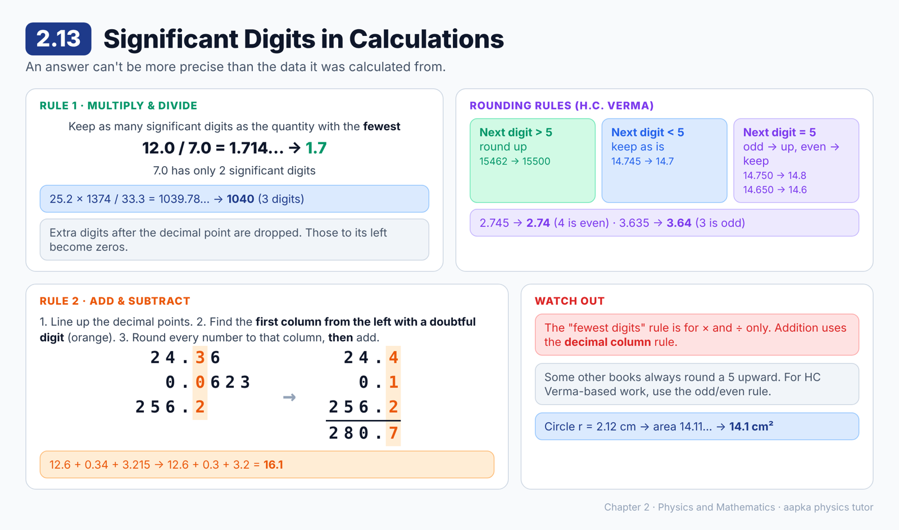

### 📘 Learning Material

**Big idea:** A calculated answer can't be more precise than the data. Arithmetic gives 12.0 / 7.0 = 1.714285…, but only some of those digits are reliable.

**Rule 1: multiplication and division**
The answer has as many significant digits as the quantity with the **fewest** significant digits.
- 12.0 / 7.0: 7.0 has 2 significant digits, so the answer is **1.7**.
- (25.2 × 1374) / 33.3 = 1039.78…: the fewest is 3 (in 25.2 and 33.3), so the answer is **1040**.

When dropping extra digits: digits after the decimal point are **dropped**, and digits to the left of the decimal point are **replaced by zeros**.

**Rounding rules (H.C. Verma)**
Look at the digit just after the one you're keeping:
- More than 5: increase the kept digit by 1.
- Less than 5: leave the kept digit unchanged.
- Exactly 5: increase the kept digit by 1 **if it is odd**, and leave it unchanged **if it is even**.

| Number | 3 significant digits | Why |
|---|---|---|
| 15462 | 15500 | Next digit 6 > 5, so 4 becomes 5. The dropped digits become zeros. |
| 14.745 | 14.7 | Next digit 4 < 5 |
| 14.750 | 14.8 | Next digit 5, and 7 is odd, so it goes up |
| 14.650 × 10¹² | 14.6 × 10¹² | Next digit 5, and 6 is even, so it stays |

**Rule 2: addition and subtraction**
1. Write the numbers one below the other with the decimal points lined up.
2. Find the **first column from the left that has a doubtful digit**.
3. Round every number to that column **first**, then add or subtract.

**🧮 Worked example:** 24.36 + 0.0623 + 256.2
256.2 is doubtful in the tenths column. Round each number to the tenths: 24.4 + 0.1 + 256.2 = **280.7**.

> ⚠️ **Common mistakes:**
> - Applying the "fewest significant digits" rule to addition. Addition uses the *decimal column* rule.
> - Rounding 2.745 to 2.75. With the H.C. Verma rule, the 4 is even and stays: **2.74**. (Some other books always round 5 upward, so check which rule your exam follows.)

### ❓ MCQs

**Q1.** 🟢 In a multiplication or division, the number of significant digits in the answer equals that of the quantity with:
- (A) The most significant digits
- (B) The largest value
- (C) The fewest significant digits
- (D) The smallest value

**Q2.** 🔴 Using the rounding rule given in this chapter, 2.745 rounded to three significant digits is:
- (A) 2.75
- (B) 2.8
- (C) 2.7
- (D) 2.74

**Q3.** 🔴 Using the same rule, 3.635 rounded to three significant digits is:
- (A) 3.64
- (B) 3.63
- (C) 3.6
- (D) 3.65

**Q4.** 🔴 The radius of a circle is measured as 2.12 cm. Its area should be written as:
- (A) 14 cm²
- (B) 14.1124 cm²
- (C) 14.11 cm²
- (D) 14.1 cm²

**Q5.** 🔴 Using the rule for addition, 12.6 + 0.34 + 3.215 gives:
- (A) 16.155
- (B) 16.16
- (C) 16.1
- (D) 16.2

**Q6.** 🟡 The product 4.0 × 2.537, written with the correct number of significant digits, is:
- (A) 10.148
- (B) 10.1
- (C) 10
- (D) 10.15

**Q7.** 🟢 15462 rounded to three significant digits is:
- (A) 15500
- (B) 15400
- (C) 155
- (D) 15462.0

### Answer Key — 2.13
| Q | Ans | Explanation |
|---|---|---|
| 1 | C | The least precise quantity limits the answer. |
| 2 | D | The next digit is 5 and the digit being rounded (4) is even, so it stays 4. |
| 3 | A | The next digit is 5 and the digit being rounded (3) is odd, so it goes up to 4. |
| 4 | D | πr² = 14.11…, and the radius has 3 significant digits, so the answer is 14.1 cm². |
| 5 | C | 12.6 is doubtful in the tenths place. Round first: 12.6 + 0.3 + 3.2 = 16.1. |
| 6 | C | 4.0 has 2 significant digits, so 10.148 becomes 10. |
| 7 | A | The next digit (6) is more than 5, so 4 becomes 5. The digits to the left of the decimal are replaced by zeros. |

---

## 2.14 Errors in Measurement

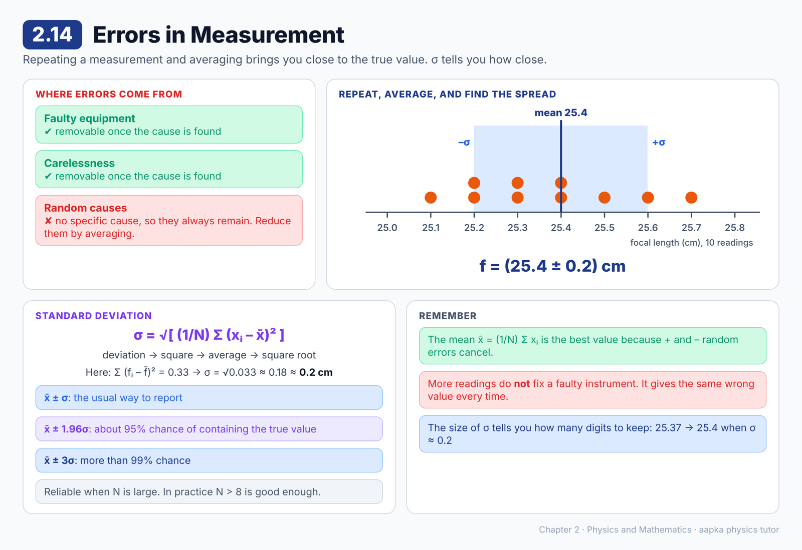

### 📘 Learning Material

**Big idea:** Every measurement has some error. Repeating it and averaging gets closer to the true value, and the **standard deviation** tells you how uncertain the average is.

**Where errors come from**
| Cause | Can we remove it? |
|---|---|
| Faulty equipment | ✔ Yes, once the cause is found |
| Carelessness of the experimenter | ✔ Yes, once the cause is found |
| Random causes | ✘ No specific cause, so they always remain |

**Taming random errors:** random errors are sometimes positive and sometimes negative. So the **average (mean)** of many repeated readings is close to the true value.
x̄ = (1/N) Σ xᵢ

**How uncertain is the average? The standard deviation σ**
σ = √[ (1/N) Σ (xᵢ – x̄)² ]
Find each reading's deviation from the mean, square it, average the squares, then take the square root.

Report the result as **x̄ ± σ**.
- About a **95%** chance the true value lies within **x̄ ± 1.96σ**
- More than **99%** chance it lies within **x̄ ± 3σ**
- These results are reliable when N is large. In practice, **N > 8** gives reasonably correct results.

**🧮 Worked example: a focal length measured 10 times (in cm)**
25.4, 25.2, 25.6, 25.1, 25.3, 25.2, 25.5, 25.4, 25.3, 25.7

- Mean f̄ = 253.7 / 10 = 25.37 ≈ **25.4 cm**
- Deviations from 25.4: 0.0, –0.2, 0.2, –0.3, –0.1, –0.2, 0.1, 0.0, –0.1, 0.3
- Sum of squares = 0.33, so σ = √(0.33/10) = √0.033 ≈ 0.18 ≈ **0.2 cm**
- Result: **f = (25.4 ± 0.2) cm**

> 💡 The uncertainty (± 0.2) also tells you how many digits to keep in the mean. There's no point writing 25.37 when the uncertainty is in the first decimal place.

> ⚠️ **Common mistake:** Thinking more readings remove *all* errors. Averaging reduces the effect of **random** errors only. A faulty instrument gives the same wrong value every time until you fix it.

### ❓ MCQs

**Q1.** 🟢 Which type of error cannot be removed by finding its cause?
- (A) Error due to faulty equipment
- (B) Error due to carelessness
- (C) Random error
- (D) Error due to a bent scale

**Q2.** 🟡 The best value of a quantity from many repeated observations is:
- (A) The first reading
- (B) The largest reading
- (C) The mean of all readings
- (D) The smallest reading

**Q3.** 🟡 The probability that the true value lies within x̄ ± 1.96σ is about:
- (A) 50%
- (B) 68%
- (C) 95%
- (D) 100%

**Q4.** 🔴 Four readings of a length are 4 cm, 6 cm, 5 cm and 5 cm. The standard deviation is about:
- (A) 0.5 cm
- (B) 0.71 cm
- (C) 1 cm
- (D) 2 cm

**Q5.** 🟢 The standard deviation σ of N readings with mean x̄ is:
- (A) √[ (1/N) Σ (xᵢ – x̄)² ]
- (B) (1/N) Σ (xᵢ – x̄)
- (C) Σ (xᵢ – x̄)²
- (D) √[ Σ xᵢ² ]

**Q6.** 🟡 Taking more repeated observations of a quantity mainly helps because:
- (A) The effect of random errors on the average is reduced
- (B) Errors due to faulty equipment disappear
- (C) The standard deviation always becomes zero
- (D) It has no effect on accuracy

**Q7.** 🟡 To be more than 99% sure that the true value lies in an interval, one should use:
- (A) x̄ ± σ
- (B) x̄ ± 1.96σ
- (C) x̄ ± 3σ
- (D) x̄ ± 0.5σ

### Answer Key — 2.14
| Q | Ans | Explanation |
|---|---|---|
| 1 | C | Random errors have no specific cause, so they cannot be removed. They can only be reduced by averaging. |
| 2 | C | Positive and negative random errors tend to cancel in the mean. |
| 3 | C | There is about a 95% chance that the true value lies within x̄ ± 1.96σ. |
| 4 | B | The mean is 5. Deviations –1, 1, 0, 0 give squares adding to 2. σ = √(2/4) = √0.5 ≈ 0.71 cm. |
| 5 | A | Square the deviations, average them, then take the square root. |
| 6 | A | Averaging many readings cancels random errors. Faulty-equipment errors need the cause fixed. |
| 7 | C | x̄ ± 3σ gives more than 99% confidence. |

---

**Total: 85 questions** · 2.1 (5) · 2.2 (4) · 2.3 (7) · 2.4 (4) · 2.5 (4) · 2.6 (6) · 2.7 (6) · 2.8 (8) · 2.9 (8) · 2.10 (6) · 2.11 (7) · 2.12 (6) · 2.13 (7) · 2.14 (7)
