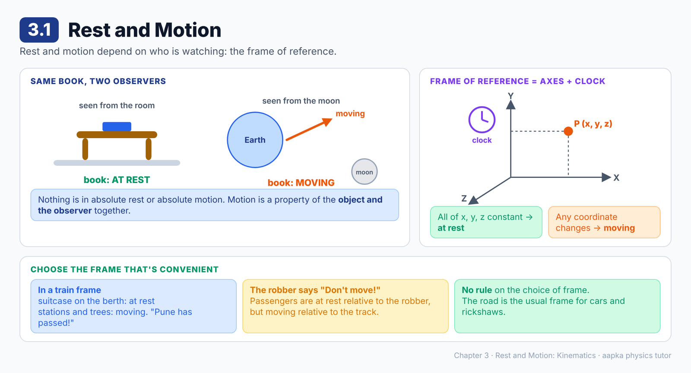
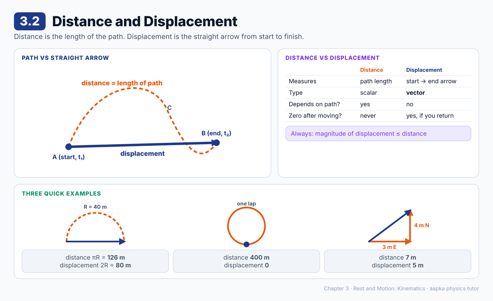
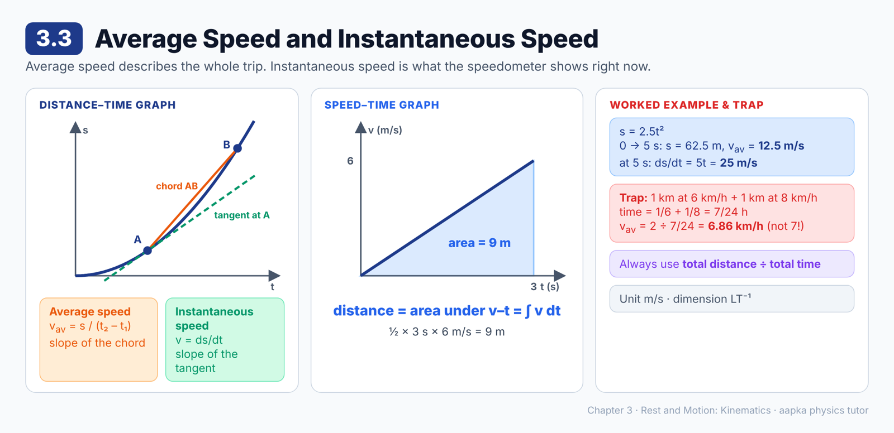
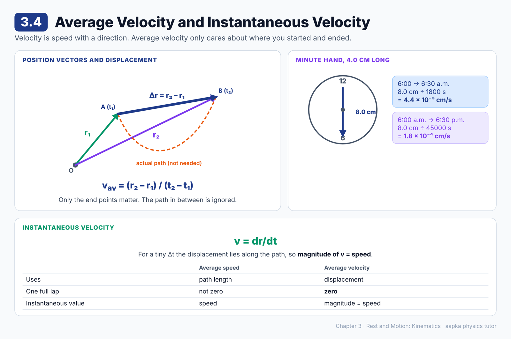
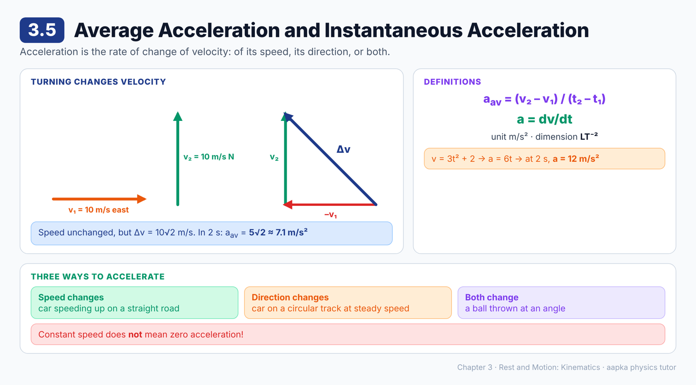
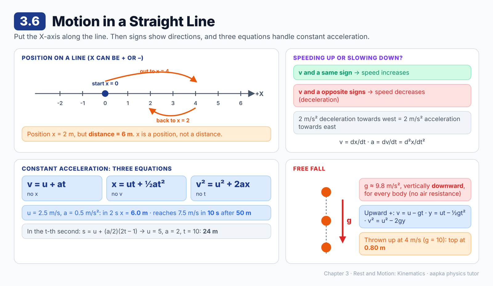
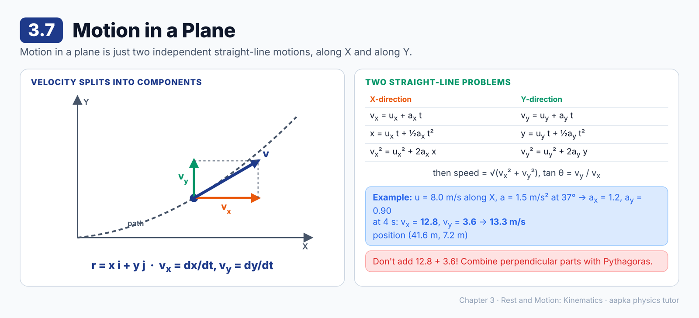
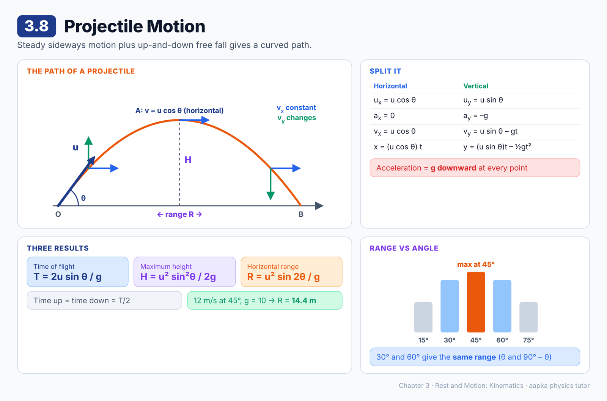
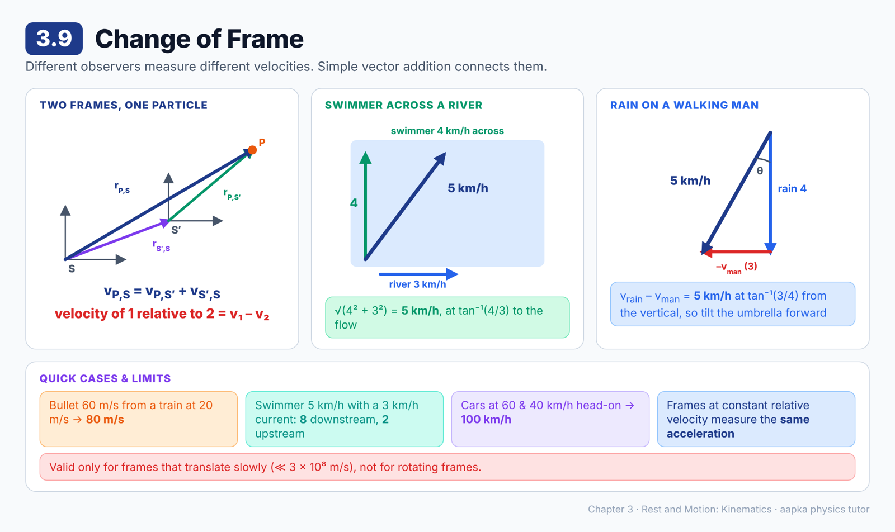

# Chapter 3 — Rest and Motion: Kinematics
### Learning Material + MCQ Practice Set (based on H.C. Verma, *Concepts of Physics* Vol. 1)

**How to use:** Each section opens with a **summary diagram**, then **📘 Learning Material** (key ideas, formulas, worked examples, common mistakes). Then come the **MCQs**, followed by an answer key with short explanations. Difficulty is marked: 🟢 Recall · 🟡 Understanding · 🔴 Application.

**Notation:** vectors are written in **bold** (**r**, **v**, **a**). A plain letter means the magnitude or a component along an axis. **i** and **j** are unit vectors along the X and Y axes. Use g = 9.8 m/s² unless a question says g = 10 m/s².

---

## 3.1 Rest and Motion

### 📘 Learning Material

**Big idea:** Rest and motion are not properties of an object alone. They depend on **who is watching**, that is, on the frame of reference.

**A book on a table**
- Seen from the room: the book stays put, so it is **at rest**.
- Seen from the moon: the whole earth (room, table and book) is moving, so the book is **moving**.

**Nothing is in absolute rest or absolute motion.** Motion is a combined property of the object and the observer.

**The train robber example:** a robber in a fast train shouts "Don't move!" and the passengers stand still. They are at rest **with respect to the robber** (and the train), but moving **with respect to the rail track**.

**Frame of reference**
To locate a particle we choose:
1. Three mutually perpendicular axes (X, Y, Z), which give the coordinates (x, y, z) of the particle
2. A clock to measure time

- If **all three coordinates stay the same** as time passes, the particle is **at rest** in that frame.
- If **any one or more** coordinates change, the particle is **moving** in that frame.

**Choosing a frame:** there is no rule. We pick whatever frame makes the problem easiest.
- Inside a train, a suitcase on the upper berth is at rest in the train frame, while stations and trees are moving ("Pune has already passed!").
- On a road, "the car is moving and the rickshaw is not" clearly uses the road as the frame.

> ⚠️ **Common misconception:** "The ground is the true frame, so things on it are truly at rest." The ground frame is just convenient. It is not special.

### ❓ MCQs

**Q1.** 🟢 Whether a body is at rest or in motion depends on:
- (A) The body only
- (B) The observer only
- (C) Both the body and the observer (the frame of reference)
- (D) Neither of them

**Q2.** 🟡 A book is lying on a table in a room. As seen by an observer on the moon, the book is:
- (A) At rest
- (B) Moving
- (C) At rest, because it is on the table
- (D) Impossible to describe

**Q3.** 🟡 Passengers stand still in a fast-moving train. They are at rest with respect to:
- (A) The rail track
- (B) The train compartment
- (C) The trees outside
- (D) The sun

**Q4.** 🟢 A particle is said to be at rest in a frame of reference if:
- (A) At least one of its coordinates stays the same
- (B) Its speed is less than 1 m/s
- (C) It is touching the ground
- (D) All three of its coordinates x, y and z stay the same as time passes

**Q5.** 🟡 The frame of reference for a problem:
- (A) Must always be fixed to the earth
- (B) Must be at absolute rest
- (C) Can be chosen according to convenience
- (D) Must always be fixed to the sun

### Answer Key — 3.1
| Q | Ans | Explanation |
|---|---|---|
| 1 | C | Motion is a combined property of the object and the observer. |
| 2 | B | From the moon, the earth (with the room and the book) is moving. |
| 3 | B | Their position does not change with respect to the train, but it does with respect to the track. |
| 4 | D | Rest in a frame means none of the coordinates change with time. |
| 5 | C | There is no rule. Pick the frame that makes the situation easiest to describe. |

---

## 3.2 Distance and Displacement

### 📘 Learning Material

**Big idea:** Distance is how much ground you cover along the path. Displacement is the straight arrow from where you started to where you ended.

| | Distance | Displacement |
|---|---|---|
| What it measures | Length of the actual path | Straight line from initial to final position |
| Direction? | No (scalar) | Yes, from initial to final position (vector) |
| Depends on the path? | Yes | No, only on the start and end points |
| Can it be zero after moving? | No | Yes, if you return to the start |

**Displacement is a vector:** a particle moved across a table while the table itself is moved across the room has a net displacement equal to the **vector sum** of the two displacements.

**Always true:** magnitude of displacement ≤ distance. They are equal only for motion along a straight line without turning back.

**🧮 Worked example: walk on a semicircular track of radius 40.0 m, from one end to the other**
- Distance = length of the semicircle = πR = π × 40.0 = **126 m**
- Displacement = the diameter = 2R = **80 m**, from the starting point to the end point

**🧮 Worked example:** walk 3 m east, then 4 m north.
- Distance = 3 + 4 = **7 m**
- Displacement = √(3² + 4²) = **5 m**, towards the north-east

**🧮 One full lap** of a 400 m track: distance = 400 m, displacement = **0**.

> ⚠️ **Common mistake:** Adding the two legs of a trip to get the displacement. That gives the distance. The displacement uses the triangle rule.

### ❓ MCQs

**Q1.** 🟢 The magnitude of displacement is:
- (A) The length of the actual path
- (B) The length of the straight line joining the initial and final positions
- (C) Always more than the distance
- (D) Always zero

**Q2.** 🔴 A person walks along a semicircular track of radius 40.0 m from one end to the other. The distance covered and the magnitude of displacement are:
- (A) 126 m and 80 m
- (B) 80 m and 126 m
- (C) 126 m and 126 m
- (D) 251 m and 80 m

**Q3.** 🟡 Which of these is a vector quantity?
- (A) Distance
- (B) Speed
- (C) Time
- (D) Displacement

**Q4.** 🔴 An athlete completes exactly one lap of a 400 m circular track. Their displacement is:
- (A) 400 m
- (B) 200 m
- (C) 0
- (D) 127 m

**Q5.** 🟡 For any motion, the magnitude of displacement is ______ the distance travelled.
- (A) Greater than
- (B) Less than or equal to
- (C) Always equal to
- (D) Always half of

**Q6.** 🔴 A boy walks 3 m east and then 4 m north. The magnitude of his displacement is:
- (A) 7 m
- (B) 1 m
- (C) 12 m
- (D) 5 m

### Answer Key — 3.2
| Q | Ans | Explanation |
|---|---|---|
| 1 | B | Displacement is the straight-line arrow from the initial to the final position. |
| 2 | A | Distance πR = 126 m. Displacement = diameter 2R = 80 m. |
| 3 | D | Displacement has a direction and adds by the triangle rule. |
| 4 | C | The athlete ends where they started, so the displacement is zero. |
| 5 | B | The straight line is the shortest path, so displacement can never exceed distance. |
| 6 | D | √(3² + 4²) = 5 m. (7 m is the distance.) |

---

## 3.3 Average Speed and Instantaneous Speed

### 📘 Learning Material

**Big idea:** Average speed describes a whole trip. Instantaneous speed is what the speedometer shows at one moment.

**Average speed**
**v_av = (distance travelled) / (time interval) = s / (t₂ – t₁)**
Like a run rate in cricket: some overs are expensive and some are economical, but the average gives the overall picture.

**Instantaneous speed** (just called "speed")
Take a tiny interval Δt, in which the distance travelled is Δs. As Δt → 0, the ratio Δs/Δt approaches a fixed value:
**v = lim (Δt → 0) Δs/Δt = ds/dt**

**Graphs**
- **Distance–time graph:** instantaneous speed = **slope of the tangent**. Average speed = slope of the chord.
- **Speed–time graph:** distance travelled = **area under the curve**, because ds = v dt, so s = ∫ v dt.

**Units:** m/s. Dimensions: LT⁻¹.

**🧮 Worked example:** s = (2.5 m/s²) t²
- Average speed from 0 to 5.0 s: s = 2.5 × 25 = 62.5 m, so v_av = 62.5 / 5.0 = **12.5 m/s**
- Instantaneous speed at 5.0 s: ds/dt = 5.0t = **25 m/s**

**🧮 Worked example: area under a speed–time graph**
Speed rises steadily from 0 to 6 m/s in 3 s. Distance = area of the triangle = ½ × 3 × 6 = **9 m**.

**🧮 Watch out for this trap:** 1 km at 6 km/h, then 1 km at 8 km/h.
Total time = 1/6 + 1/8 = 7/24 h. Average speed = 2 / (7/24) = 48/7 ≈ **6.86 km/h**, not 7 km/h!

> ⚠️ **Common mistake:** Averaging the two speeds directly. That only works if equal **times** (not equal distances) are spent at each speed. Always use total distance ÷ total time.

### ❓ MCQs

**Q1.** 🟢 Average speed is defined as:
- (A) Displacement divided by time
- (B) (Initial speed + final speed) / 2, always
- (C) Total distance travelled divided by the total time taken
- (D) Distance multiplied by time

**Q2.** 🔴 The distance travelled by a particle is s = (2.5 m/s²) t². Its instantaneous speed at t = 5.0 s is:
- (A) 12.5 m/s
- (B) 25 m/s
- (C) 62.5 m/s
- (D) 5 m/s

**Q3.** 🔴 For the same particle (s = 2.5 t²), the average speed from t = 0 to t = 5.0 s is:
- (A) 25 m/s
- (B) 62.5 m/s
- (C) 12.5 m/s
- (D) 5 m/s

**Q4.** 🟡 On a distance–time graph, the instantaneous speed at a moment is given by:
- (A) The slope of the tangent at that moment
- (B) The area under the curve
- (C) The slope of a long chord
- (D) The intercept on the time axis

**Q5.** 🟡 On a speed–time graph, the distance travelled between two instants is given by:
- (A) The slope of the curve
- (B) The area under the curve between those instants
- (C) The intercept on the speed axis
- (D) The maximum speed

**Q6.** 🔴 A man walks 1 km at 6 km/h and then another 1 km at 8 km/h. His average speed is about:
- (A) 7 km/h
- (B) 6.5 km/h
- (C) 6.86 km/h
- (D) 14 km/h

**Q7.** 🔴 The speed of a particle increases uniformly from 0 to 6 m/s in 3 s. The distance it travels in this time is:
- (A) 18 m
- (B) 6 m
- (C) 3 m
- (D) 9 m

### Answer Key — 3.3
| Q | Ans | Explanation |
|---|---|---|
| 1 | C | Average speed uses total distance (not displacement) over total time. |
| 2 | B | ds/dt = 5.0t = 5.0 × 5.0 = 25 m/s. |
| 3 | C | s(5) = 2.5 × 25 = 62.5 m, and 62.5 / 5.0 = 12.5 m/s. |
| 4 | A | As Δt → 0, the chord becomes the tangent. |
| 5 | B | ds = v dt, so the distance is the area under the v–t curve. |
| 6 | C | Total time = 1/6 + 1/8 = 7/24 h, so the average speed is 2 ÷ 7/24 = 48/7 ≈ 6.86 km/h. |
| 7 | D | Area of the triangle = ½ × 3 s × 6 m/s = 9 m. |

---

## 3.4 Average Velocity and Instantaneous Velocity

### 📘 Learning Material

**Big idea:** Velocity is the vector version of speed. Average velocity uses **displacement**, so it only cares about where you started and where you ended.

**Position vector:** the arrow from the origin O to the particle. If the particle is at A at time t₁ and at B at time t₂:
- position vectors **r₁** = OA and **r₂** = OB
- displacement = AB = **r₂ – r₁**

**Average velocity**
**v_av = (r₂ – r₁) / (t₂ – t₁)** = displacement / time
- It is a vector, in the direction of the displacement.
- The path between A and B does **not** matter.

**Instantaneous velocity** (just called "velocity")
**v = lim (Δt → 0) Δr/Δt = dr/dt**
For a very short interval, Δr lies along the path and its length equals Δs. So **the magnitude of the velocity = the instantaneous speed**.

**🧮 Worked example: the tip of a 4.0 cm minute hand**
From 6:00 a.m. to 6:30 a.m. the tip moves from the 12 mark to the 6 mark.
- Displacement = diameter = 2 × 4.0 = **8.0 cm**, from the 12 mark towards the 6 mark
- (a) 6:00 to 6:30 a.m.: time = 1800 s, so v_av = 8.0 / 1800 = **4.4 × 10⁻³ cm/s**
- (b) 6:00 a.m. to 6:30 p.m.: same displacement, time = 45000 s, so v_av = **1.8 × 10⁻⁴ cm/s**

**🧮 Worked example:** **r₁** = (2**i** + 3**j**) m at t = 1 s and **r₂** = (8**i** + 11**j**) m at t = 3 s.
Δ**r** = 6**i** + 8**j**, with magnitude 10 m, so the magnitude of v_av = 10 / 2 = **5 m/s**.

| | Average speed | Magnitude of average velocity |
|---|---|---|
| Uses | Total path length | Straight-line displacement |
| One full lap of a track | Not zero | **Zero** |

> ⚠️ **Common mistake:** Thinking the magnitude of average velocity equals the average speed. It is equal only for straight-line motion without turning back. For instantaneous values, speed = magnitude of velocity always.

### ❓ MCQs

**Q1.** 🟢 Average velocity is defined as:
- (A) Displacement divided by the time interval
- (B) Distance divided by the time interval
- (C) Final velocity minus initial velocity
- (D) Speed multiplied by time

**Q2.** 🔴 The minute hand of a clock is 4.0 cm long. The magnitude of the average velocity of its tip between 6:00 a.m. and 6:30 a.m. is about:
- (A) 0
- (B) 8.0 cm/s
- (C) 4.4 × 10⁻³ cm/s
- (D) 7.0 × 10⁻³ cm/s

**Q3.** 🟡 A runner completes one lap of a circular track in 50 s and returns to the starting point. Her average velocity for the lap is:
- (A) 8 m/s
- (B) 0
- (C) 4 m/s
- (D) Impossible to find without the radius

**Q4.** 🟡 The magnitude of the instantaneous velocity of a particle equals its:
- (A) Instantaneous speed
- (B) Average speed
- (C) Displacement
- (D) Acceleration

**Q5.** 🟡 The average velocity of a particle over a time interval depends on:
- (A) The exact path followed
- (B) The maximum speed reached
- (C) The total distance covered
- (D) Only the initial and final positions and the time interval

**Q6.** 🔴 A particle is at (2**i** + 3**j**) m at t = 1 s and at (8**i** + 11**j**) m at t = 3 s. The magnitude of its average velocity is:
- (A) 10 m/s
- (B) 7 m/s
- (C) 2.5 m/s
- (D) 5 m/s

### Answer Key — 3.4
| Q | Ans | Explanation |
|---|---|---|
| 1 | A | v_av = (**r₂** – **r₁**)/(t₂ – t₁). |
| 2 | C | Displacement = 8.0 cm in 1800 s, giving 4.4 × 10⁻³ cm/s. (7.0 × 10⁻³ cm/s is the average speed along the arc.) |
| 3 | B | The displacement is zero, so the average velocity is zero. |
| 4 | A | For tiny intervals, the displacement length equals the distance, so speed = magnitude of velocity. |
| 5 | D | Only the end positions are used. The path in between doesn't matter. |
| 6 | D | Δ**r** = 6**i** + 8**j** has magnitude 10 m. Divide by 2 s to get 5 m/s. |

---

## 3.5 Average Acceleration and Instantaneous Acceleration

### 📘 Learning Material

**Big idea:** Acceleration is the rate of change of **velocity**. Since velocity is a vector, changing the speed, the direction, or both means the body is accelerating.

- **Uniform velocity:** the velocity stays the same (same speed and same direction), so there is no acceleration.
- **Accelerated motion:** the velocity changes in magnitude, direction or both.

**Average acceleration**
**a_av = (v₂ – v₁) / (t₂ – t₁)**
It depends only on the velocities at t₁ and t₂, not on how the velocity changed in between.

**Instantaneous acceleration** (just called "acceleration")
**a = lim (Δt → 0) Δv/Δt = dv/dt**

**Units:** m/s². Dimensions: **LT⁻²**.

**🧮 Worked example: turning without speeding up**
A car's velocity changes from 10 m/s east to 10 m/s north in 2 s.
Δ**v** = **v₂** – **v₁** has magnitude √(10² + 10²) = 10√2 m/s.
a_av = 10√2 / 2 = **5√2 ≈ 7.1 m/s²**, even though the speed never changed!

**🧮 Worked example:** v = 3t² + 2 (m/s). Then a = dv/dt = 6t. At t = 2 s, **a = 12 m/s²**.

> ⚠️ **Common misconception:** "Constant speed means no acceleration." A car going round a bend at a steady speed **is** accelerating, because its direction changes.

### ❓ MCQs

**Q1.** 🟢 The SI unit of acceleration is:
- (A) m/s²
- (B) m/s
- (C) m²/s
- (D) m·s

**Q2.** 🟡 A car goes round a circular track at a constant speed. The car is:
- (A) Not accelerating, because its speed is constant
- (B) Accelerating, because the direction of its velocity keeps changing
- (C) Moving with constant velocity
- (D) Moving with zero acceleration

**Q3.** 🔴 The velocity of a body changes from 10 m/s towards east to 10 m/s towards north in 2 s. The magnitude of its average acceleration is:
- (A) 0
- (B) 10 m/s²
- (C) 5√2 m/s²
- (D) 5 m/s²

**Q4.** 🟡 The dimensional formula of acceleration is:
- (A) MLT⁻²
- (B) LT⁻¹
- (C) L²T⁻²
- (D) LT⁻²

**Q5.** 🔴 The velocity of a particle is v = 3t² + 2 (in m/s, t in s). Its acceleration at t = 2 s is:
- (A) 14 m/s²
- (B) 6 m/s²
- (C) 24 m/s²
- (D) 12 m/s²

### Answer Key — 3.5
| Q | Ans | Explanation |
|---|---|---|
| 1 | A | Acceleration is velocity (m/s) per second, so m/s². |
| 2 | B | A change in direction is a change in velocity, so the car is accelerating. |
| 3 | C | The change in velocity has magnitude 10√2 m/s. Divided by 2 s, that is 5√2 m/s² ≈ 7.1 m/s². |
| 4 | D | (LT⁻¹)/T = LT⁻². MLT⁻² is force. |
| 5 | D | a = dv/dt = 6t = 12 m/s². (14 is the velocity at t = 2 s.) |

---

## 3.6 Motion in a Straight Line

### 📘 Learning Material

**Big idea:** For motion along one line, choose that line as the X-axis. Then velocity and acceleration become simple numbers with a **sign** (+ or –) showing the direction.

**Definitions in one dimension**
- Position: x (the coordinate)
- Velocity: **v = dx/dt**
- Acceleration: **a = dv/dt = d²x/dt²**

A positive value points along +X and a negative value along –X.

**Speeding up or slowing down?**
| v and a | Speed |
|---|---|
| Same sign (both + or both –) | **Increases** |
| Opposite signs | **Decreases** (deceleration) |

Deceleration is just negative acceleration: 2.0 m/s² of deceleration towards west = 2.0 m/s² of acceleration towards east.

**Equations of motion for constant acceleration** (start at x = 0 when t = 0)
| Equation | Leaves out |
|---|---|
| **v = u + at** | x |
| **x = ut + ½at²** | v |
| **v² = u² + 2ax** | t |

These come from integrating dv/dt = a and then dx/dt = u + at.

**x is the position, not always the distance.** A particle goes from the origin to x = 4 m, turns back and is at x = 2 m. Its position is x = 2 m, but the distance travelled is 6 m.

**🧮 Worked example:** u = 2.5 m/s, a = 0.50 m/s².
- In the first 2 s: x = 2.5 × 2 + ½ × 0.5 × 4 = **6.0 m**
- Time to reach 7.5 m/s: t = (7.5 – 2.5)/0.50 = **10 s**
- Distance in that time: x = (7.5² – 2.5²)/(2 × 0.50) = **50 m**

**Displacement in the last 1 second (the "t-th second")**
s_t = u(1 s) + (a/2)(2t – 1 s)(1 s)
With u = 5 m/s, a = 2 m/s² and t = 10 s: s_t = 5 + 1 × 19 = **24 m**.
(Keep the "1 s" in the formula, or the units won't balance.)

**Free fall**
Near the earth's surface, ignoring air resistance, everything falls with the same constant acceleration **g ≈ 9.8 m/s², vertically downward**.

| Upward taken as + | Downward taken as + |
|---|---|
| v = u – gt | v = u + gt |
| y = ut – ½gt² | y = ut + ½gt² |
| v² = u² – 2gy | v² = u² + 2gy |

**🧮 Worked example:** a ball is thrown up at 4.0 m/s (g = 10 m/s²). At the top v = 0, so 0 = 16 – 2 × 10 × y, giving **y = 0.80 m**.

> ⚠️ **Common mistakes:**
> - Mixing signs. Choose one direction as positive and stick to it for u, v, a and x.
> - Using the equations when the acceleration is **not** constant. They only work for constant a.

### ❓ MCQs

**Q1.** 🟢 Which equation of motion relates v, u, a and x without involving time?
- (A) v = u + at
- (B) x = ut + ½at²
- (C) v² = u² + 2ax
- (D) x = vt

**Q2.** 🔴 A particle starts with velocity 2.5 m/s and accelerates uniformly at 0.50 m/s². The distance it covers in the first 2 s is:
- (A) 5.0 m
- (B) 6.0 m
- (C) 7.0 m
- (D) 1.0 m

**Q3.** 🔴 For the same particle (u = 2.5 m/s, a = 0.50 m/s²), the time taken to reach a velocity of 7.5 m/s is:
- (A) 15 s
- (B) 5 s
- (C) 20 s
- (D) 10 s

**Q4.** 🔴 A ball is thrown vertically upward at 4.0 m/s. Taking g = 10 m/s², the maximum height it reaches is:
- (A) 0.80 m
- (B) 0.40 m
- (C) 1.6 m
- (D) 8.0 m

**Q5.** 🟡 In straight-line motion, the speed of a particle decreases when:
- (A) Velocity and acceleration have the same sign
- (B) Acceleration is zero
- (C) Velocity and acceleration have opposite signs
- (D) Velocity is zero

**Q6.** 🔴 A particle has u = 5 m/s and a constant acceleration of 2 m/s². Its displacement during the 10th second is:
- (A) 24 m
- (B) 25 m
- (C) 100 m
- (D) 19 m

**Q7.** 🟡 A particle starts at the origin, moves to x = 4 m, turns back and stops at x = 2 m. The distance it has travelled is:
- (A) 2 m
- (B) 4 m
- (C) 6 m
- (D) 8 m

**Q8.** 🟢 Neglecting air resistance, a body falling freely near the earth's surface has an acceleration of about:
- (A) 9.8 m/s² upward
- (B) 9.8 m/s² downward
- (C) Zero
- (D) A value that keeps increasing as it falls

**Q9.** 🔴 A stone is dropped from rest. Taking g = 10 m/s², how far does it fall in 3 s?
- (A) 30 m
- (B) 90 m
- (C) 45 m
- (D) 15 m

**Q10.** 🟡 A deceleration of 2 m/s² towards west is the same as:
- (A) An acceleration of 2 m/s² towards east
- (B) An acceleration of 2 m/s² towards west
- (C) Zero acceleration
- (D) An acceleration of 4 m/s² towards east

### Answer Key — 3.6
| Q | Ans | Explanation |
|---|---|---|
| 1 | C | v² = u² + 2ax has no t in it. |
| 2 | B | x = 2.5 × 2 + ½ × 0.50 × 2² = 5.0 + 1.0 = 6.0 m. |
| 3 | D | t = (7.5 – 2.5)/0.50 = 10 s. |
| 4 | A | 0 = 4.0² – 2 × 10 × y gives y = 16/20 = 0.80 m. |
| 5 | C | When the acceleration opposes the velocity, the body slows down. |
| 6 | A | s = u + (a/2)(2t – 1) = 5 + 1 × 19 = 24 m. |
| 7 | C | 4 m out and 2 m back = 6 m. The position is still x = 2 m. |
| 8 | B | g ≈ 9.8 m/s², always directed vertically downward. |
| 9 | C | y = ½gt² = ½ × 10 × 9 = 45 m. |
| 10 | A | Deceleration towards west means the acceleration points east. |

---

## 3.7 Motion in a Plane

### 📘 Learning Material

**Big idea:** Motion in a plane splits into **two independent straight-line motions**, one along X and one along Y.

**Position, velocity and acceleration with components**
- Position: **r** = x**i** + y**j**
- Velocity: **v** = v_x**i** + v_y**j**, where **v_x = dx/dt** and **v_y = dy/dt**
- Acceleration: **a** = a_x**i** + a_y**j**, where **a_x = dv_x/dt** and **a_y = dv_y/dt**

**Constant acceleration: use the straight-line equations on each axis separately**
| X-direction | Y-direction |
|---|---|
| v_x = u_x + a_x t | v_y = u_y + a_y t |
| x = u_x t + ½ a_x t² | y = u_y t + ½ a_y t² |
| v_x² = u_x² + 2a_x x | v_y² = u_y² + 2a_y y |

Then combine: speed = √(v_x² + v_y²), and the direction is tan θ = v_y / v_x.

**🧮 Worked example**
At t = 0 a particle is at the origin with velocity 8.0 m/s along X. It has a constant acceleration of 1.5 m/s² at 37° to the X-axis (cos 37° ≈ 4/5, sin 37° ≈ 3/5).
- a_x = 1.5 × 4/5 = 1.2 m/s² and a_y = 1.5 × 3/5 = 0.90 m/s²
- At t = 4.0 s:
  - v_x = 8.0 + 1.2 × 4 = **12.8 m/s** and v_y = 0 + 0.90 × 4 = **3.6 m/s**
  - speed = √(12.8² + 3.6²) ≈ **13.3 m/s**, at tan θ = 3.6/12.8 = 9/32 to the X-axis
  - x = 8.0 × 4 + ½ × 1.2 × 16 = **41.6 m** and y = ½ × 0.90 × 16 = **7.2 m**

> 💡 If a_x = 0, then v_x never changes. This is exactly what happens horizontally in projectile motion (next section).

> ⚠️ **Common mistake:** Adding speeds along X and Y directly (12.8 + 3.6). Combine perpendicular components with Pythagoras.

### ❓ MCQs

**Q1.** 🟢 Motion in a plane with constant acceleration can be analysed as:
- (A) A single straight-line motion
- (B) Circular motion
- (C) Two independent straight-line motions along the X and Y axes
- (D) Something the equations of motion cannot handle

**Q2.** 🟡 The x-component of velocity is:
- (A) dy/dt
- (B) dv/dt
- (C) x/t
- (D) dx/dt

**Q3.** 🔴 A particle starts from the origin with velocity 8.0 m/s along the X-axis and has a constant acceleration (1.2**i** + 0.90**j**) m/s². Its y-component of velocity at t = 4.0 s is:
- (A) 4.8 m/s
- (B) 3.6 m/s
- (C) 12.8 m/s
- (D) 0.90 m/s

**Q4.** 🔴 For the same particle, the x-component of velocity at t = 4.0 s is:
- (A) 12.8 m/s
- (B) 8.0 m/s
- (C) 4.8 m/s
- (D) 13.3 m/s

**Q5.** 🔴 The coordinates of a particle are x = 3t and y = 4t (in metres, t in seconds). Its speed is:
- (A) 7 m/s
- (B) 1 m/s
- (C) 5 m/s
- (D) 12 m/s

**Q6.** 🟡 If the x-component of acceleration of a particle is zero, then:
- (A) v_x stays constant
- (B) v_y stays constant
- (C) The speed stays constant
- (D) The path must be a straight line

### Answer Key — 3.7
| Q | Ans | Explanation |
|---|---|---|
| 1 | C | The x-quantities and y-quantities follow separate straight-line equations. |
| 2 | D | v_x is the rate of change of the x-coordinate. |
| 3 | B | v_y = u_y + a_y t = 0 + 0.90 × 4.0 = 3.6 m/s. |
| 4 | A | v_x = 8.0 + 1.2 × 4.0 = 12.8 m/s. |
| 5 | C | v_x = 3 and v_y = 4, so the speed is √(9 + 16) = 5 m/s. |
| 6 | A | dv_x/dt = 0 means v_x does not change. The y-motion can still change. |

---

## 3.8 Projectile Motion

### 📘 Learning Material

**Big idea:** A thrown ball moves sideways at a **steady** speed while it rises and falls exactly like a ball thrown straight up. The two motions together make its curved path.

**Assumptions:** the body stays close to the earth's surface, and air resistance is negligible. Then the acceleration is **g, vertically downward, throughout**.

**Terms:** for a body thrown from O with speed u at angle θ to the horizontal:
- θ is the **angle of projection**
- the highest point is A
- the horizontal distance OB to where it lands at the same level is the **horizontal range**
- the total time in the air is the **time of flight**

**Split the motion** (origin at O, upward taken as +)
| Horizontal | Vertical |
|---|---|
| u_x = u cos θ | u_y = u sin θ |
| a_x = 0 | a_y = –g |
| v_x = u cos θ (**constant**) | v_y = u sin θ – gt |
| x = (u cos θ) t | y = (u sin θ) t – ½gt² |

**Key results**
- **Time of flight: T = 2u sin θ / g** (setting y = 0 gives t = 0 or this value)
- **Time to reach the top: u sin θ / g**, exactly half of T. Going up takes as long as coming down.
- **Maximum height: H = u² sin²θ / 2g** (at the top, v_y = 0)
- **Horizontal range: R = u² sin 2θ / g** (v_x × T = 2u² sin θ cos θ / g)

**Useful consequences**
- At the highest point, the velocity is **horizontal**, equal to u cos θ. It is **not** zero.
- For a given speed, the range is **maximum at θ = 45°**, where R_max = u²/g.
- Angles θ and (90° – θ), such as 30° and 60°, give the **same range**, because sin 2θ is the same for both.

**🧮 Worked example:** a ball is thrown at 12.0 m/s at 45° (g = 10 m/s²).
R = 144 × sin 90° / 10 = **14.4 m**.

**🧮 Worked example:** u = 20 m/s at 30° (g = 10 m/s²).
T = 2 × 20 × ½ / 10 = **2 s**, H = 400 × ¼ / 20 = **5 m**, R = 400 × (√3/2) / 10 ≈ **34.6 m**.

> ⚠️ **Common mistake:** Saying the velocity is zero at the top. Only the **vertical** component is zero. The ball is still moving sideways at u cos θ.

### ❓ MCQs

**Q1.** 🟢 Neglecting air resistance, the horizontal component of a projectile's velocity:
- (A) Remains constant
- (B) Increases
- (C) Decreases
- (D) Becomes zero at the highest point

**Q2.** 🟡 At the highest point of its path, the velocity of a projectile is:
- (A) Zero
- (B) Horizontal, equal to u cos θ
- (C) Vertical
- (D) Equal to the initial velocity u

**Q3.** 🔴 A ball is thrown at 12 m/s at 45° to the horizontal. Taking g = 10 m/s², its horizontal range is:
- (A) 7.2 m
- (B) 28.8 m
- (C) 14.4 m
- (D) 12 m

**Q4.** 🔴 A stone is projected at 20 m/s at 30° above the horizontal (g = 10 m/s²). Its time of flight is:
- (A) 1 s
- (B) 4 s
- (C) 3.46 s
- (D) 2 s

**Q5.** 🔴 For the same stone (20 m/s at 30°, g = 10 m/s²), the maximum height reached is:
- (A) 5 m
- (B) 10 m
- (C) 20 m
- (D) 2.5 m

**Q6.** 🟡 For a given speed of projection, the horizontal range is maximum when the angle of projection is:
- (A) 30°
- (B) 45°
- (C) 60°
- (D) 90°

**Q7.** 🟡 The time a projectile takes to reach its maximum height, compared with the total time of flight, is:
- (A) Equal
- (B) Twice
- (C) Half
- (D) One quarter

**Q8.** 🔴 For the same speed, which pair of angles of projection gives the same horizontal range?
- (A) 30° and 45°
- (B) 45° and 90°
- (C) 20° and 80°
- (D) 30° and 60°

**Q9.** 🟢 During its flight, the acceleration of a projectile is:
- (A) g, vertically downward, throughout the motion
- (B) Zero at the highest point
- (C) Along the direction of its velocity
- (D) Greatest at the moment of projection

### Answer Key — 3.8
| Q | Ans | Explanation |
|---|---|---|
| 1 | A | a_x = 0, so v_x = u cos θ throughout. |
| 2 | B | At the top, v_y = 0 but v_x = u cos θ is still there. |
| 3 | C | R = u² sin 2θ / g = 144 × 1 / 10 = 14.4 m. |
| 4 | D | T = 2u sin θ / g = 2 × 20 × 0.5 / 10 = 2 s. |
| 5 | A | H = u² sin²θ / 2g = 400 × 0.25 / 20 = 5 m. |
| 6 | B | sin 2θ is largest (= 1) when 2θ = 90°. |
| 7 | C | Time to the top is u sin θ / g, which is half of 2u sin θ / g. |
| 8 | D | sin 60° = sin 120°, so θ and 90° – θ give equal ranges. |
| 9 | A | Gravity is the only force, so the acceleration is g downward at every point. |

---

## 3.9 Change of Frame

### 📘 Learning Material

**Big idea:** Position, velocity and acceleration depend on the frame. Simple vector addition connects what two different observers measure.

**Two frames S and S′, and a particle P**
- **Position:** **r**_P,S = **r**_P,S′ + **r**_S′,S
  (position of P in S = position of P in S′ + position of S′ in S)
- **Velocity:** differentiate to get **v**_P,S = **v**_P,S′ + **v**_S′,S
- **Relative velocity:** rearranging gives **v**_P,S′ = **v**_P,S – **v**_S′,S

So the **velocity of body 1 with respect to body 2 = v₁ – v₂**, when both are measured in the same frame.

**When does this work?** We assume time and d/dt mean the same thing in both frames. That is true when the frames only **translate** with speeds much smaller than light (3 × 10⁸ m/s). It fails if the speeds are comparable to that of light, or if one frame **rotates** relative to the other.

**Everyday examples**
| Situation | Result |
|---|---|
| Bullet fired at 60 m/s (relative to the gun) from a train moving at 20 m/s, in the same direction | 80 m/s relative to the ground |
| Swimmer at 5 km/h (relative to water) with a 3 km/h current | 8 km/h downstream, 2 km/h upstream |
| Two cars at 60 km/h and 40 km/h heading towards each other | Each sees the other approaching at 100 km/h |
| Same two cars going the same way | Relative speed 20 km/h |

**🧮 Worked example: swimming across a river**
A swimmer moves at 4.0 km/h perpendicular to the current (relative to the water). The river flows at 3.0 km/h.
- Velocity relative to the ground = √(4² + 3²) = **5.0 km/h**
- Direction: tan θ = 4/3 with the direction of flow

**🧮 Worked example: rain and a walking man**
Rain falls vertically at 4.0 km/h, and a man walks at 3.0 km/h.
**v**_rain,man = **v**_rain,street – **v**_man,street, which has magnitude √(4² + 3²) = **5.0 km/h**.
It makes an angle tan⁻¹(3/4) with the vertical, so the rain seems to come towards him from the front. That's why you tilt your umbrella forward!

**Acceleration:** **a**_P,S = **a**_P,S′ + **a**_S′,S. If S′ moves at a **constant velocity** relative to S, then **a**_S′,S = 0, so **both frames measure the same acceleration**.

> ⚠️ **Common mistake:** Adding velocities when you should subtract. For "velocity of A as seen by B", always compute **v**_A – **v**_B (both measured from the ground).

### ❓ MCQs

**Q1.** 🟢 If two bodies have velocities **v₁** and **v₂** with respect to the ground, the velocity of body 1 with respect to body 2 is:
- (A) **v₂** – **v₁**
- (B) **v₁** + **v₂**
- (C) **v₁** – **v₂**
- (D) **v₁** × **v₂**

**Q2.** 🔴 A gun mounted on a train moving at 20 m/s fires a bullet forward with a muzzle velocity of 60 m/s (relative to the gun). The bullet's speed relative to the ground is:
- (A) 80 m/s
- (B) 40 m/s
- (C) 60 m/s
- (D) 20 m/s

**Q3.** 🔴 A swimmer can swim at 4.0 km/h in still water. He swims perpendicular to the current of a river flowing at 3.0 km/h. His speed relative to the ground is:
- (A) 7.0 km/h
- (B) 1.0 km/h
- (C) 3.5 km/h
- (D) 5.0 km/h

**Q4.** 🔴 Rain falls vertically at 4.0 km/h. A man walks on a level road at 3.0 km/h. To the man, the rain appears to fall at:
- (A) 5.0 km/h, vertically
- (B) 5.0 km/h, at an angle tan⁻¹(3/4) with the vertical
- (C) 7.0 km/h, at an angle tan⁻¹(4/3) with the vertical
- (D) 1.0 km/h, vertically

**Q5.** 🟡 Two frames move with constant velocity relative to each other. The acceleration of a body measured in the two frames is:
- (A) The same
- (B) Different
- (C) Zero in both
- (D) Equal in magnitude but opposite in direction

**Q6.** 🟡 A swimmer can swim at 5 km/h in still water. Swimming upstream against a current of 3 km/h, his speed relative to the bank is:
- (A) 8 km/h
- (B) 2 km/h
- (C) 5 km/h
- (D) 3 km/h

**Q7.** 🟡 The relation **v**_P,S = **v**_P,S′ + **v**_S′,S does **not** hold when:
- (A) The two frames are at rest relative to each other
- (B) The speeds involved are small
- (C) The speeds are comparable to 3 × 10⁸ m/s, or one frame rotates relative to the other
- (D) The particle is at rest

**Q8.** 🔴 Two cars move towards each other on a straight road at 60 km/h and 40 km/h. The speed of one car as seen from the other is:
- (A) 20 km/h
- (B) 50 km/h
- (C) 100 km/h
- (D) 2400 km/h

### Answer Key — 3.9
| Q | Ans | Explanation |
|---|---|---|
| 1 | C | **v**_1,2 = **v**_1,G – **v**_2,G. |
| 2 | A | **v**_bullet,ground = **v**_bullet,gun + **v**_gun,ground = 60 + 20 = 80 m/s. |
| 3 | D | The two velocities are perpendicular, so the speed is √(4² + 3²) = 5.0 km/h. |
| 4 | B | **v**_rain – **v**_man has magnitude √(16 + 9) = 5 km/h, tilted at tan⁻¹(3/4) to the vertical. |
| 5 | A | **a**_S′,S = 0, so **a**_P,S = **a**_P,S′. |
| 6 | B | 5 – 3 = 2 km/h relative to the bank. |
| 7 | C | The simple rule assumes time is the same in both frames, which fails near light speed or for rotating frames. |
| 8 | C | Opposite directions: 60 – (–40) = 100 km/h. |

---

**Total: 62 questions** · 3.1 (5) · 3.2 (6) · 3.3 (7) · 3.4 (6) · 3.5 (5) · 3.6 (10) · 3.7 (6) · 3.8 (9) · 3.9 (8)
