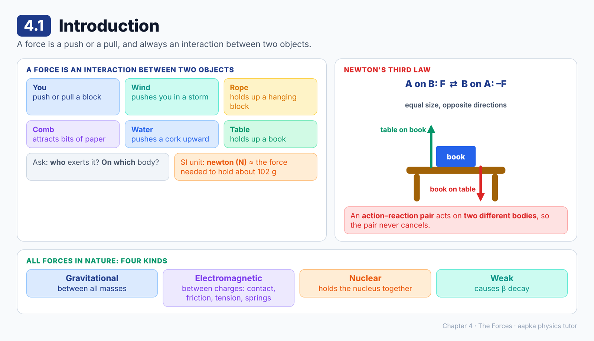
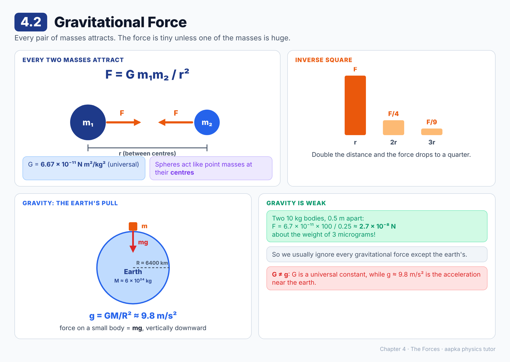
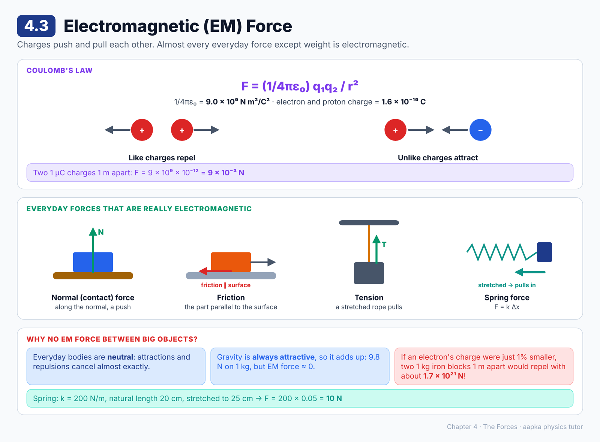
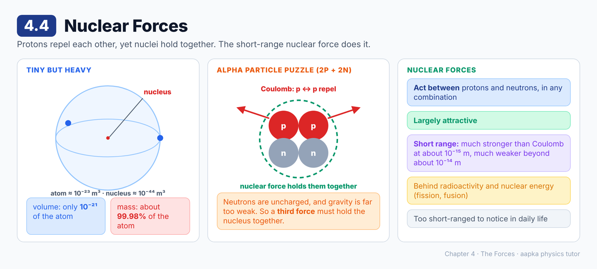
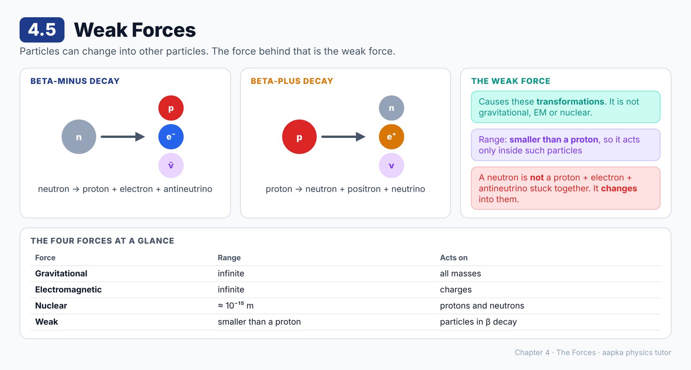
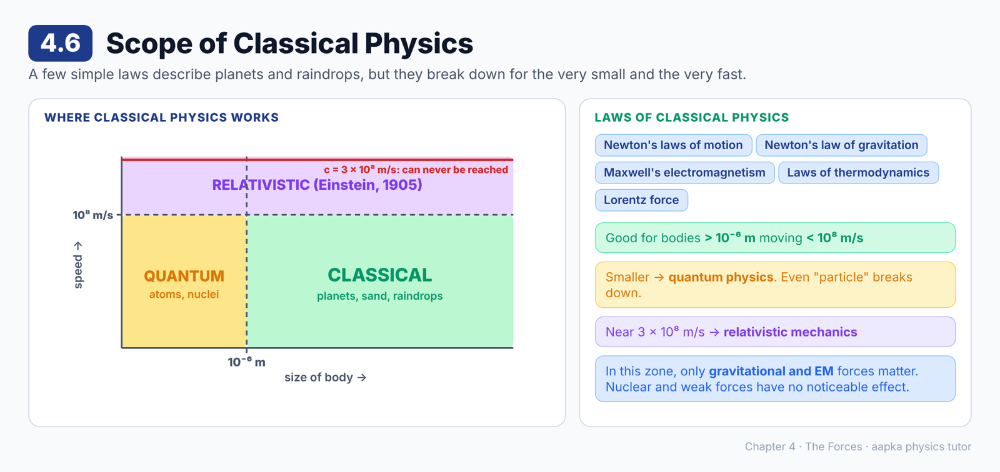

# Chapter 4 — The Forces
### Learning Material + MCQ Practice Set (based on H.C. Verma, *Concepts of Physics* Vol. 1)

**How to use:** Each section opens with a **summary diagram**, then **📘 Learning Material** (key ideas, formulas, worked examples, common mistakes). Then come the **MCQs**, followed by an answer key with short explanations. Difficulty is marked: 🟢 Recall · 🟡 Understanding · 🔴 Application.

**Notation:** vectors are written in **bold** (**F**). Use g = 9.8 m/s² unless a question says g = 10 m/s².

---

## 4.1 Introduction

### 📘 Learning Material

**Big idea:** A force is a push or a pull, and it is always an **interaction between two objects**.

**Forces are everywhere, not just from people**
- You push or pull objects. Holding a heavy block takes a large force, and a light block a small one.
- Wind pushes on you in a storm.
- A rope holds up a hanging block.
- A freshly used comb attracts small bits of paper.
- Water pushes a cork upward, so you must push down to keep it under.

**Unit:** the SI unit of force is the **newton (N)**. Roughly, 1 N is the force needed to hold a body of mass about **102 g** near the earth's surface. (The exact definition comes from Newton's laws in the next chapter.)

**Two questions to ask about any force**
1. **Who** exerted this force?
2. **On which** object was it exerted?

**Force is a vector.** When several forces act on a particle, the resultant is found by vector addition.

**Newton's third law of motion**
If body A exerts a force **F** on body B, then B exerts a force **–F** on A. The two forces act along the line joining the bodies.
- The pair **F** and **–F** is called an **action–reaction pair**. Either one can be called the action.
- The table pushes the book up, and the book pushes the table down.
- The rope pulls the block up, and the block pulls the rope tight.

**The four kinds of force in nature**
| Force | Where it matters |
|---|---|
| Gravitational | Planets, falling bodies, your weight |
| Electromagnetic | Atoms, contact forces, tension, springs, friction |
| Nuclear | Holding the nucleus together |
| Weak | Radioactive β decay |

> ⚠️ **Common misconception:** "Action and reaction cancel, so nothing can move." They act on **different** bodies, so they never cancel each other.

### ❓ MCQs

**Q1.** 🟢 The SI unit of force is the:
- (A) Joule
- (B) Newton
- (C) Watt
- (D) Pascal

**Q2.** 🟢 One newton is roughly the force needed to hold a body near the earth's surface whose mass is:
- (A) 1 kg
- (B) 9.8 kg
- (C) 10 g
- (D) About 102 g

**Q3.** 🟡 Body A exerts a force **F** on body B. According to Newton's third law, B exerts on A a force of:
- (A) **F**
- (B) Zero
- (C) –**F**, along the line joining the bodies
- (D) **F**/2

**Q4.** 🟡 A book rests on a table, and the table exerts an upward force on the book. The reaction to this force is:
- (A) The downward force exerted by the book on the table
- (B) The earth's pull on the book
- (C) The weight of the table
- (D) The force of the floor on the table

**Q5.** 🟢 All forces in nature can be grouped into which four categories?
- (A) Gravitational, friction, tension and spring
- (B) Gravitational, electromagnetic, nuclear and weak
- (C) Push, pull, contact and magnetic
- (D) Mechanical, electrical, chemical and nuclear

**Q6.** 🟡 Force is:
- (A) A scalar quantity
- (B) A dimensionless quantity
- (C) A vector quantity
- (D) Sometimes a vector, sometimes a scalar

### Answer Key — 4.1
| Q | Ans | Explanation |
|---|---|---|
| 1 | B | Force is measured in newtons (N). |
| 2 | D | The weight of about 102 g is 0.102 × 9.8 ≈ 1 N. |
| 3 | C | Third law: equal in size, opposite in direction, along the line joining A and B. |
| 4 | A | Action and reaction act between the same two bodies: table on book, and book on table. |
| 5 | B | These are the four fundamental categories. Friction, tension and spring forces are all electromagnetic. |
| 6 | C | Forces have direction and add by vector addition. |

---

## 4.2 Gravitational Force

### 📘 Learning Material

**Big idea:** Every pair of masses attracts each other. The force is tiny unless at least one of the masses is huge, like the earth.

**Newton's law of gravitation (point masses)**
**F = G m₁m₂ / r²**
- G = **6.67 × 10⁻¹¹ N m²/kg²**, a universal constant
- The force is always **attractive** and acts along the line joining the masses.
- Double the distance and the force becomes ¼ (inverse square).

**Extended bodies:** add the forces between every particle of one body and every particle of the other, as vectors. With 3 particles in each body that's already 9 forces, and real bodies need integration.

**The shortcut for spheres:** two **spherically symmetric** bodies attract as if all their mass were at their **centres**. Use r = the distance between the centres.

**How weak is gravity between everyday objects?**
Two 10 kg bodies, 0.5 m apart:
F = 6.7 × 10⁻¹¹ × 10 × 10 / 0.25 ≈ **2.7 × 10⁻⁸ N**, about the weight of 3 micrograms! That's why we usually ignore every gravitational force except the earth's.

**Gravity: the earth's pull on small bodies**
Treat the earth as a sphere with radius R ≈ 6400 km and mass M ≈ 6 × 10²⁴ kg.
- Force on a mass m near the surface: F = GMm/R², directed towards the centre of the earth, which we call **vertically downward**.
- The quantity **g = GM/R²** has dimensions of acceleration. It is the **acceleration due to gravity**, ≈ **9.8 m/s²** (often rounded to 10 m/s²).
- So the earth's force on a small body is **mg, vertically downward**.

**🧮 Check:** g = 6.67 × 10⁻¹¹ × 6 × 10²⁴ / (6.4 × 10⁶)² ≈ **9.8 m/s²** ✔

> ⚠️ **Common mistake:** Mixing up G and g. **G** is a universal constant (6.67 × 10⁻¹¹ N m²/kg²). **g** is the acceleration due to gravity near the earth (≈ 9.8 m/s²), and it depends on the earth's mass and radius.

### ❓ MCQs

**Q1.** 🟢 The value of the universal gravitational constant G is about:
- (A) 9.8 m/s²
- (B) 6.67 × 10⁻¹¹ N m²/kg²
- (C) 9.0 × 10⁹ N m²/C²
- (D) 6.67 × 10¹¹ N m²/kg²

**Q2.** 🔴 Two bodies of mass 10 kg each are placed 0.5 m apart. The gravitational force between them is about:
- (A) 2.7 × 10⁻⁸ N
- (B) 1.3 × 10⁻⁸ N
- (C) 2.7 × 10⁻¹⁰ N
- (D) 98 N

**Q3.** 🟡 If M and R are the mass and radius of the earth, the acceleration due to gravity near its surface is:
- (A) GMR²
- (B) GM/R
- (C) G/(MR²)
- (D) GM/R²

**Q4.** 🟡 To calculate the gravitational force between two spherically symmetric bodies, we can:
- (A) Treat them as point masses placed at their centres
- (B) Use the distance between their nearest surfaces
- (C) Ignore their masses
- (D) Use only the mass of the bigger body

**Q5.** 🔴 The distance between two masses is doubled. The gravitational force between them becomes:
- (A) Half
- (B) Double
- (C) One quarter
- (D) Unchanged

**Q6.** 🟡 We can usually ignore the gravitational force between two everyday objects, such as two chairs, because:
- (A) Their gravitational forces cancel out
- (B) G is very small, so the force is tiny unless a mass is huge
- (C) Gravity acts only between planets
- (D) Gravitational forces are repulsive

**Q7.** 🔴 The force exerted by the earth on a 5 kg body near its surface (g = 9.8 m/s²) is:
- (A) 5 N
- (B) 9.8 N
- (C) 49 N
- (D) 0.5 N

### Answer Key — 4.2
| Q | Ans | Explanation |
|---|---|---|
| 1 | B | G = 6.67 × 10⁻¹¹ N m²/kg². (9.0 × 10⁹ is the Coulomb constant.) |
| 2 | A | F = 6.7 × 10⁻¹¹ × 100 / 0.25 ≈ 2.7 × 10⁻⁸ N. |
| 3 | D | F = GMm/R² = mg, so g = GM/R². |
| 4 | A | A spherically symmetric body attracts as if its whole mass were at its centre. |
| 5 | C | F ∝ 1/r², so 2r gives F/4. |
| 6 | B | G is so small that the force only becomes noticeable when at least one body is very massive. |
| 7 | C | F = mg = 5 × 9.8 = 49 N, vertically downward. |

---

## 4.3 Electromagnetic (EM) Force

### 📘 Learning Material

**Big idea:** Charged particles push and pull on each other. This electromagnetic force is behind almost every everyday force except weight: contact forces, friction, tension and springs.

**Coulomb's law (charges at rest)**
**F = (1/4πε₀) q₁q₂ / r²**
- ε₀ = 8.85 × 10⁻¹² C²/(N m²), so **1/4πε₀ = 9.0 × 10⁹ N m²/C²**
- The force acts along the line joining the charges.
- **Like charges repel** (both + or both –). **Unlike charges attract.**
- This is why a freshly used comb picks up paper bits.
- Between **moving** charges the force is more complicated, with extra terms beyond Coulomb's law.

**Matter is made of charges:** an electron carries **1.6 × 10⁻¹⁹ C** of negative charge, and a proton carries the same amount of positive charge. EM forces bind electrons to nuclei in atoms, and atoms into molecules.

**Everyday forces that are really electromagnetic**
| Force | What happens |
|---|---|
| **Contact (normal) force** | The atoms of two touching surfaces push on each other. The force is along the common **normal** and is a push. |
| **Friction** | The part of the contact force **parallel** to the surfaces. "Smooth" means frictionless, which is why a smooth metal pole is hard to climb but a rough tree trunk isn't. |
| **Tension** | A stretched rope or string pulls on the bodies tied to its ends. |
| **Spring force** | **F = k × (change in length) = k Δx**. A stretched spring pulls inward, and a compressed spring pushes outward. k is the **spring constant**. |

Contact forces obey Newton's third law: the book presses down on the table with force F, and the table pushes up on the book with an equal force F.

**🧮 Worked example: spring force**
A spring with k = 200 N/m and natural length 20 cm is stretched to 25 cm. Δx = 0.05 m, so F = 200 × 0.05 = **10 N**.

**🧮 Worked example: two 1 μC charges 1 m apart**
F = 9 × 10⁹ × (10⁻⁶)² / 1² = **9 × 10⁻³ N**

**Why don't we feel EM forces between big objects?** Everyday bodies are **electrically neutral**. The attractions and repulsions between their charges almost exactly **cancel**. Gravitational forces are all attractive, so they add up instead. A 1 kg block 100 m above the ground feels about 9.8 N of gravity but almost zero EM force from the earth.

**🧮 How exact must neutrality be?** Suppose an electron's charge were just 1% smaller than a proton's. Then two 1 kg iron blocks 1 m apart would each carry about 4.3 × 10⁵ C and repel with about **1.7 × 10²¹ N**. That's a tremendous force, which shows how exact charge neutrality really is.

> ⚠️ **Common misconception:** "Friction and normal force are separate kinds of force." They are two components (parallel and perpendicular) of one contact force, and both are electromagnetic.

### ❓ MCQs

**Q1.** 🟢 The value of 1/4πε₀ in Coulomb's law is about:
- (A) 6.67 × 10⁻¹¹ N m²/kg²
- (B) 9.0 × 10⁹ N m²/C²
- (C) 8.85 × 10⁻¹² C²/(N m²)
- (D) 1.6 × 10⁻¹⁹ C

**Q2.** 🟡 Two charges of the same sign placed near each other will:
- (A) Attract each other
- (B) Exert no force on each other
- (C) Repel each other
- (D) Attract or repel depending on their masses

**Q3.** 🔴 Two charges of 1 μC each are placed 1 m apart. The force between them is:
- (A) 9 × 10⁻³ N
- (B) 9 × 10⁹ N
- (C) 9 × 10⁻¹² N
- (D) 1 N

**Q4.** 🟡 The force with which a table supports a book kept on it is fundamentally:
- (A) Gravitational
- (B) Nuclear
- (C) Weak
- (D) Electromagnetic

**Q5.** 🟡 Friction is:
- (A) The component of the contact force perpendicular to the surfaces
- (B) The component of the contact force parallel to the surfaces
- (C) A kind of gravitational force
- (D) A kind of nuclear force

**Q6.** 🔴 A spring of spring constant 200 N/m has a natural length of 20 cm. It is stretched to 25 cm. The force it exerts is:
- (A) 10 N
- (B) 50 N
- (C) 1000 N
- (D) 40 N

**Q7.** 🟡 There is almost no electromagnetic force between the earth and a block kept above it, even though both contain huge numbers of charges. This is because:
- (A) EM forces are always weaker than gravity
- (B) The block is too far away
- (C) Both bodies are electrically neutral, so the attractions and repulsions cancel
- (D) The earth contains no charged particles

**Q8.** 🟡 A stretched spring:
- (A) Pulls the bodies attached to its ends towards its centre
- (B) Pushes the bodies attached to its ends outward
- (C) Exerts no force
- (D) Exerts a force only on the heavier body

**Q9.** 🟢 The charge carried by an electron has a magnitude of:
- (A) 9.1 × 10⁻³¹ C
- (B) 1.6 × 10¹⁹ C
- (C) 6.67 × 10⁻¹¹ C
- (D) 1.6 × 10⁻¹⁹ C

### Answer Key — 4.3
| Q | Ans | Explanation |
|---|---|---|
| 1 | B | 1/4πε₀ = 9.0 × 10⁹ N m²/C². The value of ε₀ itself is 8.85 × 10⁻¹². |
| 2 | C | Like charges repel and unlike charges attract. |
| 3 | A | F = 9 × 10⁹ × 10⁻⁶ × 10⁻⁶ / 1 = 9 × 10⁻³ N. |
| 4 | D | Contact forces come from EM forces between the atoms of the two surfaces. |
| 5 | B | Friction is the part of the contact force along the surface. |
| 6 | A | F = kΔx = 200 × 0.05 = 10 N. |
| 7 | C | In neutral bodies the attractive and repulsive EM forces almost exactly cancel. |
| 8 | A | When stretched, a spring pulls inward. When compressed, it pushes outward. |
| 9 | D | e = 1.6 × 10⁻¹⁹ C. (9.1 × 10⁻³¹ kg is the electron's mass.) |

---

## 4.4 Nuclear Forces

### 📘 Learning Material

**Big idea:** Protons in a nucleus repel each other strongly, yet the nucleus holds together. A third force, the **nuclear force**, does the job.

**The nucleus is tiny but heavy**
- Volume of a nucleus ≈ 10⁻⁴⁴ m³. Volume of an atom ≈ 10⁻²³ m³.
- So the nucleus takes up only about **10⁻²¹** of the atom's volume, yet holds about **99.98%** of its mass.

**The puzzle: the alpha particle**
An alpha particle (a helium nucleus) has 2 protons and 2 neutrons, and it is perfectly stable.
- The 2 protons **repel** each other through the Coulomb force.
- The neutrons are uncharged, "silent spectators" in this electric drama.
- Gravity is far too weak to help.
- So what holds it together?

**Nuclear forces**
| Property | Detail |
|---|---|
| Acts between | Protons and neutrons (in any combination) |
| Nature | Largely **attractive** |
| Range | **Very short**. Much weaker than Coulomb beyond about 10⁻¹⁴ m, much stronger at about 10⁻¹⁵ m |
| Shows up in | Nuclear stability, radioactivity, nuclear energy (fission, fusion) |

Because the range is so short, we never notice nuclear forces in daily life. They matter only for changes inside the nucleus.

> ⚠️ **Common mistake:** Thinking gravity holds the nucleus together. Gravity between nucleons is totally negligible compared with their Coulomb repulsion.

### ❓ MCQs

**Q1.** 🟢 The force that holds protons and neutrons together inside a nucleus is the:
- (A) Gravitational force
- (B) Coulomb force
- (C) Nuclear force
- (D) Weak force

**Q2.** 🟡 Nuclear forces are:
- (A) Long ranged and repulsive
- (B) Short ranged and largely attractive
- (C) Long ranged and attractive
- (D) Forces that act mainly on electrons

**Q3.** 🟢 Roughly what fraction of an atom's volume does its nucleus occupy?
- (A) 10⁻²¹
- (B) 10⁻³
- (C) 10⁻¹⁰
- (D) 10⁻⁴⁴

**Q4.** 🟡 Nuclear forces act between:
- (A) Electrons only
- (B) All charged particles
- (C) Photons
- (D) Protons and neutrons (in any combination)

**Q5.** 🟡 At a separation of more than about 10⁻¹⁴ m, the nuclear force between two protons is:
- (A) Much stronger than the Coulomb force
- (B) Much weaker than the Coulomb force
- (C) Exactly equal to the Coulomb force
- (D) Infinite

**Q6.** 🟢 About what percentage of an atom's mass is contained in its nucleus?
- (A) 50%
- (B) 0.02%
- (C) 99.98%
- (D) 10%

### Answer Key — 4.4
| Q | Ans | Explanation |
|---|---|---|
| 1 | C | Only the nuclear force is strong enough at about 10⁻¹⁵ m to beat the Coulomb repulsion. |
| 2 | B | They are strong but act only over very short distances, and are mostly attractive. |
| 3 | A | 10⁻⁴⁴ m³ ÷ 10⁻²³ m³ = 10⁻²¹. |
| 4 | D | Nuclear forces act on protons and neutrons, also called nucleons. |
| 5 | B | Beyond about 10⁻¹⁴ m the nuclear force fades away and the Coulomb force dominates. |
| 6 | C | The tiny nucleus holds about 99.98% of the atom's mass. |

---

## 4.5 Weak Forces

### 📘 Learning Material

**Big idea:** Some particles can change into other particles. The force behind these changes is neither gravitational, nor electromagnetic, nor nuclear. It is the **weak force**.

**Beta decay: particles transforming**
| Process | What happens |
|---|---|
| **β⁻ decay** | neutron → proton + electron + antineutrino |
| **β⁺ decay** | proton → neutron + positron + neutrino |

**Important:** a neutron is **not** made of a proton, an electron and an antineutrino stuck together. It changes into them, which is a genuine transformation.

**Weak forces**
- They cause β decay and other reactions involving protons, electrons and neutrons.
- They have an extremely short **range**, even smaller than the size of a proton or neutron.
- So their effects are felt only **inside** such particles.

**The four forces at a glance**
| Force | Range | Acts on |
|---|---|---|
| Gravitational | Infinite | All masses |
| Electromagnetic | Infinite | Charges |
| Nuclear | About 10⁻¹⁵ m | Protons and neutrons |
| Weak | Smaller than a proton | Particles in β decay |

> ⚠️ **Common misconception:** "Weak means unimportant." The weak force drives β decay, and without it radioactivity would look very different.

### ❓ MCQs

**Q1.** 🟢 In β⁻ decay, a neutron changes into:
- (A) A proton and a positron
- (B) A proton, an electron and an antineutrino
- (C) Two protons
- (D) An alpha particle

**Q2.** 🟡 The force responsible for β decay is the:
- (A) Nuclear force
- (B) Gravitational force
- (C) Weak force
- (D) Electromagnetic force

**Q3.** 🟡 The range of the weak force is:
- (A) Infinite
- (B) About the size of an atom
- (C) About 1 m
- (D) Smaller than the size of a proton or neutron

**Q4.** 🟡 Which statement about the neutron is correct?
- (A) A neutron can change into a proton while emitting an electron and an antineutrino
- (B) A neutron is a proton, an electron and an antineutrino stuck together
- (C) A neutron can never change into anything else
- (D) A neutron has a negative charge

**Q5.** 🟢 In β⁺ decay, a proton changes into:
- (A) A neutron and an electron
- (B) Two neutrons
- (C) A neutron, a positron and a neutrino
- (D) A helium nucleus

### Answer Key — 4.5
| Q | Ans | Explanation |
|---|---|---|
| 1 | B | β⁻ decay: n → p + e⁻ + antineutrino. |
| 2 | C | β decay is caused by the weak force, not the nuclear force. |
| 3 | D | The weak force acts only over distances smaller than a nucleon. |
| 4 | A | It is a transformation. The neutron is not made of those particles. |
| 5 | C | β⁺ decay: p → n + e⁺ + neutrino. |

---

## 4.6 Scope of Classical Physics

### 📘 Learning Material

**Big idea:** A small set of laws, called classical physics, describes everything from planets to raindrops. It breaks down for very tiny things and very fast things.

**The laws of classical physics**
- Newton's laws of motion
- Newton's law of gravitation
- Maxwell's electromagnetism
- The laws of thermodynamics
- The Lorentz force

These work beautifully for the sun, earth and moon, and equally well for grains of sand and raindrops.

**Where classical physics fails**
| Limit | What takes over |
|---|---|
| Size smaller than about 10⁻⁶ m (atoms, nuclei) | **Quantum physics**. At this scale even the idea of a "particle" breaks down. |
| Speed comparable to 3 × 10⁸ m/s (light) | **Relativistic mechanics** (Einstein, 1905) |

**The cosmic speed limit:** no material particle can ever reach the speed of light, 3 × 10⁸ m/s, however hard or long you push it.

**The working zone for this book**
Classical physics is a good description when:
- the bodies are **larger than about 10⁻⁶ m**, and
- they move **slower than about 10⁸ m/s**.

In this zone, nuclear and weak forces have no noticeable effect, so we only need **gravitational and electromagnetic forces**. We also assume Newton's third law holds for these forces.

> 💡 Even when we apply classical ideas to atoms, the answers are often approximately right and still help us understand nature. Quantum physics comes in the final chapters.

> ⚠️ **Common misconception:** "Classical physics is wrong, so why learn it?" It is extremely accurate inside its zone, which covers almost everything you see in daily life.

### ❓ MCQs

**Q1.** 🟢 Classical physics is a good description of nature for bodies:
- (A) Smaller than 10⁻¹⁰ m moving faster than 10⁸ m/s
- (B) Of any size moving at any speed
- (C) Larger than about 10⁻⁶ m moving slower than about 10⁸ m/s
- (D) Only on the earth's surface

**Q2.** 🟡 The behaviour of atoms and nuclei is governed by:
- (A) Classical physics
- (B) Quantum physics
- (C) Thermodynamics only
- (D) Newton's laws only

**Q3.** 🟡 For particles moving at speeds comparable to 3 × 10⁸ m/s, we must use:
- (A) Newton's laws as they are
- (B) Quantum physics only
- (C) Relativistic mechanics
- (D) Classical thermodynamics

**Q4.** 🟢 The upper limit of speed that any material particle can approach, but never reach, is about:
- (A) 3 × 10⁸ m/s
- (B) 3 × 10⁶ m/s
- (C) There is no limit
- (D) 1 × 10⁸ m/s

**Q5.** 🟡 Within the limits of classical physics used in this book, which forces need to be considered?
- (A) All four forces equally
- (B) Only gravitational and electromagnetic forces
- (C) Only nuclear and weak forces
- (D) Only electromagnetic forces

**Q6.** 🟡 Which of the following is **not** one of the laws that classical physics is based on?
- (A) Newton's laws of motion
- (B) Maxwell's electromagnetism
- (C) The laws of thermodynamics
- (D) Quantum mechanics

### Answer Key — 4.6
| Q | Ans | Explanation |
|---|---|---|
| 1 | C | Classical physics works for sizes above about 10⁻⁶ m and speeds below about 10⁸ m/s. |
| 2 | B | At atomic scales the classical laws fail and quantum physics takes over. |
| 3 | C | Einstein's relativistic mechanics (1905) handles speeds near that of light. |
| 4 | A | No material particle can reach the speed of light, 3 × 10⁸ m/s. |
| 5 | B | Nuclear and weak forces have no noticeable effect at these sizes. |
| 6 | D | Quantum mechanics is the theory that replaces classical physics at small scales. |

---

**Total: 39 questions** · 4.1 (6) · 4.2 (7) · 4.3 (9) · 4.4 (6) · 4.5 (5) · 4.6 (6)
