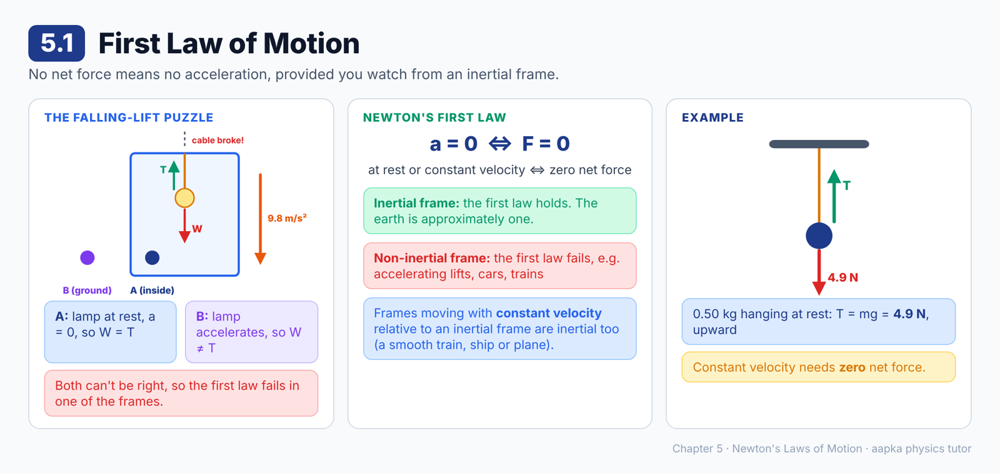
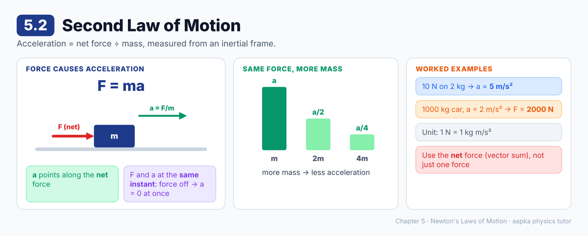
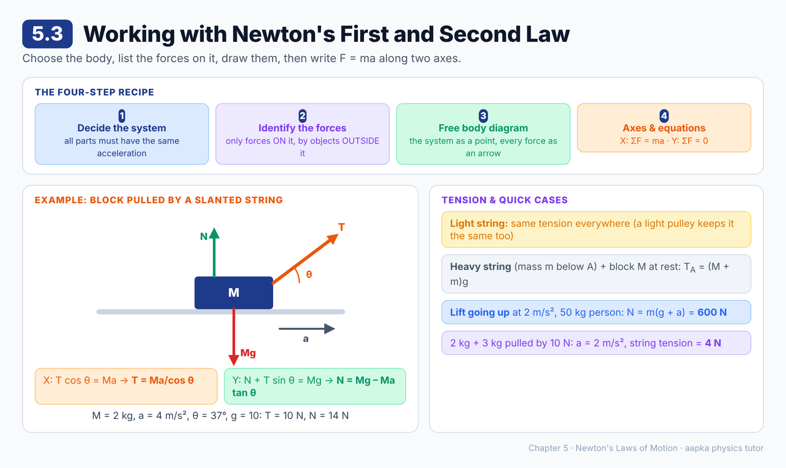
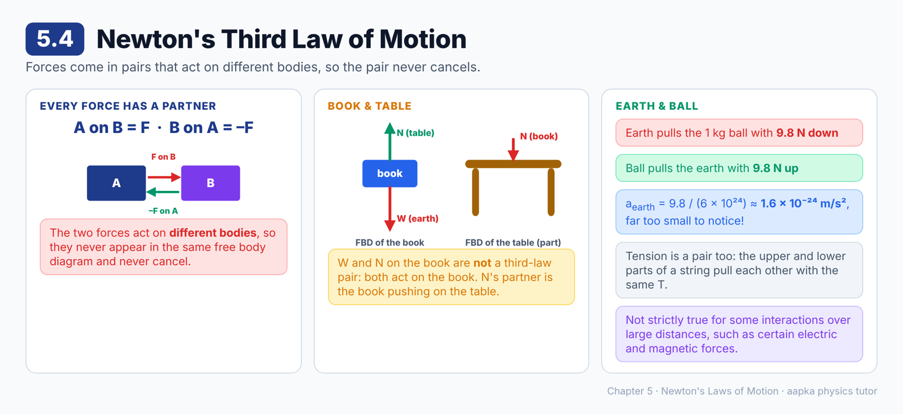
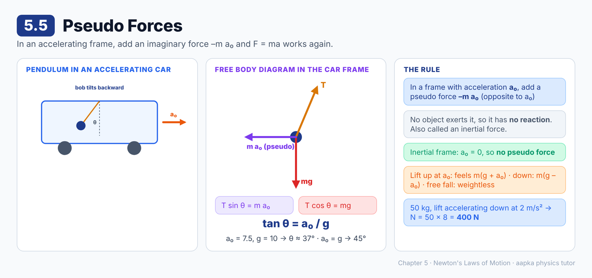
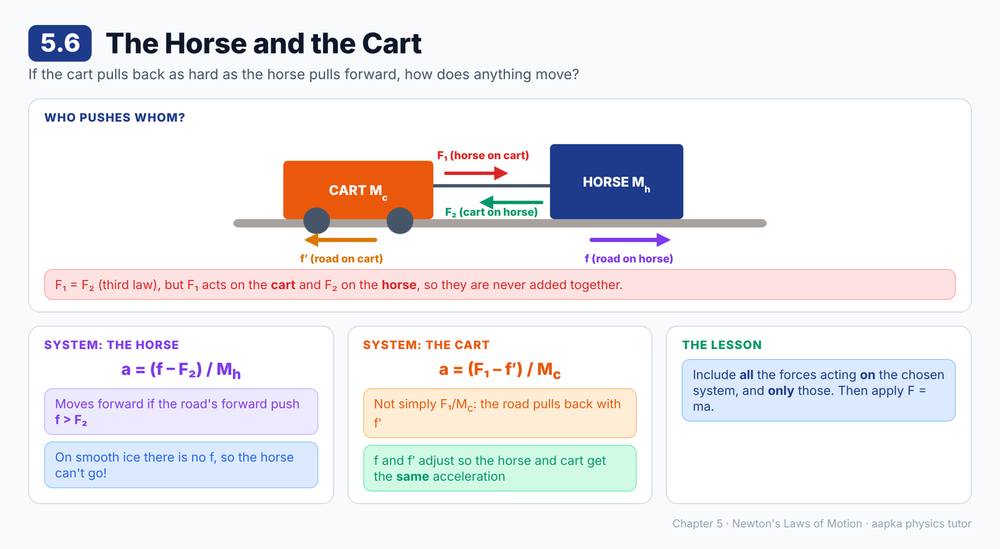
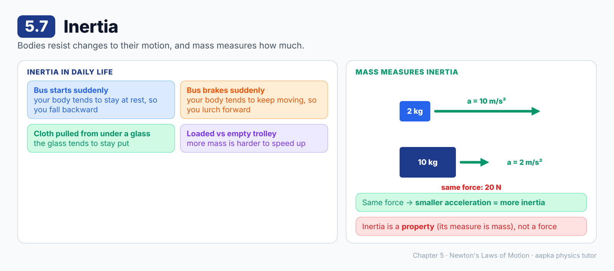

# Chapter 5 — Newton's Laws of Motion
### Learning Material + MCQ Practice Set (based on H.C. Verma, *Concepts of Physics* Vol. 1)

**How to use:** Each section opens with a **summary diagram**, then **📘 Learning Material** (key ideas, formulas, worked examples, common mistakes). Then come the **MCQs**, followed by an answer key with short explanations. Difficulty is marked: 🟢 Recall · 🟡 Understanding · 🔴 Application.

**Notation:** vectors are written in **bold** (**F**, **a**). Use g = 9.8 m/s² unless a question says g = 10 m/s². Strings and pulleys are light (massless) unless stated otherwise.

---

## 5.1 First Law of Motion

### 📘 Learning Material

**Big idea:** If the total force on a particle is zero, it does not accelerate, and if it does not accelerate, the total force on it is zero. But this is only true when you watch from the right kind of frame.

**Newton's first law**
If the (vector) sum of all the forces acting on a particle is zero then, and only then, the particle remains unaccelerated. That is, it stays at rest or moves with constant velocity.
**a = 0 if and only if F = 0**

**The falling-lift puzzle: which frame?**
A lift cabin falls freely after its cable breaks. A lamp hangs inside, with weight W pulling down and tension T pulling up.
- **Observer A, inside the cabin:** the lamp is at rest (a = 0), so A concludes W = T.
- **Observer B, on the ground:** the lamp accelerates at 9.8 m/s², so B concludes W ≠ T.

Both cannot be right, so the first law cannot hold in both frames.

**Inertial and non-inertial frames**
- **Inertial frame:** a frame in which the first law holds.
- **Non-inertial frame:** a frame in which it does not, such as an accelerating lift, car or train.

So the first law is really the **definition** of an inertial frame. It becomes a law when we say the **earth is (approximately) an inertial frame**. Very accurate measurements show the earth isn't perfectly inertial, but it is close enough for everyday work.

**Frames moving uniformly are inertial too:** if S is inertial and S′ moves with **constant velocity** relative to S, then the accelerations are the same in both, so S′ is also inertial. Examples: a train moving at constant velocity, a plane flying straight at steady speed, a ship sailing smoothly on a calm sea.

**🧮 Worked example:** a 0.50 kg particle hangs at rest from a string (g = 9.8 m/s²).
- Forces: the earth's pull of 0.50 × 9.8 = 4.9 N downward, and the string's pull T upward.
- At rest, so the forces sum to zero: **T = 4.9 N, upward**.

> ⚠️ **Common misconception:** "A moving body needs a force to keep moving." Constant velocity needs **zero** net force. A force is needed to **change** the velocity.

### ❓ MCQs

**Q1.** 🟢 According to Newton's first law, a particle stays unaccelerated if and only if:
- (A) A single constant force acts on it
- (B) The vector sum of all forces on it is zero
- (C) It is at rest
- (D) It moves in a circle

**Q2.** 🟡 A frame of reference in which Newton's first law holds is called:
- (A) A non-inertial frame
- (B) An accelerated frame
- (C) An inertial frame
- (D) A rotating frame

**Q3.** 🟡 Which of these is an inertial frame (to a good approximation)?
- (A) A car braking suddenly
- (B) A lift accelerating upward
- (C) A merry-go-round
- (D) A train moving with constant velocity on a straight track

**Q4.** 🔴 A particle of mass 0.50 kg hangs at rest from a string. Taking g = 9.8 m/s², the tension in the string is:
- (A) 4.9 N
- (B) 0.50 N
- (C) 9.8 N
- (D) 19.6 N

**Q5.** 🟡 A body moves with constant velocity in an inertial frame. The net force on it is:
- (A) In the direction of motion
- (B) Zero
- (C) Opposite to the direction of motion
- (D) Equal to its weight

**Q6.** 🟡 If S is an inertial frame and S′ moves with constant velocity relative to S, then S′ is:
- (A) Also an inertial frame
- (B) A non-inertial frame
- (C) Inertial only if it is at rest
- (D) Impossible to decide

### Answer Key — 5.1
| Q | Ans | Explanation |
|---|---|---|
| 1 | B | First law: a = 0 if and only if the total force is zero. |
| 2 | C | That is the definition of an inertial frame. |
| 3 | D | Uniform motion relative to the (inertial) ground keeps a frame inertial. The others accelerate. |
| 4 | A | At rest, so T = mg = 0.50 × 9.8 = 4.9 N. |
| 5 | B | No acceleration means zero net force. |
| 6 | A | A frame moving uniformly relative to an inertial frame measures the same accelerations, so it is also inertial. |

---

## 5.2 Second Law of Motion

### 📘 Learning Material

**Big idea:** Force causes acceleration. The bigger the force, the bigger the acceleration, and the bigger the mass, the smaller the acceleration.

**Newton's second law**
Measured from an **inertial frame**, a particle's acceleration equals the **vector sum of all forces** on it divided by its mass:
**a = F/m, or F = ma**

**Key points**
- **a** is in the **same direction** as the net force **F**.
- **F** and **a** are taken at the **same instant**. If the force stops, the acceleration becomes zero at that very instant (the velocity stays at whatever it had reached).
- **Unit:** 1 N = 1 kg × 1 m/s² = 1 kg m/s².
- The first law is a special case: if F = 0, then a = 0.

**🧮 Worked examples**
- A 10 N net force on a 2 kg body gives a = 10/2 = **5 m/s²**.
- To give a 1000 kg car an acceleration of 2 m/s², you need F = 1000 × 2 = **2000 N**.
- The same force on double the mass gives **half** the acceleration.

> ⚠️ **Common mistake:** Using just one force in F = ma. F is the **net** (vector sum) force from everything acting on the body.

### ❓ MCQs

**Q1.** 🟢 Newton's second law, written for an inertial frame, is:
- (A) F = mv
- (B) F = m/a
- (C) F = ma
- (D) F = a/m

**Q2.** 🔴 A net force of 10 N acts on a body of mass 2 kg. Its acceleration is:
- (A) 20 m/s²
- (B) 5 m/s²
- (C) 0.2 m/s²
- (D) 12 m/s²

**Q3.** 🟡 The direction of the acceleration of a particle is always the same as the direction of:
- (A) Its velocity
- (B) Its displacement
- (C) The largest single force on it
- (D) The net force on it

**Q4.** 🟡 The force acting on a moving particle suddenly becomes zero. At that instant, its acceleration:
- (A) Becomes zero
- (B) Stays the same for a while
- (C) Reverses direction
- (D) Becomes infinite

**Q5.** 🔴 What net force is needed to give a 1000 kg car an acceleration of 2 m/s²?
- (A) 500 N
- (B) 1002 N
- (C) 2000 N
- (D) 20 N

**Q6.** 🟡 The same net force acts on two bodies, one of which has twice the mass of the other. The heavier body's acceleration is:
- (A) Twice that of the lighter body
- (B) Half that of the lighter body
- (C) Equal to that of the lighter body
- (D) Four times that of the lighter body

### Answer Key — 5.2
| Q | Ans | Explanation |
|---|---|---|
| 1 | C | a = F/m, so F = ma. |
| 2 | B | a = 10/2 = 5 m/s². |
| 3 | D | a = **F**/m, so **a** points along the net force (not necessarily along the velocity). |
| 4 | A | F and a are related at the same instant, so no force means no acceleration. |
| 5 | C | F = 1000 × 2 = 2000 N. |
| 6 | B | a = F/m, so doubling m halves a. |

---

## 5.3 Working with Newton's First and Second Law

### 📘 Learning Material

**Big idea:** Solving force problems is a recipe. Choose the body, list the forces on it, draw them, then write F = ma along two axes.

**The four-step algorithm**
1. **Decide the system.** It can be a block, two blocks together, a piece of string, and so on. The only rule: **every part of the system must have the same acceleration** (magnitude and direction). Two blocks moving in different directions, or a disc sliding along a string, can't be one system.
2. **Identify the forces.** List only the forces exerted **on** the system **by objects outside it**. Forces the system exerts on others don't go in the list. Neither do forces between parts of the system.
3. **Draw a free body diagram (FBD).** Represent the system as a point and draw every force as an arrow from that point.
4. **Choose axes and write equations.**
   - Take X along the (likely) acceleration and Y perpendicular to it.
   - Along X: sum of force components = ma.
   - Along Y: sum of force components = 0.
   - Repeat with another system if you need more equations.

Accelerations of connected bodies are often linked by kinematics, so use the **same symbol a** for them.

**The boy with a load on his head**
| System | Forces on it |
|---|---|
| **Boy** | his weight W (earth, down), N from the floor (up), N₁ from the load (down) |
| **Load** | its weight W′ (earth, down), N₁ from the boy (up) |
Change the system and the list changes!

**🧮 Worked example: a block pulled by a slanted string on a smooth table**
Block mass M, string at angle θ above the horizontal, acceleration a. Forces: Mg down, N up, T along the string.
- X: T cos θ = Ma, so **T = Ma / cos θ**
- Y: N + T sin θ – Mg = 0, so **N = Mg – Ma tan θ**

With M = 2 kg, a = 4 m/s², θ = 37° (cos = 0.8, tan = 0.75) and g = 10 m/s²: **T = 10 N** and **N = 20 – 6 = 14 N**.

**Tension in a string**
- **Tension** at a point is the common magnitude of the pulls that the two parts of the string, on either side of that point, exert on each other.
- **Light (massless) string:** the tension is the **same everywhere** along it, as long as nothing massive is attached in between. A light pulley doesn't change it either.
- **Heavy string** (mass m below point A) holding a block M at rest: tension at the lower end = Mg, and tension at A = (M + m)g.
- If the same system **descends with acceleration a**: tension at A = (M + m)(g – a).

**🧮 Worked example: a person in a lift**
A 50 kg person stands in a lift accelerating **upward** at 2 m/s² (g = 10 m/s²).
N – mg = ma, so N = 50 × (10 + 2) = **600 N**. The person feels heavier.

**🧮 Worked example: two blocks**
Blocks of 2 kg and 3 kg on a smooth floor are tied by a light string. A 10 N force pulls the 3 kg block.
- Whole system: a = 10/5 = **2 m/s²**
- 2 kg block alone: T = 2 × 2 = **4 N**

> ⚠️ **Common mistakes:**
> - Listing forces before choosing the system.
> - Including a force the system exerts on something else, or a force between two parts of the system.

### ❓ MCQs

**Q1.** 🟢 The first step in applying Newton's laws to a problem is to:
- (A) Write F = ma
- (B) Choose the axes
- (C) Decide the system
- (D) Draw the pulleys

**Q2.** 🟡 When listing the forces for a free body diagram of a system, we include:
- (A) Only the forces exerted on the system by objects outside it
- (B) The forces the system exerts on other objects
- (C) The forces between different parts of the system
- (D) All the forces in the situation

**Q3.** 🟡 Two bodies can be treated together as one system for Newton's laws only if:
- (A) They have the same mass
- (B) They are touching each other
- (C) They are made of the same material
- (D) They have the same acceleration

**Q4.** 🔴 A 2 kg block on a smooth table is pulled by a string at 37° above the horizontal and accelerates at 4 m/s² (cos 37° = 0.8). The tension in the string is:
- (A) 8 N
- (B) 10 N
- (C) 6.4 N
- (D) 12 N

**Q5.** 🔴 For the same block (M = 2 kg, a = 4 m/s², θ = 37°, tan 37° = 0.75, g = 10 m/s²), the normal force from the table is:
- (A) 20 N
- (B) 26 N
- (C) 14 N
- (D) 6 N

**Q6.** 🟡 In a light (massless) string with no massive body attached in between, the tension:
- (A) Is the same at every point
- (B) Is greatest at the top
- (C) Is zero at the ends
- (D) Doubles at the middle

**Q7.** 🔴 A 50 kg person stands in a lift that accelerates upward at 2 m/s² (g = 10 m/s²). The normal force from the floor on the person is:
- (A) 400 N
- (B) 500 N
- (C) 100 N
- (D) 600 N

**Q8.** 🔴 Blocks of 2 kg and 3 kg lie on a smooth floor, tied by a light string. A force of 10 N pulls the 3 kg block horizontally. The tension in the string is:
- (A) 6 N
- (B) 4 N
- (C) 10 N
- (D) 2 N

**Q9.** 🔴 A block of mass M hangs at rest from a string, and the part of the string below a point A has mass m. The tension at A is:
- (A) Mg
- (B) mg
- (C) (M + m)g
- (D) (M – m)g

### Answer Key — 5.3
| Q | Ans | Explanation |
|---|---|---|
| 1 | C | You cannot list the forces until you know which body you are talking about. |
| 2 | A | Only external forces acting on the system go into its free body diagram. |
| 3 | D | Newton's laws treat the system as one particle, so all its parts must accelerate equally. |
| 4 | B | T cos θ = Ma, so T = 2 × 4 / 0.8 = 10 N. |
| 5 | C | N = Mg – Ma tan θ = 20 – 2 × 4 × 0.75 = 14 N. |
| 6 | A | A massless string carries the same tension throughout. |
| 7 | D | N – mg = ma, so N = m(g + a) = 50 × 12 = 600 N. |
| 8 | B | a = 10/5 = 2 m/s². For the 2 kg block, T = 2 × 2 = 4 N. |
| 9 | C | Take the block plus the string below A as the system: T = (M + m)g. |

---

## 5.4 Newton's Third Law of Motion

### 📘 Learning Material

**Big idea:** Forces come in pairs. The two forces of a pair act on **different** bodies, so they never appear together in the same free body diagram.

**Newton's third law:** if body A exerts a force **F** on body B, then B exerts a force **–F** on A. The two are equal in magnitude and opposite in direction.

**Why the pair never cancels**
- The table pushes the block up with N. This goes in the block's FBD.
- The block pushes the table down with N. This goes in the table's FBD.
- Only **one** force of the pair appears in any one system's equations.

**The earth and a falling particle**
- The earth pulls a particle of mass M with force Mg, downward.
- The particle pulls the earth with force Mg, upward.
- They don't cancel. The particle accelerates at g, and the earth also accelerates, but its huge mass makes that acceleration unbelievably small.

**Tension is a third-law pair too:** at any cross-section of a string, the lower part pulls the upper part down with T, and the upper part pulls the lower part up with the same T.

**🧮 Worked example: how much does the earth accelerate?**
A 1 kg ball falls. It pulls the earth with 9.8 N, so a_earth = 9.8 / (6 × 10²⁴) ≈ **1.6 × 10⁻²⁴ m/s²**. That's far too small to notice!

> 💡 The third law is not strictly correct for bodies interacting over large distances, for example through some electric and magnetic forces. For everyday contact and gravitational forces it works very well.

> ⚠️ **Common mistake:** Saying "weight and normal force are an action–reaction pair". Both act on the **same** book, so they are not a pair. The partner of the earth's pull on the book is the book's pull on the earth.

### ❓ MCQs

**Q1.** 🟢 The two forces of an action–reaction pair:
- (A) Act on the same body
- (B) Act on different bodies
- (C) Always cancel each other
- (D) Are always perpendicular

**Q2.** 🟡 A book rests on a table. Its weight (the earth's pull on it) and the normal force from the table are:
- (A) An action–reaction pair
- (B) Always unequal
- (C) Both acting on the book, so not a third-law pair
- (D) Both acting on the table

**Q3.** 🟡 The earth pulls a ball downward with a force of 10 N. The ball pulls the earth:
- (A) Upward with 10 N
- (B) Downward with 10 N
- (C) With zero force
- (D) Upward with a force much smaller than 10 N

**Q4.** 🔴 A 1 kg ball falls freely. The ball also accelerates the earth (mass 6 × 10²⁴ kg) towards itself. The magnitude of the earth's acceleration is about:
- (A) 9.8 m/s²
- (B) Zero, exactly
- (C) 1 m/s²
- (D) 1.6 × 10⁻²⁴ m/s²

**Q5.** 🟡 When we write the equation of motion for a single chosen system:
- (A) Both forces of every action–reaction pair must be included
- (B) At most one force of an action–reaction pair can appear
- (C) Third-law forces are never included
- (D) Only gravitational forces are included

**Q6.** 🟢 Newton's third law is **not** strictly correct for:
- (A) A book pressing on a table
- (B) A rope pulling a block
- (C) Some interactions between bodies separated by large distances, such as certain electric and magnetic forces
- (D) A person pushing a wall

### Answer Key — 5.4
| Q | Ans | Explanation |
|---|---|---|
| 1 | B | A on B and B on A act on two different bodies. |
| 2 | C | Both act on the book. Each has its own partner force acting on a different body. |
| 3 | A | Equal in size and opposite in direction: 10 N upward on the earth. |
| 4 | D | a = 9.8 / (6 × 10²⁴) ≈ 1.6 × 10⁻²⁴ m/s². |
| 5 | B | The other force of the pair acts on a different body, outside the system. |
| 6 | C | The book notes deviations for interactions at large distances, which we meet in electricity and magnetism. |

---

## 5.5 Pseudo Forces

### 📘 Learning Material

**Big idea:** In an accelerating frame, F = ma fails. To keep using it, add an imaginary force, **–m a₀**, to the list of forces.

**Where it comes from**
Frame S′ has acceleration **a₀** relative to an inertial frame S. For a particle of mass m:
- **a**_P,S = **a**_P,S′ + **a₀**, and m **a**_P,S = **F** (the real forces)
- So m **a**_P,S′ = **F** – m **a₀**

**The rule:** when working from a frame with acceleration **a₀**, add a **pseudo force –m a₀** (mass of the particle × the frame's acceleration, pointing **opposite** to it). Then use "total force = mass × acceleration" as usual.

- Pseudo forces are also called **inertial forces**.
- They are **not exerted by any object**, so they have no third-law partner.
- In an inertial frame, a₀ = 0, so there is no pseudo force.

**🧮 Worked example: a pendulum in an accelerating car**
The car accelerates forward at a₀. From the car frame, the bob is at rest under three forces: T along the string, mg down, and the pseudo force m a₀ **backward**.
- X: T sin θ = m a₀
- Y: T cos θ = mg
- Dividing: **tan θ = a₀ / g**. The string tilts **backward**.
- With a₀ = 7.5 m/s² and g = 10 m/s²: tan θ = 0.75, so **θ ≈ 37°**.
- With a₀ = g: θ = **45°**.

**🧮 Worked example: in a lift accelerating upward at a₀**
The pseudo force m a₀ acts downward, so you feel heavier. The apparent weight is m(g + a₀). Accelerating downward, you feel lighter: m(g – a₀). In free fall, a₀ = g, so you feel **weightless**.

> ⚠️ **Common mistake:** Adding a pseudo force when working from the ground frame. Pseudo forces belong **only** in accelerating (non-inertial) frames.

### ❓ MCQs

**Q1.** 🟢 A pseudo force has to be included when we apply Newton's second law in:
- (A) An inertial frame
- (B) A frame moving with constant velocity
- (C) A non-inertial (accelerating) frame
- (D) Any frame at all

**Q2.** 🟡 In a frame with acceleration **a₀**, the pseudo force on a particle of mass m is:
- (A) m **a₀**, in the direction of the frame's acceleration
- (B) –m **a₀**, opposite to the frame's acceleration
- (C) m **g**, downward
- (D) Zero

**Q3.** 🔴 A pendulum hangs in a car accelerating at a₀ on a level road. The angle θ the string makes with the vertical is given by:
- (A) tan θ = g / a₀
- (B) sin θ = a₀ / g
- (C) cos θ = a₀ / g
- (D) tan θ = a₀ / g

**Q4.** 🔴 A car accelerates at 7.5 m/s², with g = 10 m/s². A pendulum hanging from its roof makes an angle with the vertical of about:
- (A) 37°
- (B) 53°
- (C) 45°
- (D) 0°

**Q5.** 🟡 Pseudo forces differ from real forces because:
- (A) They are always larger
- (B) They are not exerted by any object, so they have no reaction force
- (C) They only act on light bodies
- (D) They act only vertically

**Q6.** 🔴 A 50 kg person stands in a lift accelerating downward at 2 m/s² (g = 10 m/s²). Working in the lift frame, the normal force from the floor is:
- (A) 600 N
- (B) 500 N
- (C) 400 N
- (D) 0

**Q7.** 🟡 In a car accelerating forward, a pendulum hanging from the roof tilts:
- (A) Forward
- (B) Backward
- (C) Sideways
- (D) It stays vertical

### Answer Key — 5.5
| Q | Ans | Explanation |
|---|---|---|
| 1 | C | Only in accelerating frames does F = ma need a correction term. |
| 2 | B | The pseudo force is –m**a₀**: the particle's mass times the frame's acceleration, reversed. |
| 3 | D | T sin θ = m a₀ and T cos θ = mg, so tan θ = a₀/g. |
| 4 | A | tan θ = 7.5/10 = 0.75, so θ ≈ 37°. |
| 5 | B | No object exerts a pseudo force. It is a correction for working in an accelerating frame. |
| 6 | C | The pseudo force is m a₀ upward, so N = m(g – a) = 50 × 8 = 400 N. |
| 7 | B | The pseudo force points backward, opposite to the car's acceleration, so the bob swings back. |

---

## 5.6 The Horse and the Cart

### 📘 Learning Material

**Big idea:** "The cart pulls the horse back just as hard as the horse pulls the cart forward, so how can anything move?" The answer: action and reaction act on **different** bodies, and we must include **all** the forces on the body we're studying.

**The puzzle:** the horse pulls the cart forward with F₁. By the third law, the cart pulls the horse backward with F₂ = F₁. These add to zero, so why does anything accelerate?

**The mistake:** F₁ acts on the **cart** and F₂ acts on the **horse**. They belong to different systems and must never be added together.

**System = the horse**
- The cart pulls it backward with F₂.
- The **road** pushes the horse's hooves with a force that has a **forward** component f (friction from the ground).
- The horse accelerates forward when **f > F₂**: a = (f – F₂) / M_h.
- Gravity on the horse has no forward component.

**System = the cart**
- The horse pulls it forward with F₁.
- The road exerts a **backward** component f′ on the wheels.
- So a = (F₁ – f′) / M_c, not simply F₁ / M_c.

**They move together:** f and f′ are self-adjusting, so (f – F₂)/M_h = (F₁ – f′)/M_c. The horse and the cart have the same acceleration.

**The lesson:** to find the motion of a system, include **only** the forces acting **on** that system, and include **all** of them. Then apply **F = ma**.

> 💡 Without a rough road (on ice, say) the horse cannot get the forward push f, and the whole thing goes nowhere, however hard it tries.

### ❓ MCQs

**Q1.** 🟡 The horse pulls the cart forward with force F₁ and the cart pulls the horse back with F₂ = F₁. They do not cancel because:
- (A) F₁ is always bigger than F₂
- (B) They act on different bodies
- (C) F₂ is a pseudo force
- (D) They act at different times

**Q2.** 🟡 The horse is able to accelerate forward because:
- (A) It pulls the cart harder than the cart pulls it
- (B) Gravity pushes it forward
- (C) The road pushes its hooves with a forward component f that is bigger than F₂
- (D) The cart pushes it forward

**Q3.** 🔴 F₁ is the horse's pull on the cart, f′ is the backward force of the road on the cart, and M_c is the cart's mass. The acceleration of the cart is:
- (A) F₁ / M_c
- (B) (F₁ + f′) / M_c
- (C) f′ / M_c
- (D) (F₁ – f′) / M_c

**Q4.** 🟡 If the horse stands on very smooth ice, it cannot get the cart moving because:
- (A) The road cannot give it the forward push it needs
- (B) Its weight becomes zero
- (C) Newton's third law fails on ice
- (D) The cart becomes heavier

**Q5.** 🟢 The main lesson of the horse-and-cart problem is that, to find the motion of a system, we should:
- (A) Add up every force in the situation
- (B) Ignore friction
- (C) Include all the forces acting on that system, and only those
- (D) Always treat the horse and the cart separately

### Answer Key — 5.6
| Q | Ans | Explanation |
|---|---|---|
| 1 | B | Third-law forces never act on the same body, so they cannot cancel. |
| 2 | C | The road's forward push on the hooves beats the cart's backward pull. |
| 3 | D | Net force on the cart = F₁ – f′, so a = (F₁ – f′)/M_c. |
| 4 | A | With no friction, there is no forward force on the horse. |
| 5 | C | Choose the system, then list every force on it and no others. |

---

## 5.7 Inertia

### 📘 Learning Material

**Big idea:** Bodies "resist" changes to their motion. This resistance is called **inertia**, and **mass** is its measure.

**Two ways to say it**
1. **Loosely:** a body does not change its state of rest, or of uniform motion in a straight line, unless a force makes it. This unwillingness to change is **inertia**.
2. **Precisely:** if the **same force** acts on two particles, the one that gets the **smaller acceleration** has more inertia. Since a = F/m, **larger mass means smaller acceleration, which means more inertia**.

**Everyday inertia**
| Situation | What inertia does |
|---|---|
| A bus starts suddenly | Your body tends to stay at rest, so you fall backward |
| A bus brakes suddenly | Your body tends to keep moving, so you lurch forward |
| A cloth is pulled quickly from under a glass | The glass tends to stay at rest |
| Pushing an empty vs a loaded trolley | The loaded one (more mass) is harder to speed up |

**🧮 Comparison:** the same 20 N force gives a 2 kg body 10 m/s², but a 10 kg body only 2 m/s². The 10 kg body has **5 times the inertia**.

> ⚠️ **Common misconception:** "Inertia is a force that keeps things moving." Inertia is a **property** of matter, measured by mass. It is not a force.

### ❓ MCQs

**Q1.** 🟢 Inertia is the property of a body by which it:
- (A) Resists any change in its state of rest or uniform motion
- (B) Always moves in a circle
- (C) Attracts other bodies
- (D) Gains speed by itself

**Q2.** 🟡 The measure of the inertia of a body is its:
- (A) Velocity
- (B) Weight
- (C) Mass
- (D) Volume

**Q3.** 🟡 When a bus suddenly brakes, standing passengers lurch forward because:
- (A) The bus pushes them forward
- (B) Their bodies tend to keep moving forward (inertia)
- (C) Gravity increases suddenly
- (D) A pseudo force from the road pushes them

**Q4.** 🔴 The same force acts on a 2 kg body and a 10 kg body. The ratio of the inertia of the 10 kg body to that of the 2 kg body is:
- (A) 1 : 5
- (B) 1 : 1
- (C) 25 : 1
- (D) 5 : 1

**Q5.** 🟡 Which statement about inertia is correct?
- (A) Inertia is a kind of force
- (B) Only moving bodies have inertia
- (C) A body with more mass gets less acceleration from the same force
- (D) Inertia exists only in non-inertial frames

### Answer Key — 5.7
| Q | Ans | Explanation |
|---|---|---|
| 1 | A | Inertia is the unwillingness to change the state of rest or uniform straight-line motion. |
| 2 | C | Larger mass means smaller acceleration for the same force, so mass measures inertia. |
| 3 | B | The bus slows down, but the passengers' bodies tend to continue at the old speed. |
| 4 | D | Inertia is measured by mass: 10 : 2 = 5 : 1. |
| 5 | C | a = F/m, so more mass means less acceleration. Inertia is a property, not a force. |

---

**Total: 44 questions** · 5.1 (6) · 5.2 (6) · 5.3 (9) · 5.4 (6) · 5.5 (7) · 5.6 (5) · 5.7 (5)
