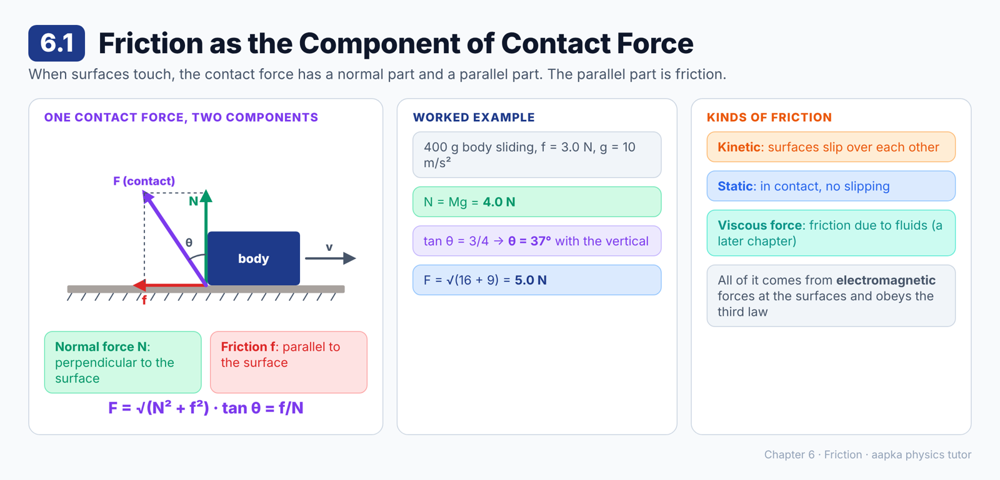
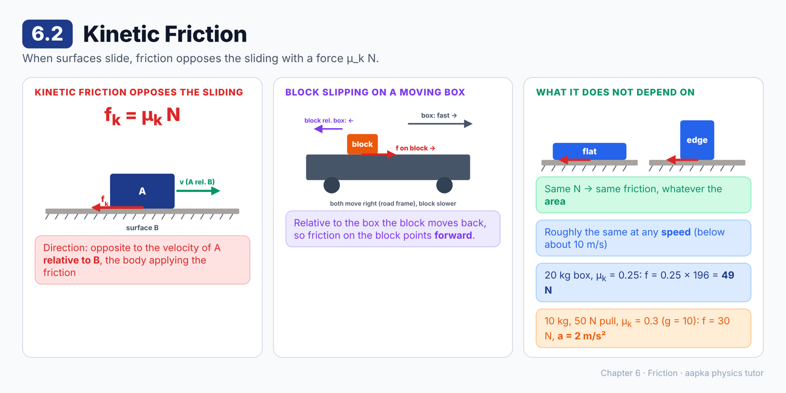
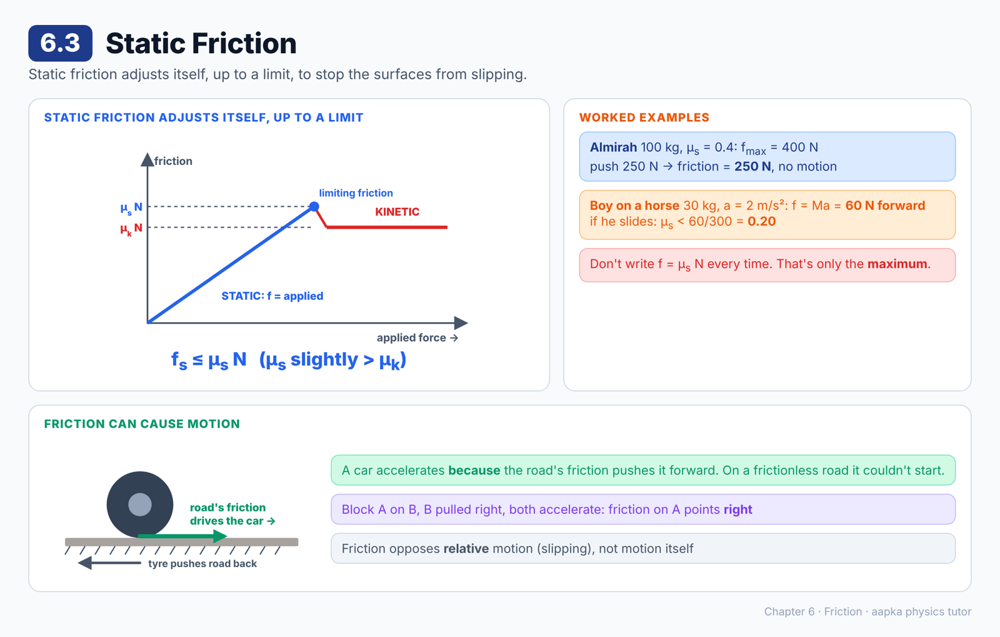
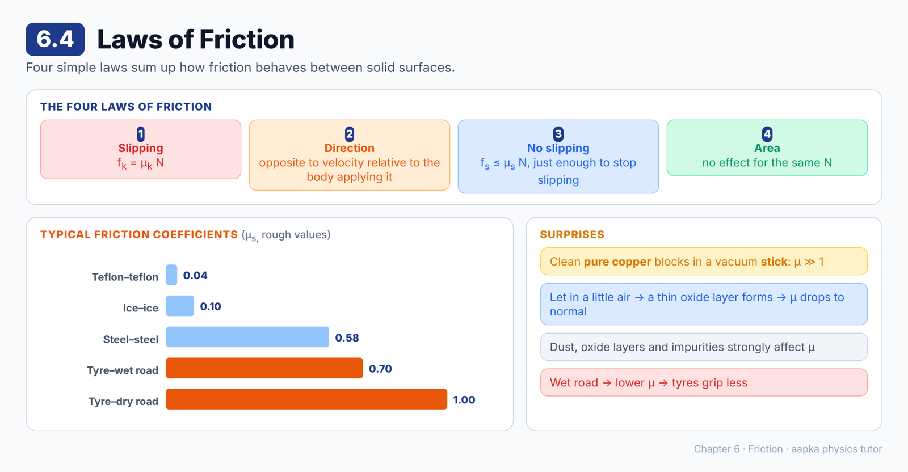
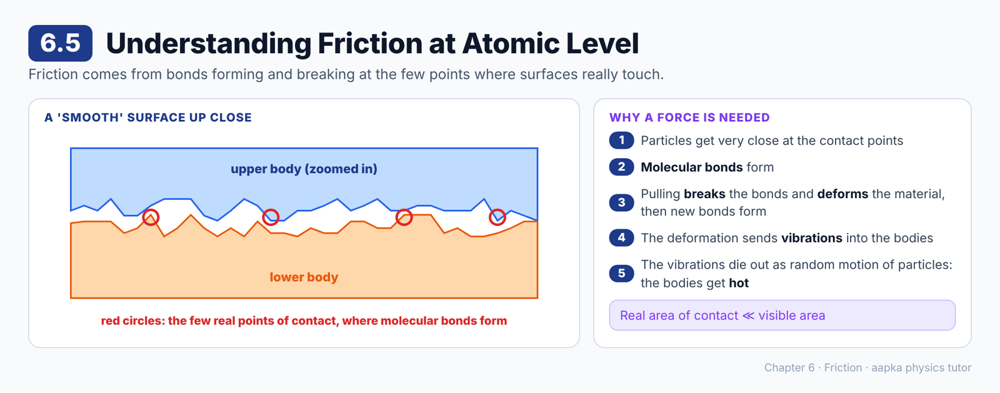
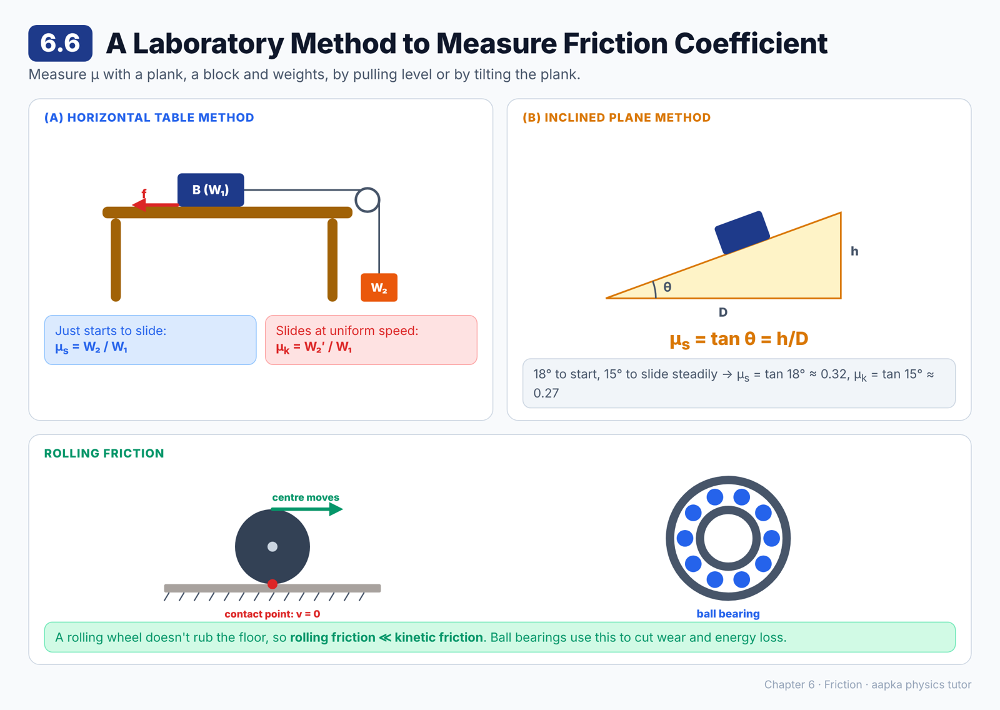

# Chapter 6 — Friction
### Learning Material + MCQ Practice Set (based on H.C. Verma, *Concepts of Physics* Vol. 1)

**How to use:** Each section opens with a **summary diagram**, then **📘 Learning Material** (key ideas, formulas, worked examples, common mistakes). Then come the **MCQs**, followed by an answer key with short explanations. Difficulty is marked: 🟢 Recall · 🟡 Understanding · 🔴 Application.

**Notation:** μ_k = coefficient of kinetic friction, μ_s = coefficient of static friction, N = normal force. Use g = 9.8 m/s² unless a question says g = 10 m/s².

---

## 6.1 Friction as the Component of Contact Force

### 📘 Learning Material

**Big idea:** When two surfaces touch, each pushes on the other with a single **contact force**. Its part perpendicular to the surface is the **normal force**, and its part along the surface is **friction**.

**Where contact forces come from:** electromagnetic forces between the charged particles at the two surfaces. The forces on the two bodies are equal and opposite, so they obey Newton's third law.

**Splitting the contact force F**
| Component | Name | Direction |
|---|---|---|
| Perpendicular to the surface | **Normal force N** | Along the common normal |
| Parallel to the surface | **Friction f** | Along the surface |

So F = √(N² + f²), and the angle θ of F with the normal satisfies tan θ = f/N.

**🧮 Worked example:** a 400 g body slides on a rough horizontal surface, and the friction on it is 3.0 N (g = 10 m/s²).
- N = Mg = 0.400 × 10 = **4.0 N**
- tan θ = f/N = 3/4, so **θ = 37°** with the vertical
- Contact force F = √(4² + 3²) = **5.0 N**

**Types of friction**
- **Kinetic friction:** the surfaces **slip** over each other.
- **Static friction:** the surfaces are in contact but **don't slip**.
- Friction can act between solids, between a solid and a fluid, or between fluids. Friction due to fluids is called **viscous force** and comes in a later chapter.

> 💡 There's no simple theory of friction from atoms. Instead, a few experimental **laws of friction** summarise what we observe.

### ❓ MCQs

**Q1.** 🟢 The component of the contact force parallel to the surfaces in contact is called:
- (A) The normal force
- (B) Friction
- (C) Tension
- (D) Weight

**Q2.** 🟡 Contact forces between two bodies arise from:
- (A) Gravitational forces
- (B) Nuclear forces
- (C) Electromagnetic forces between particles at the surfaces
- (D) Weak forces

**Q3.** 🔴 A 400 g body slides on a rough horizontal surface with a friction force of 3.0 N (g = 10 m/s²). The magnitude of the total contact force on it is:
- (A) 7.0 N
- (B) 1.0 N
- (C) 4.0 N
- (D) 5.0 N

**Q4.** 🔴 For the same body, the angle the contact force makes with the vertical is about:
- (A) 37°
- (B) 53°
- (C) 45°
- (D) 0°

**Q5.** 🟢 Friction between two bodies that are in contact but not slipping over each other is called:
- (A) Kinetic friction
- (B) Rolling friction
- (C) Viscous force
- (D) Static friction

**Q6.** 🟡 The frictional force exerted by a fluid on a body moving through it is called:
- (A) Static friction
- (B) Viscous force
- (C) Limiting friction
- (D) Normal force

### Answer Key — 6.1
| Q | Ans | Explanation |
|---|---|---|
| 1 | B | The part perpendicular to the surface is the normal force, and the part parallel to it is friction. |
| 2 | C | Charged particles at the two surfaces interact electromagnetically. |
| 3 | D | N = 4.0 N and f = 3.0 N, so F = √(16 + 9) = 5.0 N. |
| 4 | A | tan θ = f/N = 3/4, so θ ≈ 37°. |
| 5 | D | No slipping means static friction. |
| 6 | B | Fluid friction is called viscous force. |

---

## 6.2 Kinetic Friction

### 📘 Learning Material

**Big idea:** When surfaces slide over each other, friction opposes the **sliding** (the relative motion). Its size is μ_k times the normal force.

**(a) Direction**
The kinetic friction on body A sliding against body B is **opposite to the velocity of A relative to B**. The velocity that matters is relative to the body **applying** the friction.

**Example: a block slipping on a moving box**
A long box on wheels moves right along a road. A small block on it slips back and falls off the rear end. Seen from the road, both move right, but the block moves slower.
- Relative to the box, the block moves **left**.
- So the friction on the block is **to the right**, and the friction on the box is to the left.

**(b) Magnitude**
**f_k = μ_k N**
- μ_k = **coefficient of kinetic friction**. It depends on the two materials and how rough their surfaces are, and it has no units.
- It is **independent of the speed** (approximately, for speeds below about 10 m/s).
- It is **independent of the area of contact** for the same N. A slab slid flat or standing on its narrow face feels the same friction.

**🧮 Worked example:** a 20 kg box is pulled along a horizontal floor, with μ_k = 0.25.
- N = Mg, so f_k = 0.25 × 20 × 9.8 = **49 N**, opposite to the pull.

**🧮 Worked example:** a 10 kg block is pulled by a 50 N horizontal force, with μ_k = 0.3 and g = 10 m/s².
- f_k = 0.3 × 100 = 30 N, so the net force is 20 N and **a = 2 m/s²**.

> ⚠️ **Common mistake:** Taking friction opposite to the velocity measured from the ground. Use the velocity **relative to the surface** that exerts the friction.

### ❓ MCQs

**Q1.** 🟢 The magnitude of kinetic friction is given by:
- (A) f_k = μ_k / N
- (B) f_k = μ_k N
- (C) f_k = N / μ_k
- (D) f_k = μ_k + N

**Q2.** 🟡 The kinetic friction on a body A sliding on a body B acts:
- (A) Opposite to the velocity of A relative to B
- (B) Opposite to the velocity of A relative to the ground
- (C) Along the velocity of A
- (D) Always vertically

**Q3.** 🔴 A 20 kg box is pulled along a horizontal floor (μ_k = 0.25, g = 9.8 m/s²). The force of kinetic friction on it is:
- (A) 196 N
- (B) 5 N
- (C) 49 N
- (D) 80 N

**Q4.** 🟡 For the same normal force, if the area of contact between two sliding surfaces is doubled, the kinetic friction:
- (A) Doubles
- (B) Halves
- (C) Becomes four times
- (D) Stays the same

**Q5.** 🔴 A 10 kg block is pulled by a 50 N horizontal force on a floor with μ_k = 0.3 (g = 10 m/s²). Its acceleration is:
- (A) 2 m/s²
- (B) 5 m/s²
- (C) 3 m/s²
- (D) 8 m/s²

**Q6.** 🟡 A block slips backward on a moving truck and both move forward relative to the road, the block more slowly. The friction on the block from the truck acts:
- (A) Backward
- (B) Forward
- (C) Vertically upward
- (D) It is zero

**Q7.** 🟢 The coefficient of kinetic friction depends mainly on:
- (A) The speed of sliding
- (B) The area of contact
- (C) The nature (materials and roughness) of the two surfaces
- (D) The mass of the body

### Answer Key — 6.2
| Q | Ans | Explanation |
|---|---|---|
| 1 | B | Kinetic friction is proportional to the normal force: f_k = μ_k N. |
| 2 | A | It opposes the motion relative to the body that applies the friction. |
| 3 | C | f_k = 0.25 × 20 × 9.8 = 49 N. |
| 4 | D | Friction depends on N, not on the area of contact. |
| 5 | A | f = 0.3 × 100 = 30 N, net force = 20 N, so a = 20/10 = 2 m/s². |
| 6 | B | Relative to the truck the block moves backward, so friction on it points forward. |
| 7 | C | μ_k depends on the two materials and their roughness, not on speed (roughly), area or mass. |

---

## 6.3 Static Friction

### 📘 Learning Material

**Big idea:** Static friction is a "smart" force. It adjusts itself, up to a limit, to stop the surfaces from slipping.

**The heavy almirah:** labourers push a heavy almirah, but it doesn't budge. It's at rest, so the net force is zero, and the **floor's friction** must balance their push exactly.
- Push harder, and friction increases to match.
- Static friction is **self-adjusting** in both magnitude and direction.
- But it has a maximum. Beyond it, slipping starts.

**Limiting friction**
**f_max = μ_s N**
- μ_s = **coefficient of static friction**, usually a little **larger** than μ_k.
- In general, **f_s ≤ μ_s N**. The actual static friction is only as large as needed.
- f_max is independent of the area of contact for the same N.

**🧮 Worked example: an almirah**
Mass 100 kg, μ_s = 0.4, g = 10 m/s², so f_max = 0.4 × 1000 = 400 N.
- Push with 250 N: no slipping, and friction = **250 N** (not 400 N!).
- Push with more than 400 N: it starts to slide.

**🧮 Worked example: a boy on a horse**
A 30 kg boy rides a horse that speeds up at 2.0 m/s² (g = 10 m/s²).
- If he doesn't slide back, friction is the only horizontal force on him: f_s = Ma = **60 N**, forward.
- If he does slide back, then μ_s × 300 N < 60 N, so **μ_s < 0.20**.

**Direction of static friction**
- Use Newton's laws: friction must point whichever way keeps the body at rest **relative to the surface**.
- Or imagine the surfaces were frictionless, see which way the body would slip, and friction is opposite to that.
- Example: block A sits on block B, and B is pulled to the right. If the two accelerate together, the friction on A points to the **right**. Friction is what makes A move!

**Friction can cause motion:** a car or a person accelerates **because** the road's friction pushes them forward. On a frictionless road you couldn't start moving. Friction opposes **relative** motion between the surfaces, not motion in general.

> ⚠️ **Common mistakes:**
> - Writing f_s = μ_s N every time. That's only the **maximum**.
> - Thinking "friction always opposes motion". It opposes **slipping**.

### ❓ MCQs

**Q1.** 🟢 The maximum possible force of static friction (limiting friction) is:
- (A) μ_k N
- (B) μ_s / N
- (C) μ_s N
- (D) Always equal to the applied force

**Q2.** 🟡 A heavy almirah is pushed gently and does not move. The force of static friction on it is:
- (A) Equal to μ_s N
- (B) Zero
- (C) Larger than the push
- (D) Equal and opposite to the push

**Q3.** 🔴 A 100 kg almirah rests on a floor with μ_s = 0.4 (g = 10 m/s²). It is pushed horizontally with 250 N and does not move. The friction on it is:
- (A) 400 N
- (B) 250 N
- (C) 150 N
- (D) 1000 N

**Q4.** 🔴 A 30 kg boy sits on a horse that accelerates at 2.0 m/s², and he does not slide. The friction exerted by the horse on him is:
- (A) 60 N, forward
- (B) 60 N, backward
- (C) 300 N, forward
- (D) 15 N, forward

**Q5.** 🔴 If the same boy slides back during this acceleration (g = 10 m/s²), the coefficient of static friction must be:
- (A) More than 0.20
- (B) Exactly 0.20
- (C) Less than 0.20
- (D) More than 2.0

**Q6.** 🟡 Usually, the coefficient of static friction is:
- (A) Much smaller than μ_k
- (B) Slightly greater than μ_k
- (C) Exactly equal to μ_k
- (D) Always zero

**Q7.** 🟡 A car accelerates forward on a road. The friction force of the road on its driven wheels acts:
- (A) Backward, opposing the motion
- (B) Vertically
- (C) It is zero
- (D) Forward, driving the car

**Q8.** 🟡 Block A rests on block B. B is pulled to the right and both accelerate together. The friction on A due to B acts:
- (A) To the left
- (B) To the right
- (C) Downward
- (D) It is zero

### Answer Key — 6.3
| Q | Ans | Explanation |
|---|---|---|
| 1 | C | Limiting friction f_max = μ_s N. |
| 2 | D | At rest, so the net force is zero. Friction exactly balances the push. |
| 3 | B | 250 N is less than f_max = 400 N, so friction just balances the push at 250 N. |
| 4 | A | Friction is the only horizontal force: f = Ma = 30 × 2 = 60 N along the acceleration. |
| 5 | C | It slips because μ_s × 300 N is less than the 60 N needed, so μ_s < 0.20. |
| 6 | B | Starting a slide is usually a bit harder than keeping it going. |
| 7 | D | The tyres push the road back, so the road pushes the car forward. That is what accelerates it. |
| 8 | B | A accelerates to the right, and friction is the only horizontal force on it. |

---

## 6.4 Laws of Friction

### 📘 Learning Material

**Big idea:** Four simple laws sum up how friction behaves between two solid bodies.

**The four laws**
1. **Slipping:** f_k = μ_k N, where μ_k is the coefficient of kinetic friction.
2. **Direction of kinetic friction:** opposite to the velocity of the body **relative to the body applying the friction**.
3. **No slipping:** f_s ≤ μ_s N. The direction and size of static friction are whatever is needed to prevent slipping.
4. **Area doesn't matter:** f_k and f_s do not depend on the area of contact, as long as N is the same.

**Some typical values of μ_s**
| Surfaces | μ_s (roughly) |
|---|---|
| Teflon on teflon | 0.04 (very slippery) |
| Ice on ice | 0.10 |
| Steel on steel | 0.58 |
| Rubber tyre on **wet** concrete | 0.7 |
| Rubber tyre on **dry** concrete | 1.0 |

These are rough estimates. The real value depends on smoothness, dust, oxide layers and other conditions.

**A surprise: clean copper**
Take two blocks of pure copper. Clean off all oxide and dust, heat out the dissolved gases, and press them together in a vacuum. They **stick**, and μ becomes **much larger than 1**. Let in a little air, a thin oxide layer forms, and μ drops back to normal values.

> 💡 This is why tyres grip less on a wet road: the water layer reduces μ_s.

> ⚠️ **Common misconception:** "A wider object has more friction." For the same weight (same N), the area of contact makes no difference.

### ❓ MCQs

**Q1.** 🟢 According to the laws of friction, for a given normal force the frictional force:
- (A) Increases with the area of contact
- (B) Decreases with the area of contact
- (C) Does not depend on the area of contact
- (D) Depends only on the speed

**Q2.** 🟡 When there is no slipping, the force of static friction:
- (A) Is always equal to μ_s N
- (B) Is less than or equal to μ_s N
- (C) Is always greater than μ_s N
- (D) Is always zero

**Q3.** 🟢 Which pair of surfaces has the **smallest** coefficient of static friction?
- (A) Teflon on teflon
- (B) Steel on steel
- (C) Rubber tyre on dry concrete
- (D) Rubber tyre on wet concrete

**Q4.** 🟡 A rubber tyre grips a dry concrete road better than a wet one because:
- (A) The normal force is larger on a dry road
- (B) The area of contact is larger on a dry road
- (C) Wet roads have no friction at all
- (D) The coefficient of friction is larger for the dry road

**Q5.** 🟡 Two very clean blocks of pure copper pressed together in a vacuum:
- (A) Have almost zero friction
- (B) Stick, with a friction coefficient much larger than 1
- (C) Repel each other
- (D) Behave exactly as they would in air

### Answer Key — 6.4
| Q | Ans | Explanation |
|---|---|---|
| 1 | C | The fourth law: friction is independent of the area of contact for the same N. |
| 2 | B | Static friction takes only the value needed, up to the maximum μ_s N. |
| 3 | A | Teflon on teflon (about 0.04) is extremely slippery. |
| 4 | D | Typical values: about 1.0 on dry concrete and about 0.7 on wet. |
| 5 | B | Without oxide and dust layers, the surfaces bond strongly. |

---

## 6.5 Understanding Friction at Atomic Level

### 📘 Learning Material

**Big idea:** Even a "smooth" surface is a mountain range at the atomic scale. Friction comes from bonds forming and breaking at the few tiny points where the surfaces actually touch.

**Surfaces are rough up close:** a polished steel plate looks flat to the eye, but under a powerful microscope its surface is very irregular.

**The real area of contact is tiny**
When one body rests on another, they only truly touch at the tips of these bumps. The **real area of contact** is much smaller than the visible area.

**What happens at the contact points**
1. The particles of the two surfaces come very close, so **molecular forces** act across them.
2. **Molecular bonds** form at these contact points.
3. When one body is pulled, the bonds **break**, the material under them **deforms**, and new bonds form.
4. The deformation sends **vibrations** into the bodies.
5. The vibrations die out and their energy becomes **random motion of the particles**, so the bodies **heat up**.

So a force is needed to **start** the motion (to break the bonds) and to **keep it going** (bonds keep forming and breaking).

> 💡 This is why rubbing your hands together warms them up.

### ❓ MCQs

**Q1.** 🟢 Seen under a powerful microscope, a polished steel surface appears:
- (A) Perfectly flat
- (B) Very irregular
- (C) Completely smooth
- (D) Transparent

**Q2.** 🟡 When one body is kept on another, the real area of contact is:
- (A) Much smaller than the visible area of contact
- (B) Exactly equal to the visible area
- (C) Much larger than the visible area
- (D) Zero

**Q3.** 🟡 At the actual points of contact between two surfaces:
- (A) No forces act
- (B) Only gravitational forces act
- (C) Molecular bonds form between the particles of the two surfaces
- (D) Nuclear forces act

**Q4.** 🟡 Bodies get heated when they are rubbed against each other because:
- (A) Friction creates new atoms
- (B) The air between them burns
- (C) Gravity increases at the surface
- (D) Vibrations from breaking bonds and deformation end up as random motion of particles

**Q5.** 🟢 Friction is fundamentally:
- (A) A gravitational effect
- (B) An electromagnetic effect between particles at the surfaces
- (C) A nuclear effect
- (D) A purely mechanical effect with no atomic cause

### Answer Key — 6.5
| Q | Ans | Explanation |
|---|---|---|
| 1 | B | Polished surfaces are very irregular at the atomic scale. |
| 2 | A | The surfaces touch only at the tips of the bumps. |
| 3 | C | The particles get close enough to bond. |
| 4 | D | The vibration energy spreads out as random motion of the particles, which we feel as heat. |
| 5 | B | The bonds at the contact points are electromagnetic. |

---

## 6.6 A Laboratory Method to Measure Friction Coefficient

### 📘 Learning Material

**Big idea:** We can measure μ_s and μ_k in the lab with a plank, a block and some weights, either on a level table with a pulley or by tilting the plank.

**(a) Horizontal table method**
A block B (weight W₁) on a level plank is tied by a string over a pulley to a hanger H.
- **Static:** add weights to the hanger until the block **just starts** to slide, with total hanging weight W₂. Then f_max = W₂ and N = W₁, so **μ_s = W₂ / W₁**.
- **Kinetic:** reduce the weight slightly and give the block a gentle push. Adjust until the block keeps moving at **uniform speed**, with hanging weight W₂′. Then **μ_k = W₂′ / W₁**.
- Putting extra weights on the block shows that f/N stays the same. Turning the block onto a different face shows that friction doesn't depend on area.

**(b) Inclined plane method (no pulley)**
Tilt the plank slowly until the block **just begins** to slide, at angle θ.
- Along the incline: f_s = mg sin θ. Perpendicular to it: N = mg cos θ.
- So **μ_s = tan θ = h/D**, where h is the height and D the horizontal length of the plank.
- For μ_k, lower the angle slightly and push the block gently until it slides at uniform speed. Then **μ_k = tan θ′ = h′/D′**.
- **Angle of repose:** the largest angle at which a block can rest without slipping, tan θ = μ_s.

**🧮 Worked example:** a block starts slipping at 18°, and once moving it slides uniformly at 15°.
**μ_s = tan 18° ≈ 0.32** and **μ_k = tan 15° ≈ 0.27**.

**🧮 Worked example:** with μ_s = 0.3, the steepest incline on which a block stays put is θ = tan⁻¹(0.3) ≈ **17°**.

**Rolling friction**
- A heavy iron box is hard to drag, but easy to move on wheels.
- A rolling wheel's **point of contact has zero velocity** relative to the floor, so the surfaces don't rub.
- **Rolling friction is much smaller** than kinetic friction.
- **Ball bearings** put small steel balls between moving machine parts. The balls roll instead of rubbing, which cuts wear and energy loss.

> ⚠️ **Common mistake:** Using sin θ or cos θ instead of tan θ. On an incline, μ = tan θ, because the mg cancels.

### ❓ MCQs

**Q1.** 🟢 In the horizontal table method, the block (weight W₁) just starts sliding when the hanging weight is W₂. The coefficient of static friction is:
- (A) W₁ / W₂
- (B) W₂ / W₁
- (C) W₁ × W₂
- (D) W₁ – W₂

**Q2.** 🟡 On an incline, a block just begins to slip at angle θ. The coefficient of static friction is:
- (A) sin θ
- (B) cos θ
- (C) tan θ
- (D) 1/tan θ

**Q3.** 🔴 A block starts slipping on a plank inclined at 18°, and once moving it slides uniformly at 15°. The coefficient of kinetic friction is:
- (A) tan 18°
- (B) sin 15°
- (C) tan 3°
- (D) tan 15°

**Q4.** 🔴 The coefficient of static friction between a block and an incline is 0.3. The maximum angle of incline at which the block stays at rest is about:
- (A) 17°
- (B) 30°
- (C) 45°
- (D) 0.3°

**Q5.** 🟡 Rolling friction is small because:
- (A) Wheels are always very light
- (B) The point of contact of the rolling wheel does not slip on the floor
- (C) The normal force becomes zero
- (D) Rolling surfaces are always perfectly smooth

**Q6.** 🟢 Ball bearings are used in machines to:
- (A) Increase friction
- (B) Increase the normal force
- (C) Replace sliding (kinetic) friction with much smaller rolling friction
- (D) Make the parts heavier

**Q7.** 🟡 To measure μ_k by the horizontal table method, the hanging weight is adjusted until the block:
- (A) Just starts to move
- (B) Accelerates quickly
- (C) Stays at rest
- (D) Keeps moving at uniform speed after a gentle push

### Answer Key — 6.6
| Q | Ans | Explanation |
|---|---|---|
| 1 | B | f_max = W₂ and N = W₁, so μ_s = W₂/W₁. |
| 2 | C | mg sin θ = μ_s mg cos θ, so μ_s = tan θ. |
| 3 | D | Uniform sliding at 15° means μ_k = tan 15° ≈ 0.27. |
| 4 | A | θ = tan⁻¹(0.3) ≈ 16.7°, about 17°. |
| 5 | B | The point of contact is momentarily at rest relative to the floor, so there is no rubbing. |
| 6 | C | The balls roll between the parts, so there is much less friction and wear. |
| 7 | D | At uniform speed the tension (the hanging weight) equals the kinetic friction. |

---

**Total: 38 questions** · 6.1 (6) · 6.2 (7) · 6.3 (8) · 6.4 (5) · 6.5 (5) · 6.6 (7)
