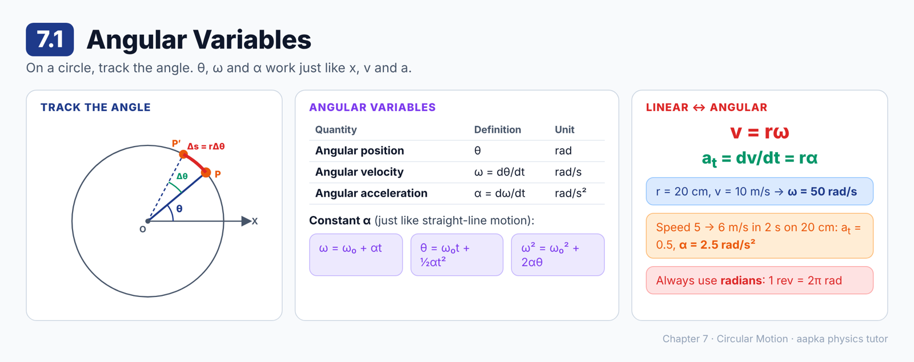
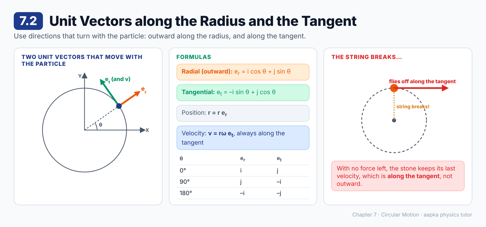
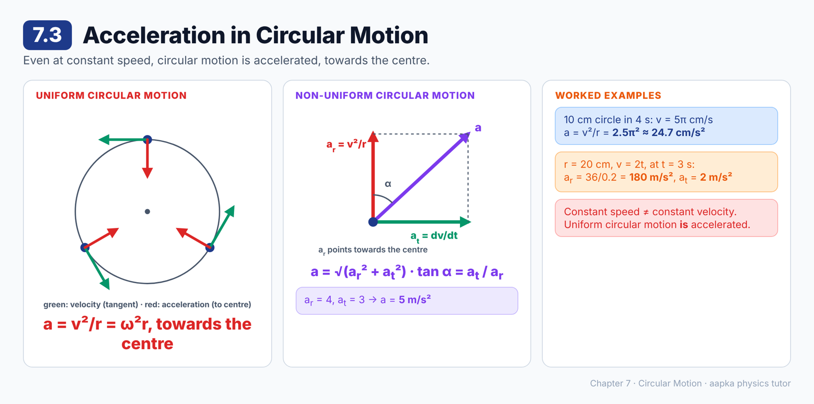
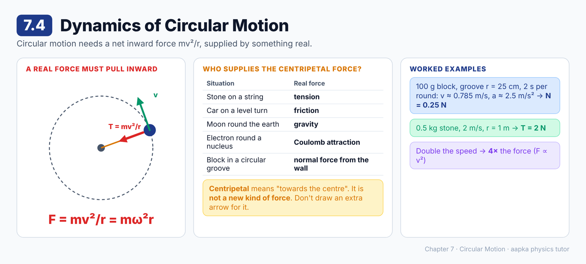
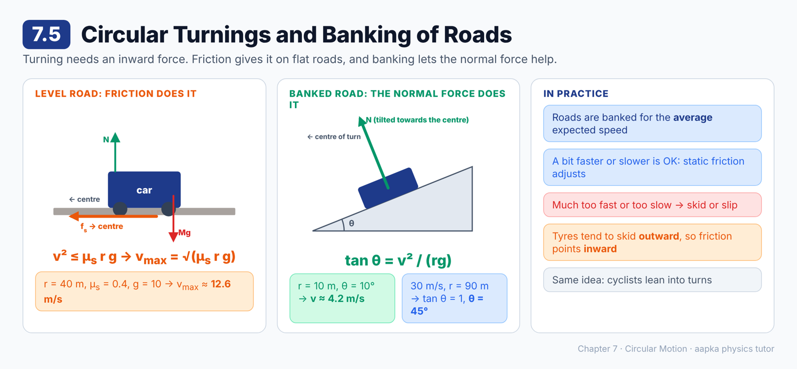
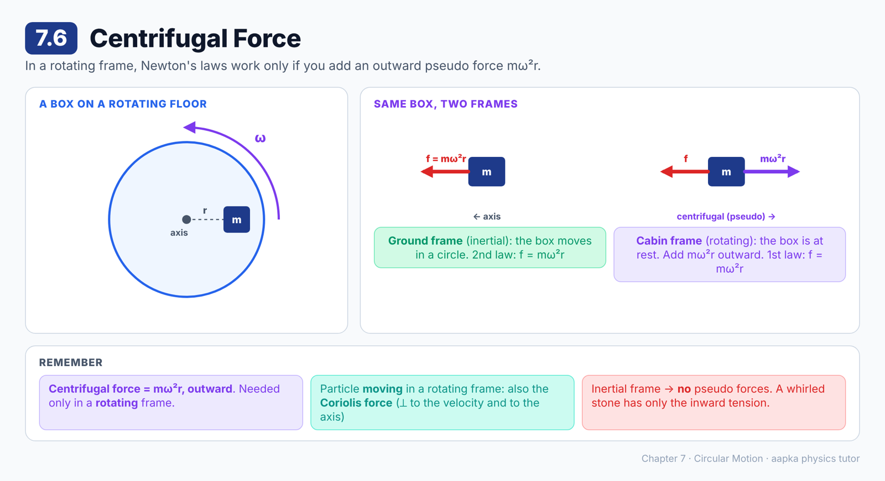
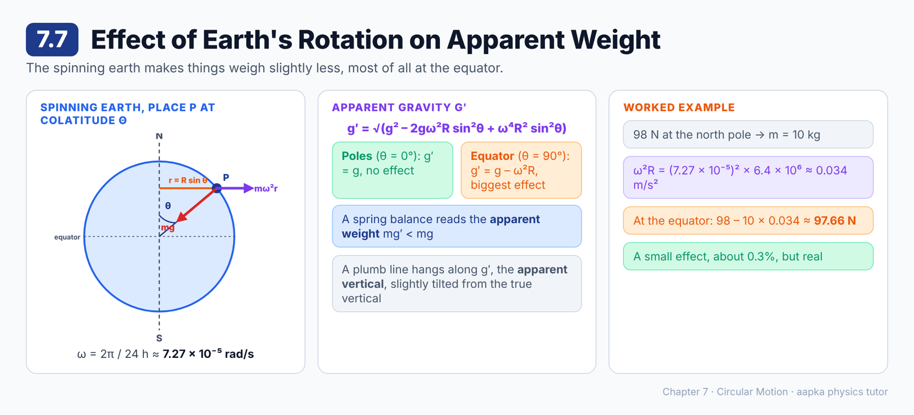

# Chapter 7 — Circular Motion
### Learning Material + MCQ Practice Set (based on H.C. Verma, *Concepts of Physics* Vol. 1)

**How to use:** Each section opens with a **summary diagram**, then **📘 Learning Material** (key ideas, formulas, worked examples, common mistakes). Then come the **MCQs**, followed by an answer key with short explanations. Difficulty is marked: 🟢 Recall · 🟡 Understanding · 🔴 Application.

**Notation:** vectors are written in **bold**. θ = angular position, ω = angular velocity, α = angular acceleration, r = radius, v = linear speed. Use g = 9.8 m/s² unless a question says g = 10 m/s².

---

## 7.1 Angular Variables

### 📘 Learning Material

**Big idea:** For motion on a circle, it's easiest to track the **angle**. Angular position, angular velocity and angular acceleration work just like position, velocity and acceleration on a straight line.

**The three angular variables**
| Quantity | Definition | Unit |
|---|---|---|
| Angular position θ | Angle of OP with the X-axis | rad |
| Angular velocity ω | **ω = dθ/dt** | rad/s |
| Angular acceleration α | **α = dω/dt = d²θ/dt²** | rad/s² |

**Constant angular acceleration:** these match the straight-line equations exactly.
- **ω = ω₀ + αt**
- **θ = ω₀t + ½αt²**
- **ω² = ω₀² + 2αθ**

**Linking angular and linear quantities**
- Arc length: Δs = r Δθ, so **v = rω**.
- Rate of change of speed: **a_t = dv/dt = rα**. This is the **tangential acceleration**.

Note that a_t is the rate of change of **speed**, not of velocity, so it is **not** the full acceleration.

**🧮 Worked example:** a particle moves on a circle of radius 20 cm at 10 m/s.
ω = v/r = 10 / 0.20 = **50 rad/s**.

**🧮 Worked example:** on the same 20 cm circle, the speed rises uniformly from 5.0 to 6.0 m/s in 2.0 s.
a_t = 1.0 / 2.0 = 0.5 m/s², so α = a_t / r = 0.5 / 0.20 = **2.5 rad/s²**.

**🧮 Worked example:** a wheel starts from rest with α = 2 rad/s².
After 3 s: ω = 2 × 3 = **6 rad/s**, and θ = ½ × 2 × 9 = **9 rad**.

> ⚠️ **Common mistake:** Using degrees in v = rω. The angle must be in **radians**. One revolution is 2π rad.

### ❓ MCQs

**Q1.** 🟢 Angular velocity is defined as:
- (A) dθ/dt
- (B) dv/dt
- (C) d²θ/dt²
- (D) r/v

**Q2.** 🔴 A particle moves on a circle of radius 20 cm with a linear speed of 10 m/s. Its angular velocity is:
- (A) 2 rad/s
- (B) 0.5 rad/s
- (C) 50 rad/s
- (D) 200 rad/s

**Q3.** 🟡 The relation between linear speed v and angular velocity ω on a circle of radius r is:
- (A) v = ω/r
- (B) v = r/ω
- (C) v = ω²r
- (D) v = rω

**Q4.** 🔴 On a circle of radius 20 cm, a particle's speed increases uniformly from 5.0 m/s to 6.0 m/s in 2.0 s. Its angular acceleration is:
- (A) 2.5 rad/s²
- (B) 0.5 rad/s²
- (C) 5.0 rad/s²
- (D) 0.1 rad/s²

**Q5.** 🔴 A wheel starts from rest with a constant angular acceleration of 2 rad/s². The angle it turns through in the first 3 s is:
- (A) 6 rad
- (B) 9 rad
- (C) 18 rad
- (D) 3 rad

**Q6.** 🟡 The tangential acceleration a_t = dv/dt of a particle moving in a circle is the rate of change of its:
- (A) Velocity
- (B) Angular position
- (C) Speed
- (D) Radius

### Answer Key — 7.1
| Q | Ans | Explanation |
|---|---|---|
| 1 | A | ω is the rate of change of angular position. |
| 2 | C | ω = v/r = 10/0.20 = 50 rad/s. |
| 3 | D | Arc Δs = rΔθ, so dividing by Δt gives v = rω. |
| 4 | A | a_t = 0.5 m/s², and α = a_t/r = 0.5/0.2 = 2.5 rad/s². |
| 5 | B | θ = ½αt² = ½ × 2 × 9 = 9 rad. |
| 6 | C | a_t is the rate of change of speed. It is not the full acceleration. |

---

## 7.2 Unit Vectors along the Radius and the Tangent

### 📘 Learning Material

**Big idea:** Instead of fixed X and Y directions, use two directions that move with the particle: **outward along the radius** and **along the tangent**.

**The two unit vectors at point P (angular position θ)**
- **Radial unit vector** (outward): **e_r = i cos θ + j sin θ**
- **Tangential unit vector** (direction of increasing θ): **e_t = –i sin θ + j cos θ**

They are perpendicular to each other, and both turn as the particle moves round.

**Position and velocity**
- Position: **r** = r **e_r** = r(i cos θ + j sin θ)
- Differentiating: **v** = rω(–i sin θ + j cos θ) = **rω e_t**

So the velocity is **always along the tangent**, and its magnitude is v = rω.

**Quick checks**
| θ | e_r | e_t |
|---|---|---|
| 0° | **i** | **j** |
| 90° | **j** | –**i** |
| 180° | –**i** | –**j** |

> 💡 Since the velocity is always tangent to the circle, a stone whirled on a string flies off **along the tangent** when the string breaks, not straight outward.

### ❓ MCQs

**Q1.** 🟢 The velocity of a particle moving in a circle is always directed:
- (A) Towards the centre
- (B) Away from the centre
- (C) Along the tangent to the circle
- (D) Along the X-axis

**Q2.** 🟡 The radial unit vector at angular position θ is:
- (A) i cos θ + j sin θ
- (B) –i sin θ + j cos θ
- (C) i sin θ + j cos θ
- (D) i + j

**Q3.** 🟡 At θ = 0°, the tangential unit vector e_t (direction of increasing θ) equals:
- (A) **i**
- (B) **j**
- (C) –**i**
- (D) –**j**

**Q4.** 🟡 The angle between e_r and e_t at any point on the circle is:
- (A) 0°
- (B) 45°
- (C) 180°
- (D) 90°

**Q5.** 🟡 A stone is whirled in a horizontal circle on a string, and the string suddenly breaks. The stone flies off:
- (A) Along the tangent at the point where it was released
- (B) Radially outward
- (C) Towards the centre
- (D) Along a spiral

### Answer Key — 7.2
| Q | Ans | Explanation |
|---|---|---|
| 1 | C | **v** = rω **e_t**, which is always along the tangent. |
| 2 | A | e_r points from the centre towards the particle: (cos θ, sin θ). |
| 3 | B | e_t = –i sin 0° + j cos 0° = **j**. |
| 4 | D | (cos θ)(–sin θ) + (sin θ)(cos θ) = 0, so they are perpendicular. |
| 5 | A | With no force left, it keeps moving with its last velocity, which was along the tangent. |

---

## 7.3 Acceleration in Circular Motion

### 📘 Learning Material

**Big idea:** Even at constant speed, a particle moving in a circle accelerates, because its direction keeps changing. This acceleration points **towards the centre**.

**The general result**
Differentiating **v** = rω **e_t** gives
**a = –ω²r e_r + (dv/dt) e_t**
- **Radial part:** ω²r = v²/r, directed towards the centre
- **Tangential part:** dv/dt, along the direction of motion

**Uniform circular motion** (constant speed, dv/dt = 0)
- **a = v²/r = ω²r, towards the centre**
- This is called **centripetal acceleration**.
- The speed is constant, but the direction changes, so the velocity changes.

**🧮 Worked example:** a particle goes round a 10 cm circle once every 4 s at uniform speed.
v = 2π × 10 / 4 = 5π cm/s, so a = v²/r = 25π² / 10 = **2.5π² ≈ 24.7 cm/s²**, towards the centre.

**Non-uniform circular motion** (the speed changes)
- a_r = v²/r (towards the centre) and a_t = dv/dt (along the tangent)
- **Total: a = √(a_r² + a_t²)**
- Its angle α with the radius satisfies **tan α = a_t / a_r**.

**🧮 Worked example:** r = 20 cm and v = 2t (m/s). At t = 3 s:
- v = 6 m/s, so a_r = 36 / 0.2 = **180 m/s²**
- a_t = d(2t)/dt = **2 m/s²**

> ⚠️ **Common misconception:** "Uniform circular motion has no acceleration." The speed is uniform, but the velocity is not.

### ❓ MCQs

**Q1.** 🟢 For uniform circular motion, the acceleration of the particle is:
- (A) Zero
- (B) Along the tangent
- (C) v²/r, towards the centre
- (D) v²/r, away from the centre

**Q2.** 🟡 Another way of writing the centripetal acceleration is:
- (A) ωr²
- (B) ω/r
- (C) ω²/r
- (D) ω²r

**Q3.** 🔴 A particle moves uniformly round a circle of radius 10 cm, completing it in 4 s. The magnitude of its acceleration is:
- (A) 2.5π² cm/s²
- (B) 5π cm/s²
- (C) 2.5π cm/s²
- (D) 0

**Q4.** 🔴 A particle moves on a circle of radius 20 cm with speed v = 2t (m/s). Its radial acceleration at t = 3 s is:
- (A) 2 m/s²
- (B) 30 m/s²
- (C) 180 m/s²
- (D) 36 m/s²

**Q5.** 🔴 For the same particle (r = 20 cm, v = 2t), the tangential acceleration at t = 3 s is:
- (A) 6 m/s²
- (B) 2 m/s²
- (C) 180 m/s²
- (D) 0

**Q6.** 🟡 In non-uniform circular motion, the radial acceleration is 4 m/s² and the tangential acceleration is 3 m/s². The magnitude of the total acceleration is:
- (A) 7 m/s²
- (B) 1 m/s²
- (C) 12 m/s²
- (D) 5 m/s²

**Q7.** 🟡 A body moves round a circle at constant speed. Which of these stays constant?
- (A) Velocity
- (B) Speed
- (C) Acceleration (as a vector)
- (D) Direction of motion

### Answer Key — 7.3
| Q | Ans | Explanation |
|---|---|---|
| 1 | C | At constant speed, a = v²/r towards the centre (centripetal). |
| 2 | D | v = ωr, so v²/r = ω²r. |
| 3 | A | v = 5π cm/s, so a = (5π)²/10 = 2.5π² ≈ 24.7 cm/s². |
| 4 | C | v = 6 m/s, so a_r = 36/0.2 = 180 m/s². |
| 5 | B | a_t = dv/dt = 2 m/s². |
| 6 | D | √(4² + 3²) = 5 m/s². |
| 7 | B | Only the speed is constant. The velocity and the acceleration keep changing direction. |

---

## 7.4 Dynamics of Circular Motion

### 📘 Learning Material

**Big idea:** Circular motion needs a net force towards the centre, of size **mv²/r**. That force must come from something real: tension, friction, gravity, a normal force and so on.

**Centripetal force**
Seen from an inertial frame, a particle in uniform circular motion has acceleration v²/r towards the centre. So, by F = ma:
**F = mv²/r (= mω²r), directed towards the centre**

**"Centripetal force" is not a new kind of force.** It just means "the net force towards the centre", the way "upward force" means a force pointing up. It must be supplied by a real interaction:
| Situation | What supplies the centripetal force |
|---|---|
| Stone whirled on a string | Tension in the string |
| Car on a level turn | Friction from the road |
| Moon round the earth | Gravitational pull of the earth |
| Electron round a nucleus | Coulomb attraction |
| Block in a circular groove | Normal force from the side wall |

**🧮 Worked example: block in a groove**
A 100 g block moves in a horizontal circular groove of radius 25 cm, taking 2.0 s per round.
- v = 2π × 0.25 / 2.0 ≈ 0.785 m/s
- a = v²/r ≈ 2.5 m/s²
- The side wall supplies the force: N = 0.100 × 2.5 = **0.25 N**

**🧮 Worked example:** a 0.5 kg stone is whirled at 2 m/s on a 1 m string (in a horizontal circle, ignoring gravity). T = mv²/r = 0.5 × 4 / 1 = **2 N**.

> ⚠️ **Common mistake:** Drawing a separate "centripetal force" arrow in the free body diagram, as well as tension or friction. Draw only the real forces. Their resultant towards the centre *is* the centripetal force.

### ❓ MCQs

**Q1.** 🟢 The force needed to keep a body of mass m moving in a circle of radius r at speed v is:
- (A) mv/r
- (B) mv²/r
- (C) mr/v²
- (D) mv²r

**Q2.** 🟡 Centripetal force is:
- (A) A new fundamental force of nature
- (B) A pseudo force
- (C) The name for the net force towards the centre, supplied by real forces such as tension, friction or gravity
- (D) Always equal to the weight

**Q3.** 🔴 A 100 g block moves in a horizontal circular groove of radius 25 cm, taking 2.0 s per round. The normal force from the side wall is about:
- (A) 0.25 N
- (B) 2.5 N
- (C) 0.785 N
- (D) 0.025 N

**Q4.** 🟡 The centripetal force on the moon as it goes round the earth is provided by:
- (A) Friction
- (B) Tension
- (C) A centrifugal force
- (D) The earth's gravitational pull

**Q5.** 🔴 A 0.5 kg stone is whirled at 2 m/s in a horizontal circle of radius 1 m (ignore gravity). The tension in the string is:
- (A) 1 N
- (B) 2 N
- (C) 4 N
- (D) 0.25 N

**Q6.** 🔴 If the speed of a body in uniform circular motion is doubled, keeping the radius the same, the centripetal force needed becomes:
- (A) Double
- (B) Half
- (C) Four times
- (D) Unchanged

### Answer Key — 7.4
| Q | Ans | Explanation |
|---|---|---|
| 1 | B | F = ma = mv²/r. |
| 2 | C | "Centripetal" just describes the direction. The force itself comes from real interactions. |
| 3 | A | a ≈ 0.785²/0.25 ≈ 2.5 m/s², so N = 0.1 × 2.5 = 0.25 N. |
| 4 | D | Gravity pulls the moon towards the earth's centre. |
| 5 | B | T = mv²/r = 0.5 × 4/1 = 2 N. |
| 6 | C | F ∝ v², so doubling v gives 4F. |

---

## 7.5 Circular Turnings and Banking of Roads

### 📘 Learning Material

**Big idea:** To turn, a vehicle needs a force towards the centre. On a flat road only friction can supply it. Tilting (banking) the road lets the normal force do the job instead.

**A level (flat) road**
- Forces: weight Mg, normal force N (vertical) and static friction f_s.
- The tyres tend to **skid outward**, so friction acts **towards the centre**.
- Need: Mv²/r ≤ μ_s N = μ_s Mg, which gives **v² ≤ μ_s r g**.
- **Maximum safe speed: v_max = √(μ_s r g)**

**🧮 Worked example:** r = 40 m, μ_s = 0.4 and g = 10 m/s², so v_max = √160 ≈ **12.6 m/s** (about 45 km/h).

**Banked road (outer edge raised by angle θ)**
At the **correct speed**, friction isn't needed at all. The normal force N tilts towards the centre:
- Along the radius: N sin θ = Mv²/r
- Vertically: N cos θ = Mg
- **tan θ = v²/(rg)**

**🧮 Worked example:** a turn of radius 10 m is banked at 10°.
v = √(rg tan θ) = √(10 × 9.8 × 0.176) ≈ **4.2 m/s**.

**🧮 Worked example:** for v = 30 m/s on a turn of radius 90 m (g = 10 m/s²), tan θ = 900/900 = 1, so **θ = 45°**.

**Real traffic:** roads are banked for the **average expected speed**. A little faster or slower is fine, because self-adjusting static friction makes up the difference. Much faster or slower, and even maximum friction can't prevent a skid or slip.

> 💡 The same idea explains why cyclists lean into a turn, and why race tracks have steeply banked curves.

> ⚠️ **Common mistake:** Thinking friction on a turn points outward. The car tends to slide **outward**, so friction acts **inward**, towards the centre.

### ❓ MCQs

**Q1.** 🟡 On a level (unbanked) road, the centripetal force needed for a car to take a turn is provided by:
- (A) The weight of the car
- (B) The normal force
- (C) The engine
- (D) Static friction between the tyres and the road

**Q2.** 🟢 The maximum safe speed for a car on a level circular turn of radius r (coefficient μ_s) is:
- (A) √(μ_s r g)
- (B) μ_s r g
- (C) √(r g / μ_s)
- (D) μ_s g / r

**Q3.** 🔴 A level turn has radius 40 m and μ_s = 0.4 (g = 10 m/s²). The maximum safe speed is about:
- (A) 4 m/s
- (B) 12.6 m/s
- (C) 16 m/s
- (D) 160 m/s

**Q4.** 🟢 For a road banked at angle θ, the correct speed v (needing no friction) on a turn of radius r satisfies:
- (A) sin θ = v²/(rg)
- (B) cos θ = v²/(rg)
- (C) tan θ = v²/(rg)
- (D) tan θ = rg/v²

**Q5.** 🔴 A curve of radius 90 m is to be banked for vehicles going at 30 m/s (g = 10 m/s²). The banking angle should be:
- (A) 30°
- (B) 60°
- (C) 18°
- (D) 45°

**Q6.** 🔴 A turn of radius 10 m is banked at 10° (tan 10° ≈ 0.176, g = 9.8 m/s²). The speed at which the normal force alone provides the centripetal force is about:
- (A) 4.2 m/s
- (B) 17.6 m/s
- (C) 1.8 m/s
- (D) 9.8 m/s

**Q7.** 🟡 When a car takes a turn on a level road, the friction on its tyres acts:
- (A) Outward, away from the centre
- (B) Towards the centre
- (C) Along the direction of motion
- (D) Vertically upward

### Answer Key — 7.5
| Q | Ans | Explanation |
|---|---|---|
| 1 | D | On a flat road, N and the weight are vertical, so only friction can act horizontally towards the centre. |
| 2 | A | Mv²/r ≤ μ_s Mg, so v ≤ √(μ_s r g). |
| 3 | B | √(0.4 × 40 × 10) = √160 ≈ 12.6 m/s. |
| 4 | C | N sin θ = Mv²/r and N cos θ = Mg give tan θ = v²/(rg). |
| 5 | D | tan θ = 900/(90 × 10) = 1, so θ = 45°. |
| 6 | A | v = √(10 × 9.8 × 0.176) ≈ √17.3 ≈ 4.2 m/s. |
| 7 | B | The tyres tend to skid outward, so friction opposes that and points inward. |

---

## 7.6 Centrifugal Force

### 📘 Learning Material

**Big idea:** In a **rotating** frame, Newton's laws only work if you add an outward pseudo force, **mω²r**, called the centrifugal force.

**One box, two observers**
A box of mass m sits on the rough floor of a cabin rotating at ω, a distance r from the axis.

| | Ground (inertial) frame | Cabin (rotating) frame |
|---|---|---|
| Motion of the box | moves in a circle | at rest |
| Forces | mg, N, friction f inward | mg, N, f inward, **plus centrifugal force mω²r outward** |
| Law used | 2nd law: f = mω²r | 1st law: f – mω²r = 0 |
| Result | **f = mω²r** | **f = mω²r** (the same!) |

**The rule:** in a frame rotating at constant ω, a particle at rest in that frame at distance r from the axis needs a pseudo force **mω²r, radially outward**. That is the **centrifugal force**.

**Coriolis force:** if the particle **moves** in the rotating frame, another pseudo force is also needed, the **Coriolis force**. It is perpendicular both to the particle's velocity and to the axis of rotation.

**No pseudo forces in an inertial frame:** from the ground, there is no centrifugal force at all. Only the real inward force exists.

> ⚠️ **Common misconception:** "Centrifugal force acts on anything moving in a circle." No! It is "felt" only because we describe the motion **from a rotating frame**. From the ground, a stone on a string has only the inward tension acting on it.

> 💡 In a car taking a sharp turn, you feel pushed outward. In the car's (rotating) frame, that's the centrifugal force. From the road's frame, your body is simply trying to go straight while the car turns.

### ❓ MCQs

**Q1.** 🟢 Centrifugal force is:
- (A) A real force exerted by the centre
- (B) A pseudo force needed in a rotating frame of reference
- (C) The reaction to the centripetal force
- (D) The same as gravity

**Q2.** 🟡 In a frame rotating at angular velocity ω, the centrifugal force on a particle of mass m at distance r from the axis is:
- (A) mω²r, radially inward
- (B) mωr, along the tangent
- (C) mω²r, radially outward
- (D) Zero

**Q3.** 🟡 A box rests on the floor of a cabin rotating at ω, at distance r from the axis. Analysed from the ground frame, the friction on the box is:
- (A) mω²r, towards the axis
- (B) mω²r, away from the axis
- (C) Zero
- (D) mg

**Q4.** 🟡 If a particle moves relative to a rotating frame, then besides the centrifugal force we must also include:
- (A) No other force
- (B) Only gravity
- (C) The centripetal force as an extra force
- (D) The Coriolis force

**Q5.** 🟡 A stone is whirled on a string. Viewed from the ground (an inertial frame), the forces in the horizontal plane are:
- (A) Tension towards the centre only
- (B) Tension inward and a centrifugal force outward
- (C) A centrifugal force only
- (D) No forces at all

### Answer Key — 7.6
| Q | Ans | Explanation |
|---|---|---|
| 1 | B | It is a pseudo force, used only because the working frame rotates. |
| 2 | C | Centrifugal force = mω²r, pointing away from the axis. |
| 3 | A | In the ground frame the box moves in a circle, so friction supplies mω²r inward. |
| 4 | D | Particles moving in a rotating frame also need the Coriolis force. |
| 5 | A | No pseudo forces in an inertial frame, only the real inward tension. |

---

## 7.7 Effect of Earth's Rotation on Apparent Weight

### 📘 Learning Material

**Big idea:** The earth spins, so in the earth's frame every body feels a small centrifugal force. This makes things weigh slightly **less**, most of all at the equator, and makes a plumb line tilt very slightly.

**Spinning earth**
- The earth turns once in 24 h, so ω = 2π / (24 × 3600 s) ≈ **7.27 × 10⁻⁵ rad/s**.
- A place P at **colatitude θ** (the angle from the polar axis) moves in a circle of radius **r = R sin θ**.
- In the earth's frame, a body of mass m at P feels a centrifugal force **mω²R sin θ**, directed away from the axis.

**Apparent gravity g′:** the true weight mg (towards the centre) combines with the centrifugal force to give an effective "gravity" g′.
- **g′ = √(g² – 2gω²R sin²θ + ω⁴R² sin²θ)**, which is slightly less than g.
- A plumb line hangs along g′ (the **apparent vertical**), tilted by a tiny angle α from the true vertical. Walls are built along g′, and still water settles perpendicular to it.

**At the poles and the equator**
| Place | θ | Effect |
|---|---|---|
| Poles | 0° | No rotation effect: **g′ = g**, α = 0 |
| Equator | 90° | **g′ = g – ω²R**. The largest reduction, and the plumb line points along the true vertical |

**Apparent weight:** a spring balance or weighing machine reads **mg′**, not mg.

**🧮 Worked example:** a body weighs 98 N at the north pole. What does it weigh at the equator?
- m = 98 / 9.8 = 10 kg
- ω²R = (7.27 × 10⁻⁵)² × 6.4 × 10⁶ ≈ 0.034 m/s²
- mg′ = 98 – 10 × 0.034 ≈ **97.66 N**

> 💡 The effect is small, about 0.3% at the equator, but real. Precise measurements of g do show it.

### ❓ MCQs

**Q1.** 🟢 The angular speed of the earth's rotation about its axis is about:
- (A) 7.27 × 10⁻⁵ rad/s
- (B) 2π rad/s
- (C) 1 rad/s
- (D) 7.27 × 10⁻³ rad/s

**Q2.** 🟡 Because of the earth's rotation, the apparent value of g is:
- (A) Greater than g everywhere
- (B) Equal to g everywhere
- (C) Less than g, except at the poles
- (D) Zero at the equator

**Q3.** 🟡 At the poles, the effect of the earth's rotation on apparent weight is:
- (A) Maximum
- (B) Zero
- (C) Half of its value at the equator
- (D) Impossible to determine

**Q4.** 🟢 At the equator, the apparent acceleration due to gravity is:
- (A) g + ω²R
- (B) g – ω²R
- (C) g
- (D) ω²R

**Q5.** 🔴 A body weighs 98 N on a spring balance at the north pole. Taking ω = 7.27 × 10⁻⁵ rad/s and R = 6400 km, its weight at the equator on the same balance is about:
- (A) 98.34 N
- (B) 98 N
- (C) 97.66 N
- (D) 94.6 N

**Q6.** 🟡 A plumb line at a place on the earth (other than the poles and the equator) hangs:
- (A) Exactly towards the centre of the earth
- (B) Horizontally
- (C) Along the earth's axis
- (D) Along the apparent vertical, slightly tilted from the true vertical

### Answer Key — 7.7
| Q | Ans | Explanation |
|---|---|---|
| 1 | A | ω = 2π / 86400 s ≈ 7.27 × 10⁻⁵ rad/s. |
| 2 | C | The outward centrifugal force reduces the effective gravity everywhere except at the poles. |
| 3 | B | The poles lie on the axis (r = 0), so there is no centrifugal force there. |
| 4 | B | At the equator the centrifugal force mω²R is directly opposite to mg. |
| 5 | C | m = 10 kg and ω²R ≈ 0.034 m/s², so 98 – 0.34 = 97.66 N. |
| 6 | D | It hangs along g′, which is tilted by a small angle α from the line to the earth's centre. |

---

**Total: 42 questions** · 7.1 (6) · 7.2 (5) · 7.3 (7) · 7.4 (6) · 7.5 (7) · 7.6 (5) · 7.7 (6)
