# Chapter 8 — Work and Energy
### Learning Material + MCQ Practice Set (based on H.C. Verma, *Concepts of Physics* Vol. 1)

**How to use:** Each section opens with a **summary diagram**, then **📘 Learning Material** (key ideas, formulas, worked examples, common mistakes). Then come the **MCQs**, followed by an answer key with short explanations. Difficulty is marked: 🟢 Recall · 🟡 Understanding · 🔴 Application.

**Notation:** K = kinetic energy, U = potential energy, W = work, E = K + U = mechanical energy, k = spring constant. Use g = 9.8 m/s² unless a question says g = 10 m/s².

---

## 8.1 Kinetic Energy

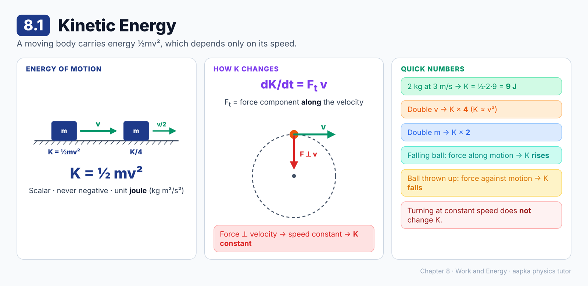

### 📘 Learning Material

**Big idea:** A moving body has energy because it is moving. This energy of motion is its **kinetic energy**.

**Definition**
**K = ½ mv²** (= ½ m **v** · **v**)
- It is a **scalar**, and never negative.
- **Unit:** joule (J) = kg m²/s²
- For a system of particles: K = Σ ½ mᵢvᵢ²

**How K changes**
- **dK/dt = F_t v**, where F_t is the component of the net force **along the velocity** (the tangential force).
- No force, or a net force **perpendicular** to the velocity (as in uniform circular motion): the speed stays the same, so **K is unchanged**.
- Force along the motion (a falling ball): K **increases**.
- Force against the motion (a ball thrown up): K **decreases**.

In small steps: **dK = F · dr**.

**🧮 Quick numbers**
- A 2 kg ball at 3 m/s: K = ½ × 2 × 9 = **9 J**.
- Double the speed and K becomes **4 times** as large (K ∝ v²).
- Double the mass at the same speed and K **doubles**.

> ⚠️ **Common mistake:** Thinking K changes whenever the direction changes. K depends only on **speed**, so turning at constant speed leaves K unchanged.

### ❓ MCQs

**Q1.** 🟢 The kinetic energy of a particle of mass m moving with speed v is:
- (A) mv
- (B) ½ mv²
- (C) mv²
- (D) ½ m²v

**Q2.** 🔴 A 2 kg ball moves at 3 m/s. Its kinetic energy is:
- (A) 6 J
- (B) 18 J
- (C) 3 J
- (D) 9 J

**Q3.** 🟡 If the speed of a body is doubled, its kinetic energy becomes:
- (A) Double
- (B) Half
- (C) Four times
- (D) Unchanged

**Q4.** 🟡 A stone moves in a horizontal circle at constant speed. Its kinetic energy:
- (A) Stays constant
- (B) Increases
- (C) Decreases
- (D) Keeps changing direction

**Q5.** 🟢 The rate of change of kinetic energy, dK/dt, equals:
- (A) F_t v, where F_t is the force component along the velocity
- (B) mv
- (C) F/v
- (D) Zero always

### Answer Key — 8.1
| Q | Ans | Explanation |
|---|---|---|
| 1 | B | K = ½mv². |
| 2 | D | ½ × 2 × 3² = 9 J. |
| 3 | C | K ∝ v², so 2v gives 4K. |
| 4 | A | The speed is constant, so K is constant. The force is perpendicular to the velocity. |
| 5 | A | d(½mv²)/dt = mv(dv/dt) = F_t v. |

---

## 8.2 Work and Work-Energy Theorem

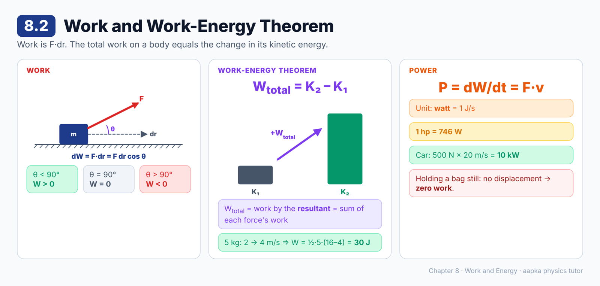

### 📘 Learning Material

**Big idea:** A force does **work** when it moves its point of application along the force. The total work on a particle equals the change in its kinetic energy.

**Work**
- In a small displacement: dW = **F · dr** = F dr cos θ
- Over a path: **W = ∫ F · dr**
- Work is a **scalar**. It can be positive (force along the motion), negative (force against the motion) or zero (force perpendicular to the motion).

**Work-energy theorem**
**W_total = K_final – K_initial = ΔK**
- W_total is the work done by the **resultant** force, which equals the **sum** of the work done by each individual force.
- Any single force's work is **not** equal to ΔK. Only the total is.

**Power: the rate of doing work**
**P = dW/dt = F · v**
- **Unit:** watt (W) = J/s
- **1 horsepower = 746 W**

**🧮 Worked example:** a 5 kg body speeds up from 2 m/s to 4 m/s.
W_total = ΔK = ½ × 5 × (16 – 4) = **30 J**.

**🧮 Worked example:** a car's engine pushes it forward with 500 N while it moves at 20 m/s.
P = Fv = 500 × 20 = **10 000 W = 10 kW** (about 13.4 hp).

> ⚠️ **Common mistake:** Saying "I held a heavy bag for an hour, so I did lots of work." No displacement means **zero** work, in physics terms.

### ❓ MCQs

**Q1.** 🟢 The work done by a force **F** during a small displacement d**r** is:
- (A) **F** × d**r**
- (B) F / dr
- (C) **F** · d**r**
- (D) F + dr

**Q2.** 🟡 According to the work-energy theorem, the work done by the resultant force on a particle equals:
- (A) Its final kinetic energy
- (B) The change in its kinetic energy
- (C) The change in its momentum
- (D) Its potential energy

**Q3.** 🔴 A 5 kg body speeds up from 2 m/s to 4 m/s. The total work done on it is:
- (A) 10 J
- (B) 40 J
- (C) 20 J
- (D) 30 J

**Q4.** 🟢 The SI unit of power is the watt, which equals:
- (A) 1 J/s
- (B) 1 J·s
- (C) 1 N·s
- (D) 746 J/s

**Q5.** 🔴 A car's engine exerts a forward force of 500 N while the car moves at 20 m/s. The power delivered is:
- (A) 25 W
- (B) 10 kW
- (C) 520 W
- (D) 1 kW

**Q6.** 🟢 One horsepower is about:
- (A) 1000 W
- (B) 100 W
- (C) 746 W
- (D) 9.8 W

### Answer Key — 8.2
| Q | Ans | Explanation |
|---|---|---|
| 1 | C | dW = **F** · d**r** = F dr cos θ, a scalar. |
| 2 | B | W_total = K_f – K_i. |
| 3 | D | ½ × 5 × (4² – 2²) = 2.5 × 12 = 30 J. |
| 4 | A | Power is work per unit time, so 1 W = 1 J/s. |
| 5 | B | P = Fv = 500 × 20 = 10 000 W. |
| 6 | C | 1 hp = 746 W. |

---

## 8.3 Calculation of Work Done

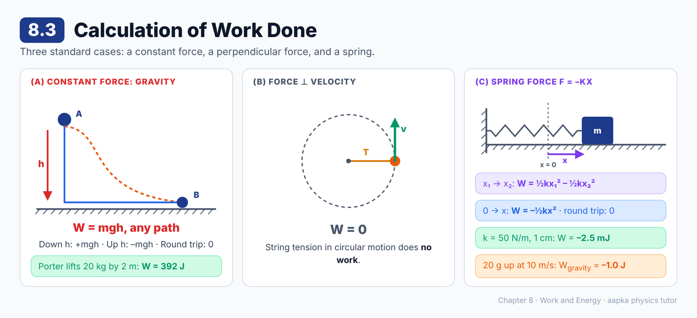

### 📘 Learning Material

**Big idea:** Three common cases cover most problems: a constant force, a force perpendicular to the motion, and a spring force.

**(a) Constant force**
**W = F · r = F d cos θ**, where θ is the angle between the force and the displacement.
- Along the motion (θ = 0): W = Fd.
- **Gravity near the earth:** W = **mgh**, where h is the height **descended**. Going up a height h, W = –mgh.
- It depends only on the **end points**, not the path. Over a round trip, W = 0.

**(b) Force perpendicular to the velocity at every instant**
**W = 0.** Example: the tension in a string whirling a stone in a circle does no work.

**(c) Spring force (F = –kx)**
The force changes as the block moves, so we must integrate:
- From x₁ to x₂: **W = ½kx₁² – ½kx₂²**
- From the natural length (x = 0) to an extension or compression x: **W = –½kx²** (the force opposes the displacement).
- From x back to the natural length: **W = +½kx²**.
- Round trip: **W = 0**.

**🧮 Worked example: a ball thrown up**
A 20 g ball is thrown up at 10 m/s. It rises h = u²/2g, so the work done by gravity is –mgh = –½mu² = –½ × 0.02 × 100 = **–1.0 J**.

**🧮 Worked example: a spring**
A spring (k = 50 N/m) is compressed by 1 cm. ½kx² = ½ × 50 × 10⁻⁴ = 2.5 × 10⁻³ J. The spring pushes back on the agency compressing it, so its work is **–2.5 mJ**.

**🧮 Worked example: a porter**
A porter lifts a 20 kg suitcase 2.0 m (g = 9.8 m/s²). He does work = mgh = 20 × 9.8 × 2 = **392 J** on it.

> ⚠️ **Common mistake:** Using W = Fd for a spring. The force isn't constant, so use ½kx².

### ❓ MCQs

**Q1.** 🟢 For a constant force F making an angle θ with a displacement d, the work done is:
- (A) Fd sin θ
- (B) Fd / cos θ
- (C) Fd cos θ
- (D) F/d

**Q2.** 🟡 A stone is whirled in a horizontal circle on a string. The work done by the tension in one complete round is:
- (A) Zero
- (B) Positive
- (C) Negative
- (D) Equal to the kinetic energy

**Q3.** 🔴 A 20 g ball is thrown vertically upward at 10 m/s. The work done by gravity while it goes up is:
- (A) +1.0 J
- (B) –0.2 J
- (C) –2.0 J
- (D) –1.0 J

**Q4.** 🔴 A spring of spring constant 50 N/m is compressed by 1 cm from its natural length. The work done by the spring on the agency compressing it is:
- (A) –2.5 mJ
- (B) +2.5 mJ
- (C) –0.5 J
- (D) –25 J

**Q5.** 🟡 The work done by a spring force as a block goes from x₁ to x₂ (measured from the natural length) is:
- (A) ½k(x₂² – x₁²)
- (B) ½k(x₁² – x₂²)
- (C) k(x₂ – x₁)
- (D) ½k(x₂ – x₁)²

**Q6.** 🔴 A porter lifts a 20 kg suitcase from the platform onto his head, 2.0 m higher (g = 9.8 m/s²). The work done by the porter on the suitcase is about:
- (A) 40 J
- (B) 196 J
- (C) 392 J
- (D) 0

### Answer Key — 8.3
| Q | Ans | Explanation |
|---|---|---|
| 1 | C | W = **F** · **d** = Fd cos θ. |
| 2 | A | The tension is perpendicular to the velocity at every instant, so W = 0. |
| 3 | D | W = –mgh = –½mu² = –½ × 0.02 × 100 = –1.0 J. |
| 4 | A | ½kx² = 2.5 × 10⁻³ J. The spring's force opposes the displacement, so its work is negative. |
| 5 | B | W = ∫(–kx)dx from x₁ to x₂ = ½kx₁² – ½kx₂². |
| 6 | C | W = mgh = 20 × 9.8 × 2 = 392 J. |

---

## 8.4 Work-Energy Theorem for a System of Particles

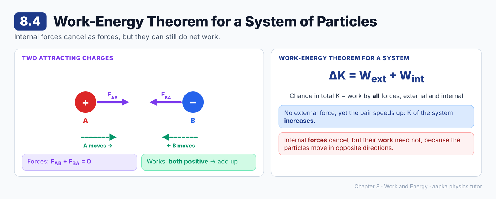

### 📘 Learning Material

**Big idea:** For a system of several particles, **internal forces can change the total kinetic energy** too, even though they come in equal-and-opposite pairs.

**The example**
Two oppositely charged particles A and B attract each other and rush together. No external force acts, yet the system's kinetic energy **increases**. How?
- B pulls A with **F**_AB, and A moves towards B, so **F**_AB does **positive** work.
- A pulls B with **F**_BA = –**F**_AB, and B moves towards A, so **F**_BA also does **positive** work.
- The forces cancel (**F**_AB + **F**_BA = 0), but **their works add up**, because the displacements are opposite too.

**Work-energy theorem for a system**
**ΔK_system = W_external + W_internal**
The change in the kinetic energy of a system equals the work done on it by **all** forces, both external and internal.

> ⚠️ **Common mistake:** "Internal forces cancel, so they do no work." The **forces** cancel, but the **work** need not. Work also depends on how far each particle moves.

### ❓ MCQs

**Q1.** 🟡 Two oppositely charged particles, initially at rest, attract each other and move closer. With no external force, the total kinetic energy of the pair:
- (A) Stays zero
- (B) Decreases
- (C) Increases
- (D) Is impossible to predict

**Q2.** 🟡 The internal forces between two particles of a system are equal and opposite. The total work done by them:
- (A) Is always zero
- (B) Is never zero
- (C) Always equals the external work
- (D) Need not be zero

**Q3.** 🟢 For a system of particles, the change in total kinetic energy equals:
- (A) The work done by external forces only
- (B) The work done by internal forces only
- (C) The work done by external and internal forces together
- (D) Zero always

**Q4.** 🟡 In the attracting-charges example, the work done by **F**_AB on A and by **F**_BA on B are:
- (A) Both positive
- (B) Both negative
- (C) Equal and opposite
- (D) Both zero

### Answer Key — 8.4
| Q | Ans | Explanation |
|---|---|---|
| 1 | C | The internal attractive forces do positive work on both particles. |
| 2 | D | The forces cancel, but the displacements can be opposite, so the works can add. |
| 3 | C | ΔK = W_ext + W_int. |
| 4 | A | Each particle moves in the direction of the force on it. |

---

## 8.5 Potential Energy

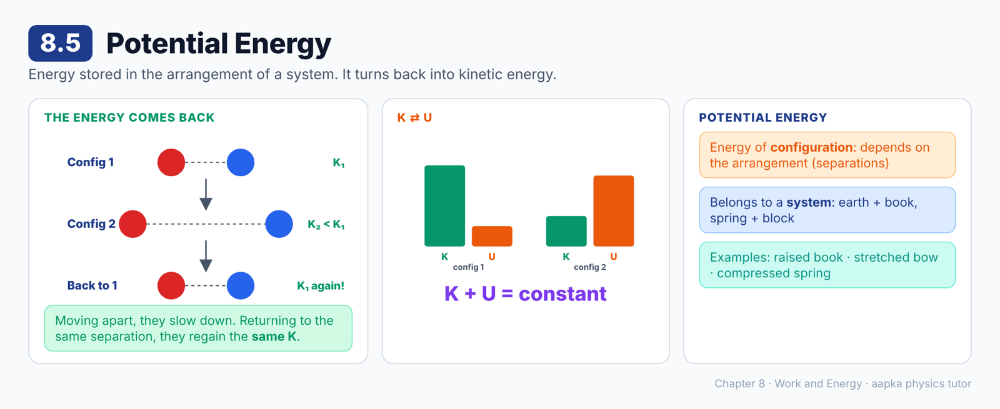

### 📘 Learning Material

**Big idea:** Some kinetic energy that seems "lost" is really stored in the **arrangement (configuration)** of the system. It comes back when the arrangement returns. This stored energy is **potential energy**.

**The two charges again:** now suppose A and B attract but are **moving apart**.
- They slow down, so K drops from K₁ (configuration 1) to K₂ (configuration 2).
- Wait a while. They turn round and come back to configuration 1, and K is **K₁ again**.
- The kinetic energy wasn't lost. It was stored, depending only on the **separation** (the configuration).

**Potential energy (U):** energy that depends on the **configuration** of a system.
- As the system moves from configuration 1 to 2, some K turns into U.
- Returning to configuration 1, U turns back into K.
- **K + U stays constant** in such cases.

**Everyday examples:** a raised book (earth + book), a stretched bow, a compressed spring.

> 💡 Potential energy belongs to a **system** of interacting bodies (earth + ball, spring + block), not to one body alone, though we often say "the ball's potential energy" for short.

### ❓ MCQs

**Q1.** 🟢 Potential energy is energy that depends on:
- (A) The speed of the particles
- (B) The configuration (arrangement) of the system
- (C) The colour of the bodies
- (D) Time only

**Q2.** 🟡 Two attracting particles move apart, slow down, then return to their original separation. Their kinetic energy on returning is:
- (A) Zero
- (B) Smaller than at the start
- (C) Larger than at the start
- (D) The same as at the start

**Q3.** 🟡 In the situation above (only these conservative forces acting), the quantity that remains constant is:
- (A) K + U
- (B) K alone
- (C) U alone
- (D) K – U

**Q4.** 🟢 Potential energy is a property of:
- (A) A single isolated particle only
- (B) Moving bodies only
- (C) A system of interacting bodies
- (D) Light only

### Answer Key — 8.5
| Q | Ans | Explanation |
|---|---|---|
| 1 | B | It depends on the positions (separations) of the interacting parts. |
| 2 | D | Same configuration, same potential energy, so the same kinetic energy. |
| 3 | A | Kinetic energy turns into potential energy and back, so their sum is constant. |
| 4 | C | It is stored in the interaction between bodies. |

---

## 8.6 Conservative and Nonconservative Forces

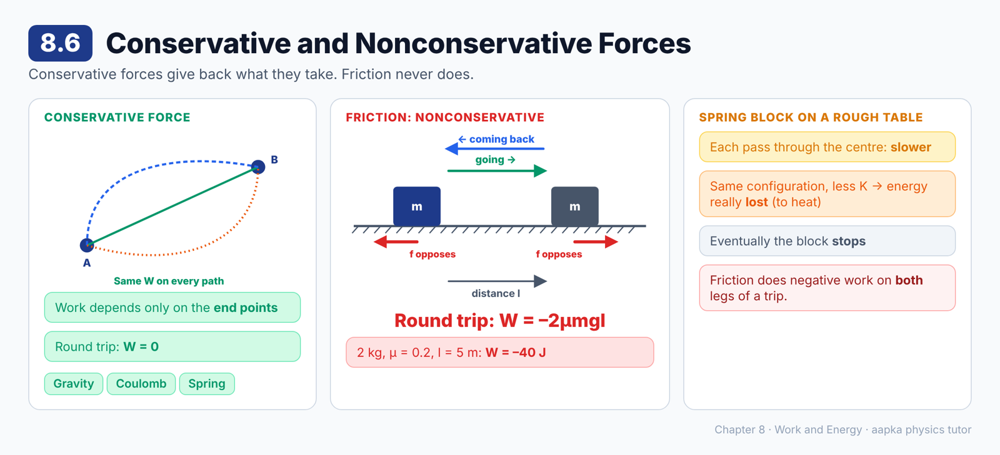

### 📘 Learning Material

**Big idea:** For some forces, a round trip costs nothing. For others, like friction, every trip costs energy.

**Two equivalent definitions of a conservative force**
1. The work done in **any round trip is zero**, or
2. The work done depends **only on the initial and final positions**, not on the path.

| Conservative | Nonconservative |
|---|---|
| Gravity | Friction |
| Coulomb (electric) force | Air drag and other resistances |
| Spring force | |

**Friction on a round trip**
A block (mass m, friction coefficient μ) is dragged a distance l to the right and then back to its start.
- Going right, friction points left: W = –μmgl.
- Coming back, friction points right: W = –μmgl again.
- **Round trip: W = –2μmgl**, not zero!

**🧮 Example:** m = 2 kg, μ = 0.2, l = 5 m, g = 10 m/s². W = –2 × 0.2 × 2 × 10 × 5 = **–40 J**.

**A spring-block on a rough table:** each time the block passes the centre, it moves a little more slowly. The configuration is the same, but the kinetic energy is really lost. Friction is the culprit, and eventually the block stops.

> ⚠️ **Common mistake:** Thinking friction does zero work on a round trip, the way gravity does. Friction always opposes the motion, so it does negative work on both legs.

### ❓ MCQs

**Q1.** 🟢 A force is called conservative if the work done by it:
- (A) Is always positive
- (B) Is always negative
- (C) Depends on the path taken
- (D) In any round trip is zero

**Q2.** 🟡 Which of these is a **nonconservative** force?
- (A) Friction
- (B) Gravity
- (C) Spring force
- (D) Coulomb force

**Q3.** 🔴 A 2 kg block is dragged 5 m to the right and then back to its starting point on a rough floor (μ = 0.2, g = 10 m/s²). The total work done by friction is:
- (A) 0
- (B) –20 J
- (C) –40 J
- (D) +40 J

**Q4.** 🟡 The work done by a conservative force between two points:
- (A) Depends on the path followed
- (B) Depends only on the initial and final positions
- (C) Is always zero
- (D) Depends on the speed of the body

**Q5.** 🟡 A block attached to a spring oscillates on a rough table. Each time it passes the centre, its speed is smaller than before because:
- (A) The spring force is nonconservative
- (B) Gravity does negative work
- (C) The spring gets lighter
- (D) Friction, a nonconservative force, removes mechanical energy

### Answer Key — 8.6
| Q | Ans | Explanation |
|---|---|---|
| 1 | D | Zero work in every round trip, or equivalently, path-independent work. |
| 2 | A | Friction does negative work on both legs of a round trip. |
| 3 | C | –2μmgl = –2 × 0.2 × 2 × 10 × 5 = –40 J. |
| 4 | B | Path independence is the second definition of a conservative force. |
| 5 | D | Friction turns mechanical energy into heat, so it is not stored and returned. |

---

## 8.7 Definition of Potential Energy and Conservation of Mechanical Energy

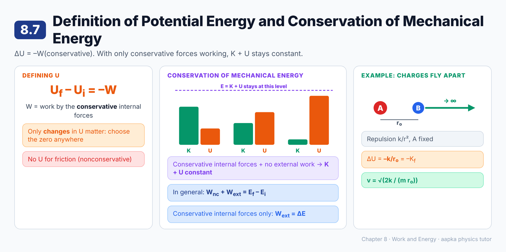

### 📘 Learning Material

**Big idea:** The change in potential energy equals **minus** the work done by the conservative internal force. If only conservative forces do work, **K + U stays constant**.

**Definition (only for conservative internal forces)**
**U_f – U_i = –W = –∫ F · dr**
- Only **changes** in U are defined. You may choose the zero of U anywhere, just like choosing an origin.
- U is **not** defined for nonconservative forces like friction.

**Conservation of mechanical energy**
If the internal forces are conservative and the external forces do no work:
**K_f + U_f = K_i + U_i** (E = K + U is constant)

**When other forces do work**
**W_nc + W_ext = E_f – E_i**
- If there's friction inside the system, E changes. The work-energy theorem still holds, but E is not conserved.
- If the internal forces are conservative but external forces do work: **W_ext = ΔE**.

**🧮 Worked example: charges flying apart**
Two charges repel with force k/r². A is held fixed, and B (mass m) is released at separation r₀ and flies off to a large distance.
- W = ∫ (k/r²) dr from r₀ to ∞ = k/r₀, so ΔU = **–k/r₀**
- K_f = k/r₀, so **v = √(2k / (m r₀))**

**Summary of the chapter so far**
1. Work on a particle = ΔK.
2. Work on a system by all forces (external and internal) = ΔK.
3. Conservative force: zero work in any round trip.
4. ΔU = –(work by the conservative internal forces).
5. Conservative internal forces and no external work → E is constant.
6. Nonconservative internal forces → E is not constant.
7. Conservative internal forces → W_ext = ΔE.

### ❓ MCQs

**Q1.** 🟢 The change in potential energy for a conservative internal force is defined as:
- (A) U_f – U_i = +W
- (B) U_f – U_i = –W
- (C) U_f – U_i = ΔK
- (D) U_f + U_i = W

**Q2.** 🟡 The total mechanical energy of a system remains constant when:
- (A) The internal forces are conservative and external forces do no work
- (B) Friction acts inside the system
- (C) External forces do positive work
- (D) The system is at rest

**Q3.** 🟡 Potential energy can be defined for:
- (A) Friction
- (B) Air resistance
- (C) Any force at all
- (D) Conservative forces only

**Q4.** 🟡 If the internal forces of a system are conservative, the work done by the external forces equals:
- (A) Zero
- (B) The change in potential energy only
- (C) The change in total mechanical energy
- (D) The change in momentum

**Q5.** 🔴 Two charges repel with force k/r². One is held fixed, and the other (mass m) is released from rest at separation r₀. Its speed when very far away is:
- (A) √(k / (m r₀))
- (B) √(2k / (m r₀))
- (C) 2k / (m r₀)
- (D) k / r₀

**Q6.** 🟢 The zero of potential energy:
- (A) Must always be at the earth's surface
- (B) Must always be at infinity
- (C) Is fixed by nature
- (D) Can be chosen at any convenient configuration

### Answer Key — 8.7
| Q | Ans | Explanation |
|---|---|---|
| 1 | B | The change in U equals minus the work done by the conservative force. |
| 2 | A | Then U_f + K_f = U_i + K_i. |
| 3 | D | Friction's work depends on the path, so no potential energy can be defined for it. |
| 4 | C | W_ext = E_f – E_i. |
| 5 | B | ½mv² = k/r₀, so v = √(2k/(m r₀)). |
| 6 | D | Only changes in U have meaning, so we choose the zero for convenience. |

---

## 8.8 Change in the Potential Energy in a Rigid-Body-Motion

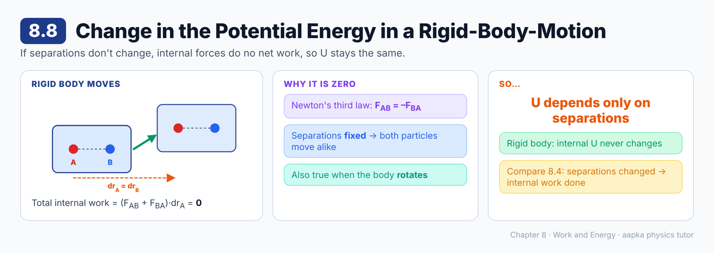

### 📘 Learning Material

**Big idea:** If the distances between the particles never change, as in a rigid body, the internal forces do **no net work**, so their potential energy doesn't change.

**Why**
Take two particles A and B of a rigid body, with **F**_AB = –**F**_BA (Newton's third law).
- If AB moves parallel to itself, then d**r**_A = d**r**_B.
- Total internal work = **F**_AB · d**r**_A + **F**_BA · d**r**_B = (**F**_AB + **F**_BA) · d**r**_A = **0**.
- The same result holds when the body **rotates**.

**Consequences**
- We never need to worry about the potential energy of the internal forces of a rigid body.
- **Potential energy changes only when the separations between the interacting parts change.** It depends only on those separations.

> 💡 Compare section 8.4: there the two charges **moved closer**, so their separation changed and the internal forces did work. In a rigid body the separations are fixed, so they don't.

### ❓ MCQs

**Q1.** 🟢 In the motion of a rigid body, the net work done by its internal forces is:
- (A) Positive
- (B) Negative
- (C) Zero
- (D) Equal to its kinetic energy

**Q2.** 🟡 The internal forces of a rigid body do no net work mainly because:
- (A) The separations between its particles do not change
- (B) Rigid bodies have no mass
- (C) There are no internal forces
- (D) Gravity cancels them

**Q3.** 🟡 The potential energy of a system changes only when:
- (A) The system moves as a whole
- (B) The separations between its interacting parts change
- (C) Its speed changes
- (D) It rotates

**Q4.** 🟡 The result that the internal forces of a rigid body do no work follows from:
- (A) Newton's first law
- (B) Newton's third law (with the separations fixed)
- (C) The law of gravitation
- (D) The conservation of mass

### Answer Key — 8.8
| Q | Ans | Explanation |
|---|---|---|
| 1 | C | The work contributions of the equal and opposite forces cancel when the separations are fixed. |
| 2 | A | With fixed separations, equal and opposite forces do cancelling work. |
| 3 | B | U depends only on the separations between the interacting particles. |
| 4 | B | **F**_AB = –**F**_BA, together with the rigid motion, gives zero total work. |

---

## 8.9 Gravitational Potential Energy

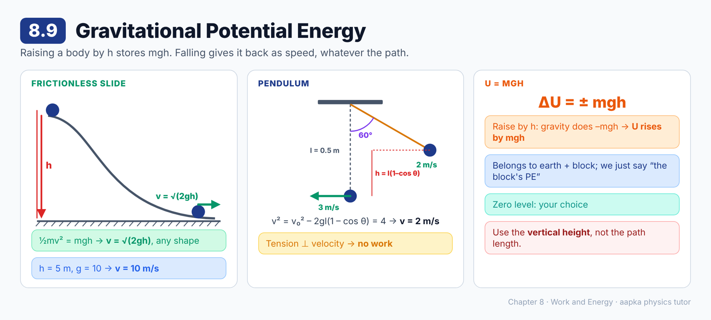

### 📘 Learning Material

**Big idea:** Raising a body through a height h stores energy **mgh** in the earth–body system. Letting it fall turns that energy back into motion.

**Earth + block**
- Gravity is conservative, so it has a potential energy.
- The earth barely moves, so its frame is very nearly inertial, and gravity does no work on the earth in that frame.
- Raising the block a height h: gravity does –mgh, so **U increases by mgh**.
- Lowering it a height h: **U decreases by mgh**.
- We usually just say "the block's gravitational potential energy".
- The zero can be anywhere. U = mgh measured from the chosen zero level (for h much smaller than the earth's radius).

**🧮 Worked example: sliding down a smooth curved surface**
A block starts from rest and drops a height h along a frictionless track. The normal force is perpendicular to the motion, so it does no work.
½mv² = mgh, so **v = √(2gh)**, whatever the shape of the path!
With h = 5 m and g = 10 m/s²: **v = 10 m/s**.

**🧮 Worked example: a pendulum**
A bob passes its lowest point at 3 m/s. String length l = 0.5 m, g = 10 m/s². What is its speed at 60° from the vertical?
- Height gained = l(1 – cos 60°) = 0.25 m
- v₁² = v₀² – 2gl(1 – cos θ) = 9 – 2 × 10 × 0.25 = 4, so **v₁ = 2 m/s**
- The string's tension is always perpendicular to the velocity, so it does no work.

> ⚠️ **Common mistake:** Using the length of the path instead of the **vertical height** in mgh.

### ❓ MCQs

**Q1.** 🟢 When a body of mass m is raised through a height h near the earth's surface, its gravitational potential energy:
- (A) Decreases by mgh
- (B) Stays the same
- (C) Increases by mgh
- (D) Increases by ½mgh

**Q2.** 🔴 A block is released from rest at a height of 5 m on a frictionless curved track (g = 10 m/s²). Its speed at the bottom is:
- (A) 5 m/s
- (B) 50 m/s
- (C) 7.1 m/s
- (D) 10 m/s

**Q3.** 🟡 For a block sliding down a frictionless curved surface, its speed at the bottom depends on:
- (A) Only the vertical height descended
- (B) The length of the path
- (C) The shape of the surface
- (D) The mass of the block

**Q4.** 🔴 A pendulum bob of length 0.5 m passes its lowest point at 3 m/s (g = 10 m/s²). Its speed when the string makes 60° with the vertical is:
- (A) 1 m/s
- (B) 2 m/s
- (C) 3 m/s
- (D) 2.5 m/s

**Q5.** 🟡 The tension in a pendulum's string does no work on the bob because:
- (A) The tension is always perpendicular to the bob's velocity
- (B) The tension is zero
- (C) The string is light
- (D) The bob moves in a straight line

### Answer Key — 8.9
| Q | Ans | Explanation |
|---|---|---|
| 1 | C | Gravity does –mgh, so U increases by mgh. |
| 2 | D | v = √(2gh) = √100 = 10 m/s. |
| 3 | A | ½mv² = mgh, so v = √(2gh). The mass and the path cancel out. |
| 4 | B | v² = 9 – 2 × 10 × 0.5 × (1 – 0.5) = 4, so v = 2 m/s. |
| 5 | A | The tension acts along the string and the velocity is along the arc, so they are perpendicular. |

---

## 8.10 Potential Energy of a Compressed or Extended Spring

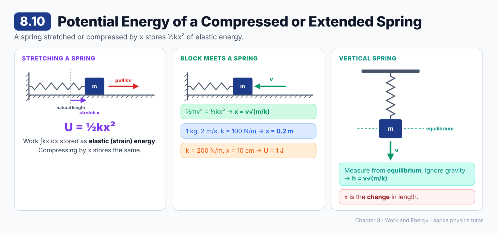

### 📘 Learning Material

**Big idea:** Stretching or compressing a spring by x stores **½kx²** of energy in it. This is elastic potential energy.

**Where ½kx² comes from**
A massless spring is fixed to a wall and slowly stretched by x.
- The wall's force does no work, because its point of application doesn't move.
- The block's pull kx does work ∫kx dx = **½kx²**.
- The spring has no mass, so it has no kinetic energy, and all this work is stored as **U = ½kx²**.
- Compressing it by x stores the **same** ½kx².

This is called **elastic potential energy** or **strain energy**, and its zero is usually taken at the natural length.

**🧮 Worked example: a block meets a spring**
A block of mass m moves at speed v on a smooth table and compresses a spring. How far does it go before stopping?
½mv² = ½kx², so **x = v√(m/k)**.
With m = 1 kg, v = 2 m/s and k = 100 N/m: x = 2 × 0.1 = **0.2 m**.

**🧮 Vertical spring**
A block hangs in equilibrium on a spring and is given a downward speed v. Taking the spring + block + earth together, it comes to rest at **h = v√(m/k)** below the equilibrium position, the same as the horizontal case.
**Tip:** for a vertical spring, treat the **equilibrium position** as the "natural length" and ignore gravity.

> ⚠️ **Common mistake:** Using the full length of the spring instead of the **change** in length x.

### ❓ MCQs

**Q1.** 🟢 The elastic potential energy stored in a spring stretched by x (spring constant k) is:
- (A) kx
- (B) ½kx
- (C) kx²
- (D) ½kx²

**Q2.** 🔴 A 1 kg block moving at 2 m/s on a smooth table hits a spring of spring constant 100 N/m. The maximum compression of the spring is:
- (A) 0.02 m
- (B) 0.2 m
- (C) 2 m
- (D) 0.4 m

**Q3.** 🟡 Compared with stretching a spring by x, compressing it by x stores:
- (A) The same energy
- (B) Less energy
- (C) More energy
- (D) Zero energy

**Q4.** 🔴 A spring (k = 200 N/m) is stretched by 10 cm. The energy stored in it is:
- (A) 20 J
- (B) 10 J
- (C) 1 J
- (D) 2 J

**Q5.** 🟡 A block hangs at equilibrium on a vertical spring and is given a downward speed v. It comes to rest at a distance below the equilibrium position of:
- (A) v√(m/k)
- (B) v√(k/m)
- (C) mg/k
- (D) v²/2g

### Answer Key — 8.10
| Q | Ans | Explanation |
|---|---|---|
| 1 | D | U = ½kx², the work done in stretching the spring. |
| 2 | B | x = v√(m/k) = 2 × √(1/100) = 0.2 m. |
| 3 | A | U depends on x², so stretching and compressing by the same amount store the same energy. |
| 4 | C | ½ × 200 × (0.1)² = 1 J. |
| 5 | A | Measured from equilibrium, gravity can be ignored: ½mv² = ½kh², so h = v√(m/k). |

---

## 8.11 Different Forms of Energy: Mass Energy Equivalence

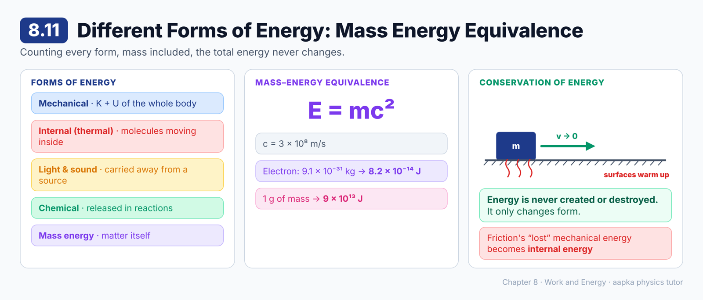

### 📘 Learning Material

**Big idea:** Mechanical energy (K + U) is just one form of energy. Counting all forms, including mass itself, **energy is never created or destroyed**.

**Forms of energy**
| Form | What it is |
|---|---|
| Mechanical | K + U of the body as a whole |
| **Internal (thermal) energy** | Kinetic and potential energy of the molecules moving and interacting **inside** a body, even when the body is at rest |
| Light and sound | A source that emits them loses energy |
| Chemical | Released or absorbed in chemical reactions |
| **Mass energy** | Matter itself is a form of energy |

**Mass–energy equivalence (Einstein's special relativity)**
**E = mc²**, where c = 3 × 10⁸ m/s.
- About **8.18 × 10⁻¹⁴ J** is needed to create an electron, and the same amount is released when one is destroyed.
- **🧮 Check:** m_e = 9.1 × 10⁻³¹ kg gives E = 9.1 × 10⁻³¹ × 9 × 10¹⁶ ≈ 8.2 × 10⁻¹⁴ J ✔
- Just **1 g** of mass is equivalent to 10⁻³ × 9 × 10¹⁶ = **9 × 10¹³ J**.

**The generalised law of conservation of energy**
Energy can never be created or destroyed. It can only change from one form into another.

> 💡 When friction "loses" mechanical energy, it isn't destroyed. It becomes internal (thermal) energy, and the surfaces warm up.

### ❓ MCQs

**Q1.** 🟢 The energy associated with the motion and interactions of the molecules inside a body is called:
- (A) Mechanical energy
- (B) Internal (thermal) energy
- (C) Mass energy
- (D) Sound energy

**Q2.** 🟢 Einstein's mass–energy relation is:
- (A) E = mc
- (B) E = ½mc²
- (C) E = mc²
- (D) E = m/c²

**Q3.** 🔴 The energy equivalent of 1 g of mass (c = 3 × 10⁸ m/s) is:
- (A) 9 × 10¹⁶ J
- (B) 3 × 10⁵ J
- (C) 9 × 10¹⁰ J
- (D) 9 × 10¹³ J

**Q4.** 🟡 According to the generalised law of conservation of energy:
- (A) Energy can be created but not destroyed
- (B) Energy can never be created or destroyed, only changed from one form into another
- (C) Mechanical energy is always conserved
- (D) Energy is lost whenever friction acts

**Q5.** 🟡 When friction slows down a sliding block, the "lost" mechanical energy:
- (A) Is destroyed
- (B) Turns into mass
- (C) Is converted mainly into internal (thermal) energy
- (D) Turns into potential energy of the block

### Answer Key — 8.11
| Q | Ans | Explanation |
|---|---|---|
| 1 | B | This is internal (thermal) energy. |
| 2 | C | E = mc². |
| 3 | D | 10⁻³ kg × (3 × 10⁸)² = 9 × 10¹³ J. |
| 4 | B | Energy only changes form. It is never created or destroyed. |
| 5 | C | The surfaces heat up. The energy is not destroyed. |

---

**Total: 55 questions** · 8.1 (5) · 8.2 (6) · 8.3 (6) · 8.4 (4) · 8.5 (4) · 8.6 (5) · 8.7 (6) · 8.8 (4) · 8.9 (5) · 8.10 (5) · 8.11 (5)
