# Chapter 9 — Centre of Mass, Linear Momentum, Collision
### Learning Material + MCQ Practice Set (based on H.C. Verma, *Concepts of Physics* Vol. 1)

**How to use:** Each section opens with a **summary diagram**, then **📘 Learning Material** (key ideas, formulas, worked examples, common mistakes). Then come the **MCQs**, followed by an answer key with short explanations. Difficulty is marked: 🟢 Recall · 🟡 Understanding · 🔴 Application.

**Notation:** CM = centre of mass, M = total mass, **P** = total linear momentum, e = coefficient of restitution. Primes (v′) mean velocities after a collision.

---

## 9.1 Centre of Mass

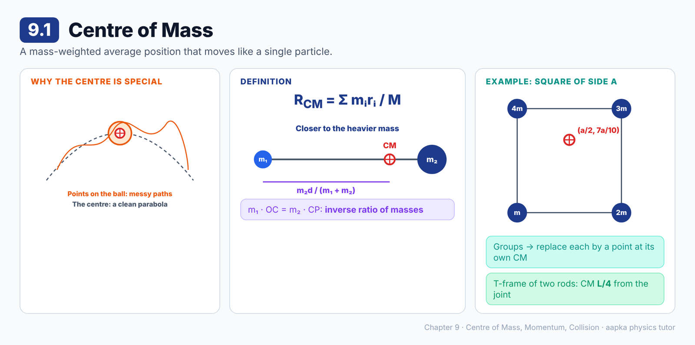

### 📘 Learning Material

**Big idea:** A spinning ball thrown in the air has points that move along complicated paths, but its **centre** always follows a neat parabola, just like a single particle. That special point is the **centre of mass**.

**Definition**
For particles of masses mᵢ at positions **r**ᵢ:
**R_CM = (1/M) Σ mᵢ rᵢ**, where M = Σ mᵢ
- X = (1/M) Σ mᵢxᵢ, Y = (1/M) Σ mᵢyᵢ, Z = (1/M) Σ mᵢzᵢ
- It is a mass-weighted average of the positions.

**Two particles a distance d apart**
- The CM lies on the line joining them, at **OC = m₂d / (m₁ + m₂)** from m₁.
- **m₁ · OC = m₂ · CP**: the CM divides the line in the **inverse ratio** of the masses, so it sits closer to the heavier one.

**Several groups of particles**
Replace each part by a **point particle** of its total mass placed at its own CM:
**X = (M₁X₁ + M₂X₂) / (M₁ + M₂)**

**🧮 Worked example: a square**
Masses m, 2m, 3m and 4m sit at the corners A(0, 0), B(a, 0), C(a, a) and D(0, a).
- X = (0 + 2ma + 3ma + 0) / 10m = **a/2**
- Y = (0 + 0 + 3ma + 4ma) / 10m = **7a/10**

**🧮 Worked example: a T-frame**
Two identical uniform rods, each of length L, form a T. Replace each rod by its mass m at its middle point. The CM is midway between the two middles, on the vertical rod **L/4 from the joint**.

> ⚠️ **Common mistake:** Taking the plain average of positions. The CM is weighted by mass, so it sits nearer the heavier particle.

### ❓ MCQs

**Q1.** 🟢 The x-coordinate of the centre of mass of a system of particles is:
- (A) Σ xᵢ / N
- (B) Σ mᵢxᵢ / Σ mᵢ
- (C) Σ mᵢxᵢ
- (D) Σ mᵢ / Σ xᵢ

**Q2.** 🟡 For two particles, the centre of mass lies on the line joining them and is:
- (A) Always exactly at the midpoint
- (B) Closer to the lighter particle
- (C) Closer to the heavier particle
- (D) Outside the line joining them

**Q3.** 🔴 Particles of 1 kg and 3 kg are 4 m apart. The distance of their centre of mass from the 1 kg particle is:
- (A) 3 m
- (B) 1 m
- (C) 2 m
- (D) 4/3 m

**Q4.** 🔴 Masses m, 2m, 3m and 4m are at the corners (0, 0), (a, 0), (a, a) and (0, a) of a square. The centre of mass is at:
- (A) (a/2, a/2)
- (B) (7a/10, a/2)
- (C) (a/2, 3a/10)
- (D) (a/2, 7a/10)

**Q5.** 🟡 To find the centre of mass of a body made of parts, each part can be replaced by:
- (A) A point particle of the part's mass at the part's centre of mass
- (B) Its heaviest point
- (C) Its geometric corner
- (D) A particle of unit mass

**Q6.** 🔴 Two identical uniform rods, each of length L, are joined to form a T. The centre of mass of the frame lies on the vertical rod at a distance from the joint of:
- (A) L/2
- (B) L/4
- (C) L/3
- (D) 3L/4

### Answer Key — 9.1
| Q | Ans | Explanation |
|---|---|---|
| 1 | B | X = Σ mᵢxᵢ / M, a mass-weighted average. |
| 2 | C | m₁ · OC = m₂ · CP, so the heavier particle is nearer. |
| 3 | A | OC = m₂d/(m₁ + m₂) = 3 × 4 / 4 = 3 m. |
| 4 | D | X = 5ma/10m = a/2, Y = 7ma/10m = 7a/10. |
| 5 | A | This is the "several groups of particles" rule. |
| 6 | B | Equal masses at the joint and at L/2 down the vertical rod: midpoint = L/4. |

---

## 9.2 Centre of Mass of Continuous Bodies

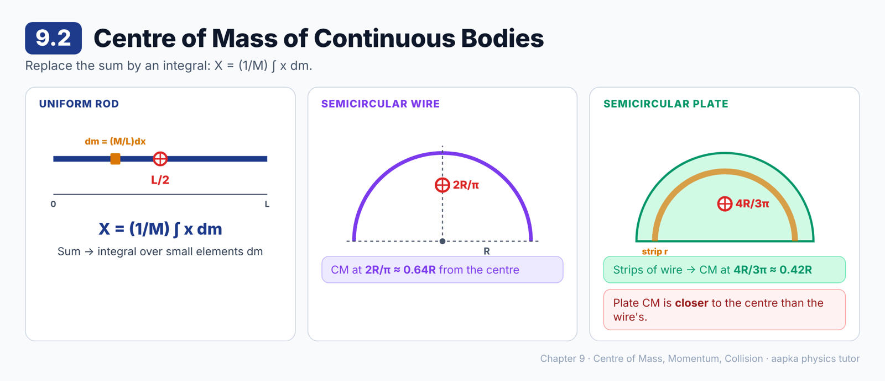

### 📘 Learning Material

**Big idea:** For a continuous body, split it into tiny elements of mass dm and replace the sum by an **integral**.

**Formula**
**X = (1/M) ∫ x dm, Y = (1/M) ∫ y dm, Z = (1/M) ∫ z dm**
Choose the element so that, as the variable runs between its limits, the elements cover the whole body.

**Three standard results**
| Body (uniform) | Element used | Centre of mass |
|---|---|---|
| Rod of length L | dm = (M/L) dx | At the middle, **L/2** from an end |
| Semicircular **wire**, radius R | dm = (M/π) dθ | **2R/π** from the centre, on the symmetry axis |
| Semicircular **plate**, radius R | thin semicircular strips of radius r, width dr | **4R/3π** from the centre, on the symmetry axis |

**How the plate result uses the wire result**
Each thin strip is a semicircular wire whose CM is at 2r/π. Replace each strip by a point at 2r/π, then integrate from r = 0 to R. The answer is 4R/3π.

**🧮 Numbers:** For R = 30 cm, the wire's CM is 2 × 30/π ≈ **19.1 cm** from the centre, and the plate's is 4 × 30/3π ≈ **12.7 cm**.

> 💡 **Symmetry shortcut:** if a body is symmetric about an axis, its CM lies on that axis. So the x-coordinate of a semicircle's CM is zero.

> ⚠️ **Common mistake:** Mixing up the wire (2R/π) and the plate (4R/3π). The plate has more mass near the centre, so its CM is closer to the centre.

### ❓ MCQs

**Q1.** 🟢 For a continuous body, the x-coordinate of the centre of mass is:
- (A) (1/M) ∫ x dm
- (B) ∫ x dx
- (C) M ∫ x dm
- (D) (1/M) ∫ dm

**Q2.** 🟢 The centre of mass of a uniform rod of length L is at a distance from one end of:
- (A) L/3
- (B) L/4
- (C) L/2
- (D) L

**Q3.** 🟡 The centre of mass of a uniform semicircular wire of radius R is at a distance from the centre of:
- (A) 4R/3π
- (B) R/2
- (C) πR/2
- (D) 2R/π

**Q4.** 🟡 The centre of mass of a uniform semicircular plate of radius R is at a distance from the centre of:
- (A) 4R/3π
- (B) 2R/π
- (C) R/π
- (D) 3R/4

**Q5.** 🟡 Compared with a semicircular wire of the same radius, the centre of mass of a semicircular plate is:
- (A) Farther from the centre
- (B) Closer to the centre
- (C) At the same place
- (D) Outside the body

### Answer Key — 9.2
| Q | Ans | Explanation |
|---|---|---|
| 1 | A | The sum Σ mᵢxᵢ becomes the integral ∫ x dm. |
| 2 | C | (1/M) ∫ x (M/L) dx from 0 to L = L/2. |
| 3 | D | (1/M) ∫ R sin θ (M/π) dθ from 0 to π = 2R/π. |
| 4 | A | Integrating strips of radius r, each with its CM at 2r/π, gives 4R/3π. |
| 5 | B | 4R/3π ≈ 0.42R is less than 2R/π ≈ 0.64R. |

---

## 9.3 Motion of the Centre of Mass

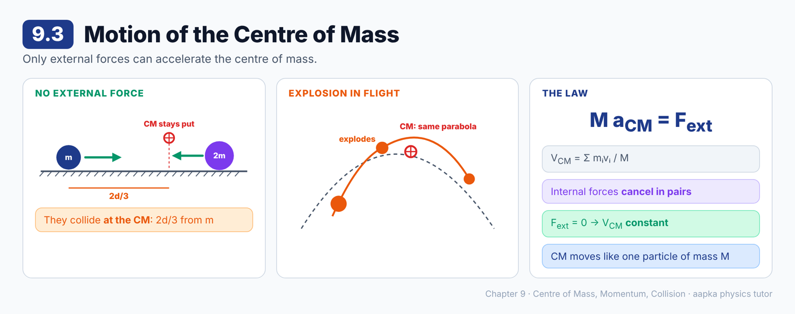

### 📘 Learning Material

**Big idea:** Internal forces cannot move the centre of mass. Only **external** forces can accelerate it.

**Velocity and acceleration of the CM**
- **V_CM = Σ mᵢvᵢ / M**
- **a_CM = Σ mᵢaᵢ / M**

**The key law**
**M a_CM = F_ext**
- Internal forces cancel in pairs (Newton's third law), so only the external forces are left.
- The CM moves like a **single particle of mass M** acted on by the total external force.

**Consequences**
- If **F_ext = 0**, then a_CM = 0: the CM keeps a **constant velocity**.
- If the CM starts **at rest**, it stays at rest, however the parts move.
- A ball thrown in the air that **breaks into pieces**: the pieces fly along different paths, but their CM continues on the **original parabola**.

**🧮 Worked example: two attracting particles**
Masses m and 2m are d apart on a smooth table and pull each other together. With no external horizontal force, the CM stays fixed, so they collide **at the CM**: **2d/3 from m**.

> ⚠️ **Common mistake:** Thinking an explosion or internal push can change where the CM goes. Only external forces can.

### ❓ MCQs

**Q1.** 🟢 The acceleration of the centre of mass of a system is given by:
- (A) M a_CM = F_internal
- (B) M a_CM = F_ext
- (C) a_CM = F_ext × M
- (D) a_CM = 0 always

**Q2.** 🟡 If the external forces on a system add to zero, the centre of mass:
- (A) Must be at rest
- (B) Accelerates uniformly
- (C) Moves with constant velocity
- (D) Moves in a circle

**Q3.** 🔴 Two particles of masses m and 2m, a distance d apart on a smooth table, attract each other and collide. The collision takes place at a distance from m of:
- (A) d/3
- (B) d/2
- (C) d
- (D) 2d/3

**Q4.** 🟡 A shell moving along a parabola explodes in mid-air. Ignoring air resistance, the centre of mass of the fragments:
- (A) Continues along the original parabola
- (B) Falls vertically
- (C) Stops at the point of explosion
- (D) Moves in a straight line upward

**Q5.** 🟡 The internal forces of a system do not affect the motion of its centre of mass because:
- (A) They are always small
- (B) They act only for a short time
- (C) They cancel in pairs by Newton's third law
- (D) They are perpendicular to the motion

### Answer Key — 9.3
| Q | Ans | Explanation |
|---|---|---|
| 1 | B | Summing mᵢaᵢ over all particles leaves only the external forces. |
| 2 | C | a_CM = 0, so V_CM is constant (it may or may not be zero). |
| 3 | D | The CM is fixed at 2m·d/3m = 2d/3 from m, and they meet there. |
| 4 | A | Only gravity acts externally, so the CM follows the same parabola. |
| 5 | C | F_ij + F_ji = 0 for every pair. |

---

## 9.4 Linear Momentum and its Conservation Principle

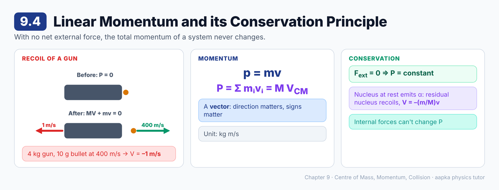

### 📘 Learning Material

**Big idea:** If no net external force acts on a system, its total momentum never changes.

**Momentum**
- One particle: **p = mv** (a vector, unit kg m/s)
- A system: **P = Σ mᵢvᵢ = M V_CM**

**Conservation of linear momentum**
If **F_ext = 0**, then **P = constant**, in magnitude and direction.
(This follows from M a_CM = F_ext: zero external force means V_CM, and so P, is constant.)

**🧮 Example: radioactive decay**
A nucleus at rest emits an alpha particle (mass m) at speed v. The rest of the nucleus (mass M) must recoil:
M**V** + m**v** = 0, so **V = –(m/M) v**, in the opposite direction.

**🧮 Example: gun recoil**
A 4 kg gun fires a 10 g bullet at 400 m/s.
0 = 4 × V + 0.01 × 400, so **V = –1 m/s**. The gun kicks back at 1 m/s.

> ⚠️ **Common mistake:** Forgetting that momentum is a **vector**. Bodies moving in opposite directions have momenta with opposite signs.

### ❓ MCQs

**Q1.** 🟢 The total linear momentum of a system equals:
- (A) M V_CM
- (B) ½ M V_CM²
- (C) M a_CM
- (D) Σ mᵢ

**Q2.** 🟢 The linear momentum of a system is conserved when:
- (A) No internal forces act
- (B) Kinetic energy is conserved
- (C) The system is at rest
- (D) The external forces add up to zero

**Q3.** 🔴 A 4 kg gun fires a 10 g bullet at 400 m/s. The recoil speed of the gun is:
- (A) 0.1 m/s
- (B) 1 m/s
- (C) 10 m/s
- (D) 4 m/s

**Q4.** 🟡 A nucleus at rest emits an alpha particle. The residual nucleus:
- (A) Stays at rest
- (B) Moves in the same direction as the alpha particle
- (C) Recoils in the opposite direction
- (D) Moves at right angles to the alpha particle

**Q5.** 🟡 Linear momentum is a:
- (A) Scalar that is never negative
- (B) Vector, in the direction of the velocity
- (C) Scalar that can be negative
- (D) Vector, in the direction of the acceleration

### Answer Key — 9.4
| Q | Ans | Explanation |
|---|---|---|
| 1 | A | Σ mᵢvᵢ = d/dt(Σ mᵢrᵢ) = M V_CM. |
| 2 | D | Then V_CM, and so P, is constant. |
| 3 | B | V = 0.01 × 400 / 4 = 1 m/s. |
| 4 | C | The total momentum must stay zero: MV = –mv. |
| 5 | B | p = mv points along v. |

---

## 9.5 Rocket Propulsion

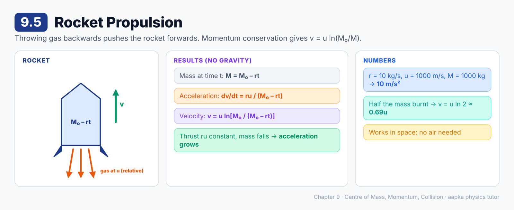

### 📘 Learning Material

**Big idea:** A rocket pushes gas backwards, and the gas pushes the rocket forwards. Momentum conservation tells us how fast it goes.

**Set-up**
- Initial mass (rocket + fuel): M₀
- Gas ejected at a constant rate **r = –dM/dt**
- Gas speed relative to the rocket: **u** (backwards)
- Mass at time t: **M = M₀ – rt**

**Results (no gravity or other external force)**
- Acceleration: **dv/dt = ru / (M₀ – rt)**
- Velocity: **v = u ln [M₀ / (M₀ – rt)]**

**What this means**
- The thrust **ru** stays the same, but the mass keeps falling, so the **acceleration keeps increasing**.
- The final speed depends on the **ratio** of the starting mass to the remaining mass.

**🧮 Examples**
- r = 10 kg/s, u = 1000 m/s, M = 1000 kg: acceleration = 10 × 1000 / 1000 = **10 m/s²**.
- When half the mass has been burnt: v = u ln 2 ≈ **0.69u**. With u = 1000 m/s, v ≈ **693 m/s**.

> 💡 A rocket needs no air to push against. It works even better in space.

### ❓ MCQs

**Q1.** 🟢 A rocket moves forward because:
- (A) The ejected gas pushes against the air
- (B) The ejected gases exert a forward force on it
- (C) Gravity pulls it up
- (D) Its mass increases

**Q2.** 🟡 For a rocket ejecting gas at a constant rate and constant relative speed, its acceleration:
- (A) Keeps increasing with time
- (B) Stays constant
- (C) Keeps decreasing
- (D) Is zero

**Q3.** 🔴 A rocket of mass 1000 kg ejects gas at 10 kg/s with a speed of 1000 m/s relative to it. Ignoring gravity, its acceleration at that moment is:
- (A) 1 m/s²
- (B) 100 m/s²
- (C) 1000 m/s²
- (D) 10 m/s²

**Q4.** 🔴 Ignoring gravity, a rocket starting from rest has speed v = u ln (M₀/M). When its mass has halved, its speed is about:
- (A) 0.5u
- (B) 2u
- (C) 0.69u
- (D) u

### Answer Key — 9.5
| Q | Ans | Explanation |
|---|---|---|
| 1 | B | Momentum conservation: gas goes back, rocket goes forward. |
| 2 | A | dv/dt = ru/(M₀ – rt). The denominator shrinks, so the acceleration grows. |
| 3 | D | ru/M = 10 × 1000 / 1000 = 10 m/s². |
| 4 | C | ln 2 ≈ 0.693. |

---

## 9.6 Collision

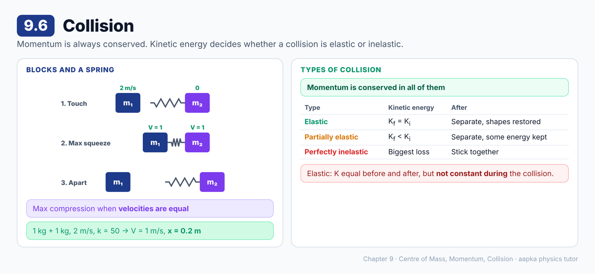

### 📘 Learning Material

**Big idea:** In every collision, momentum is conserved. What happens to kinetic energy decides the **type** of collision.

**Blocks and a spring (the model collision)**
A faster block m₁ catches up with a slower block m₂ that has a light spring on its back.
1. The spring compresses. The rear block slows down, and the front block speeds up.
2. **Maximum compression happens when both blocks have the same velocity.**
3. The spring then pushes them apart until it is back at its natural length.
4. The total momentum stays the **same at every instant**: before, during and after.

**🧮 Worked example**
Two 1 kg blocks. The rear one moves at 2 m/s, the front one is at rest, and k = 50 N/m.
- Common velocity: 1 × 2 = 2V, so **V = 1 m/s**
- K before = 2 J. K at maximum compression = ½ × 2 × 1² = 1 J
- ½ × 50 × x² = 1 J, so **x = 0.2 m**

**Three kinds of collision**
| Type | Momentum | Kinetic energy | After the collision |
|---|---|---|---|
| **Elastic** | Conserved | **K_f = K_i** | Shapes fully restored, the bodies separate |
| **Partially elastic** | Conserved | K_f < K_i | The bodies separate, but some energy stays inside |
| **Perfectly inelastic** | Conserved | K_f < K_i (largest loss) | The bodies **stick together** |

> ⚠️ **Common mistake:** In an elastic collision, K is equal **before and after**, but it is **not** constant during the collision. Some is stored as elastic energy while the bodies are squashed.

### ❓ MCQs

**Q1.** 🟢 In every collision with no external force, the quantity that is always conserved is:
- (A) Kinetic energy
- (B) Speed of each body
- (C) Total linear momentum
- (D) Momentum of each body

**Q2.** 🟡 Two blocks collide through a light spring. The spring's compression is maximum when:
- (A) The rear block stops
- (B) The two blocks have equal velocities
- (C) The front block stops
- (D) The kinetic energy is maximum

**Q3.** 🔴 A 1 kg block moving at 2 m/s hits an identical block at rest through a light spring (k = 50 N/m). The maximum compression of the spring is:
- (A) 0.2 m
- (B) 0.1 m
- (C) 0.4 m
- (D) 0.04 m

**Q4.** 🟢 In an elastic collision:
- (A) Kinetic energy stays constant at every instant
- (B) Momentum is lost
- (C) The bodies stick together
- (D) The final kinetic energy equals the initial kinetic energy

**Q5.** 🟡 In a perfectly inelastic collision, the bodies:
- (A) Separate with their original speeds
- (B) Stick together and move with a common velocity
- (C) Always stop
- (D) Gain kinetic energy

### Answer Key — 9.6
| Q | Ans | Explanation |
|---|---|---|
| 1 | C | No external force, so P is constant. K may or may not be. |
| 2 | B | While the rear block is faster, the spring keeps getting shorter. |
| 3 | A | V = 1 m/s, so 1 J is stored: ½ × 50 × x² = 1, giving x = 0.2 m. |
| 4 | D | K_f = K_i, but K dips during the collision. |
| 5 | B | They have no tendency to regain their shapes, so they move together. |

---

## 9.7 Elastic Collision in One Dimension

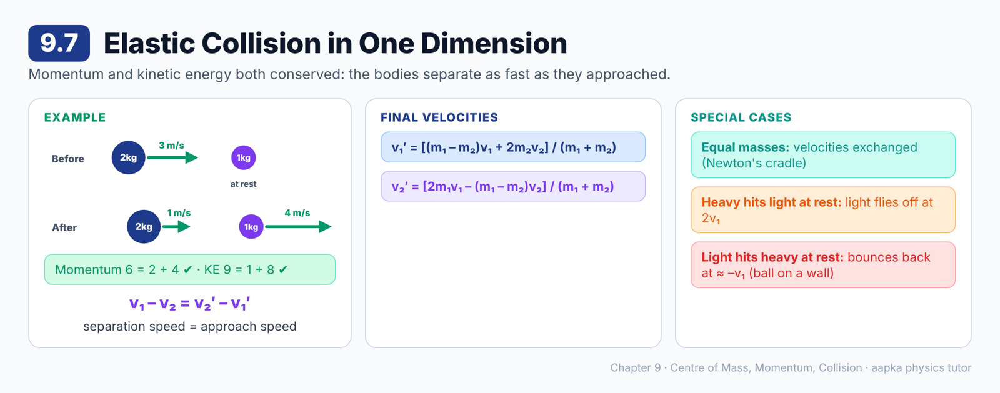

### 📘 Learning Material

**Big idea:** For a head-on elastic collision, momentum and kinetic energy together give a simple rule: the bodies separate as fast as they approached.

**Two conservation laws**
- Momentum: m₁v₁ + m₂v₂ = m₁v₁′ + m₂v₂′
- Kinetic energy: ½m₁v₁² + ½m₂v₂² = ½m₁v₁′² + ½m₂v₂′²

**Combining them**
**v₁ – v₂ = v₂′ – v₁′**
**Velocity of separation (after) = velocity of approach (before)**

**Final velocities**
- **v₁′ = [(m₁ – m₂) v₁ + 2m₂v₂] / (m₁ + m₂)**
- **v₂′ = [2m₁v₁ – (m₁ – m₂) v₂] / (m₁ + m₂)**

**Special cases**
| Case | Result |
|---|---|
| **Equal masses** | The velocities are **exchanged**: v₁′ = v₂, v₂′ = v₁ |
| **Heavy hits light at rest** (m₁ ≫ m₂) | The heavy body barely changes. The light one flies off at **2v₁** |
| **Light hits heavy at rest** (m₂ ≫ m₁) | The light body **bounces back** at about –v₁. Example: a ball hitting a wall |

**🧮 Worked example**
A 2 kg ball at 3 m/s hits a 1 kg ball at rest, elastically.
- v₁′ = (2 – 1) × 3 / 3 = **1 m/s**
- v₂′ = 2 × 2 × 3 / 3 = **4 m/s**
- Check momentum: 6 = 2 + 4 ✔. Check kinetic energy: 9 J = 1 J + 8 J ✔.

> 💡 **Newton's cradle:** equal steel balls. The moving ball stops dead, and the next one carries on with its velocity.

### ❓ MCQs

**Q1.** 🟢 In a one-dimensional elastic collision, the velocity of separation after the collision equals:
- (A) Zero
- (B) Half the velocity of approach
- (C) The velocity of approach
- (D) Twice the velocity of approach

**Q2.** 🟡 Two bodies of equal mass collide head-on elastically. After the collision, their velocities:
- (A) Are exchanged
- (B) Are both zero
- (C) Are equal
- (D) Are reversed

**Q3.** 🔴 A 2 kg ball moving at 3 m/s collides elastically head-on with a 1 kg ball at rest. The velocity of the 1 kg ball after the collision is:
- (A) 3 m/s
- (B) 2 m/s
- (C) 1 m/s
- (D) 4 m/s

**Q4.** 🟡 A very heavy body moving at v hits a very light body at rest, elastically and head-on. The light body moves off at about:
- (A) v
- (B) 2v
- (C) v/2
- (D) 0

**Q5.** 🟡 A ball hits a fixed wall elastically, head-on, at speed v. It rebounds with:
- (A) Speed 2v
- (B) Zero speed
- (C) Speed v/2
- (D) The same speed v

**Q6.** 🔴 In Q3, the velocity of the 2 kg ball after the collision is:
- (A) 1 m/s forward
- (B) 1 m/s backward
- (C) 3 m/s forward
- (D) 0

### Answer Key — 9.7
| Q | Ans | Explanation |
|---|---|---|
| 1 | C | v₁ – v₂ = v₂′ – v₁′ for an elastic collision. |
| 2 | A | Put m₁ = m₂: v₁′ = v₂ and v₂′ = v₁. |
| 3 | D | v₂′ = 2m₁v₁/(m₁ + m₂) = 12/3 = 4 m/s. |
| 4 | B | With m₁ ≫ m₂ and v₂ = 0: v₂′ ≈ 2v₁. |
| 5 | D | The wall acts as an infinitely heavy body: v₁′ ≈ –v₁. |
| 6 | A | v₁′ = (m₁ – m₂)v₁/(m₁ + m₂) = 3/3 = 1 m/s, still forward. |

---

## 9.8 Perfectly Inelastic Collision in One Dimension

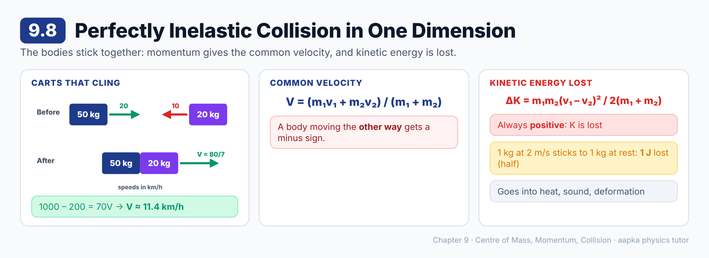

### 📘 Learning Material

**Big idea:** The bodies stick together. Momentum gives the common velocity, and some kinetic energy is always lost.

**Final velocity**
m₁v₁ + m₂v₂ = (m₁ + m₂) V
**V = (m₁v₁ + m₂v₂) / (m₁ + m₂)**

**Loss in kinetic energy**
**ΔK = m₁m₂ (v₁ – v₂)² / [2 (m₁ + m₂)]**
This is always **positive**: kinetic energy is lost, turning into heat, sound and deformation.

**🧮 Worked example: carts moving towards each other**
A 50 kg cart at 20 km/h meets a 20 kg cart coming the other way at 10 km/h. They cling together.
(50)(20) – (20)(10) = 70 V, so **V = 80/7 ≈ 11.4 km/h**, in the 50 kg cart's direction.

**🧮 Worked example: energy lost**
A 1 kg block at 2 m/s sticks to a 1 kg block at rest.
V = 1 m/s. ΔK = (1 × 1 × 4) / (2 × 2) = **1 J**, half the original 2 J.

> ⚠️ **Common mistake:** Forgetting the minus sign for a body moving the **other way**.

### ❓ MCQs

**Q1.** 🟢 After a perfectly inelastic collision, the common velocity is:
- (A) (m₁v₁ – m₂v₂) / (m₁ – m₂)
- (B) (v₁ + v₂) / 2 always
- (C) (m₁v₁ + m₂v₂) / (m₁ + m₂)
- (D) Zero always

**Q2.** 🔴 A 50 kg cart moving at 20 km/h collides with a 20 kg cart coming towards it at 10 km/h, and they stick together. Their common speed is about:
- (A) 11.4 km/h
- (B) 17.1 km/h
- (C) 15 km/h
- (D) 10 km/h

**Q3.** 🟡 The loss of kinetic energy in a perfectly inelastic collision is:
- (A) Always zero
- (B) Always positive
- (C) Always negative
- (D) Equal to the initial kinetic energy

**Q4.** 🔴 A 1 kg block moving at 2 m/s sticks to an identical block at rest. The kinetic energy lost is:
- (A) 2 J
- (B) 0.5 J
- (C) 0
- (D) 1 J

**Q5.** 🟡 The kinetic energy lost in a perfectly inelastic collision mostly turns into:
- (A) Momentum
- (B) Mass
- (C) Heat, sound and permanent deformation
- (D) Gravitational potential energy

### Answer Key — 9.8
| Q | Ans | Explanation |
|---|---|---|
| 1 | C | Momentum conservation with v₁′ = v₂′ = V. |
| 2 | A | V = (1000 – 200)/70 = 80/7 ≈ 11.4 km/h. |
| 3 | B | ΔK = m₁m₂(v₁ – v₂)²/[2(m₁ + m₂)] > 0. |
| 4 | D | (1 × 1 × 2²)/(2 × 2) = 1 J. |
| 5 | C | The energy is not destroyed. It changes into internal energy and sound. |

---

## 9.9 Coefficient of Restitution

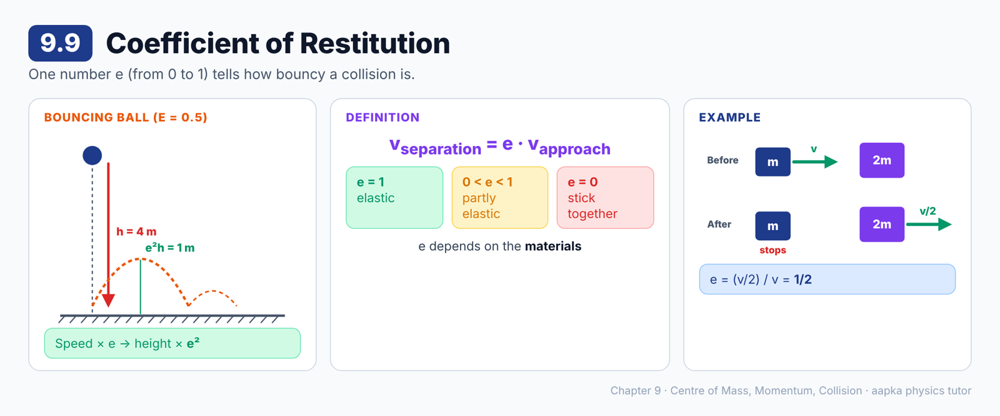

### 📘 Learning Material

**Big idea:** One number, e, tells you how bouncy a collision is.

**Definition**
**Velocity of separation = e × velocity of approach**
- **e = 1:** perfectly elastic
- **e = 0:** perfectly inelastic (no separation, the bodies stick)
- **0 < e < 1:** partially elastic. e depends on the **materials** of the bodies.

**🧮 Worked example**
A block of mass m at speed v hits a block of mass 2m at rest, and the lighter block stops.
- Momentum: mv = 2mv′, so v′ = v/2
- Separation = v/2, approach = v, so **e = 1/2**

**🧮 A bouncing ball**
A ball dropped from height h hits the floor at √(2gh) and rebounds at e√(2gh). So it rises to **e²h**.
Example: e = 0.5, dropped from 4 m → it rises to 0.25 × 4 = **1 m**.

> ⚠️ **Common mistake:** Using e for heights. The **speed** is multiplied by e, so the **height** is multiplied by e².

### ❓ MCQs

**Q1.** 🟢 The coefficient of restitution e is defined by:
- (A) Velocity of separation = e × velocity of approach
- (B) Final KE = e × initial KE
- (C) Final momentum = e × initial momentum
- (D) Force = e × time

**Q2.** 🟡 For a perfectly inelastic collision, the value of e is:
- (A) 1
- (B) 0.5
- (C) Infinity
- (D) 0

**Q3.** 🔴 A block of mass m moving at v hits a block of mass 2m at rest. The lighter block stops. The coefficient of restitution is:
- (A) 1
- (B) 1/2
- (C) 1/4
- (D) 2

**Q4.** 🔴 A ball dropped from 4 m on a floor with e = 0.5 rises to a height of:
- (A) 2 m
- (B) 0.5 m
- (C) 1 m
- (D) 4 m

### Answer Key — 9.9
| Q | Ans | Explanation |
|---|---|---|
| 1 | A | This is the definition. |
| 2 | D | The bodies don't separate, so the velocity of separation is 0. |
| 3 | B | v′ = v/2, so e = (v/2)/v = 1/2. |
| 4 | C | Height ∝ speed², so h′ = e²h = 0.25 × 4 = 1 m. |

---

## 9.10 Elastic Collision in Two Dimensions

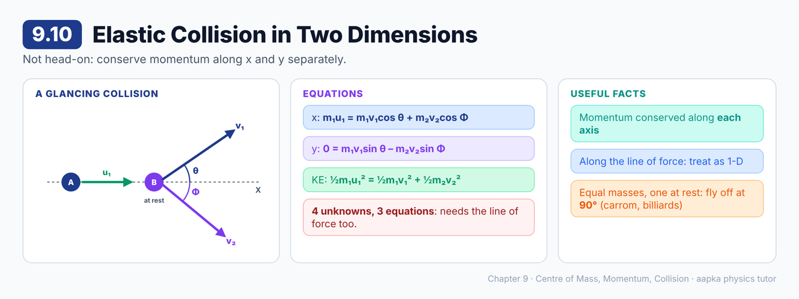

### 📘 Learning Material

**Big idea:** When a collision is not head-on, the bodies fly off at angles. Momentum is conserved along **each** axis separately.

**Set-up:** A (mass m₁, speed u₁) hits B (mass m₂) at rest. Afterwards, A moves at v₁ at angle θ above the X-axis, and B moves at v₂ at angle Φ below it.

**Equations**
1. x-momentum: **m₁u₁ = m₁v₁ cos θ + m₂v₂ cos Φ**
2. y-momentum: **0 = m₁v₁ sin θ – m₂v₂ sin Φ**
3. Kinetic energy (elastic): **½m₁u₁² = ½m₁v₁² + ½m₂v₂²**

**Three equations, four unknowns** (v₁, v₂, θ, Φ)
The final motion **can't be found from these laws alone**. It depends on the line along which the bodies push each other during the collision (the line of force).
- Perpendicular to that line, each body's momentum is unchanged.
- Along that line, treat it as a 1-D collision.

> 💡 **A well-known special case:** for **equal masses**, with one at rest and an elastic glancing collision, the two bodies move off **at 90° to each other**. You can see this in carrom and billiards.

### ❓ MCQs

**Q1.** 🟢 In a two-dimensional collision, momentum conservation is applied:
- (A) Only along the initial direction
- (B) Separately along the x- and y-axes
- (C) Only perpendicular to the initial direction
- (D) It does not apply

**Q2.** 🟡 For an elastic collision in two dimensions with one body initially at rest, the number of unknowns and equations is:
- (A) 4 unknowns, 4 equations
- (B) 3 unknowns, 3 equations
- (C) 2 unknowns, 3 equations
- (D) 4 unknowns, 3 equations

**Q3.** 🟡 Before the collision, B is at rest and A moves along the X-axis. The total y-momentum after the collision is:
- (A) Zero
- (B) m₁u₁
- (C) m₂v₂
- (D) Impossible to know

**Q4.** 🟡 Two equal masses collide elastically, one initially at rest, and the collision is not head-on. Afterwards they move:
- (A) In the same direction
- (B) In opposite directions
- (C) At 90° to each other
- (D) At 45° to each other

### Answer Key — 9.10
| Q | Ans | Explanation |
|---|---|---|
| 1 | B | Momentum is a vector, so each component is conserved. |
| 2 | D | v₁, v₂, θ, Φ, with two momentum equations and one energy equation. |
| 3 | A | It was zero before, so it is zero after. |
| 4 | C | The standard equal-mass elastic result. |

---

## 9.11 Impulse and Impulsive Force

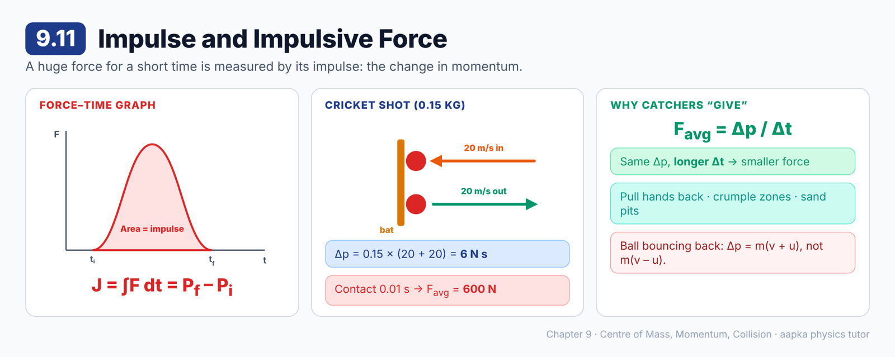

### 📘 Learning Material

**Big idea:** A very large force for a very short time (a bat hitting a ball) is best described by its **impulse**: the change in momentum it produces.

**Impulse**
**J = ∫ F dt = P_f – P_i**
- **Unit:** N s (= kg m/s)
- In one dimension, it is the **area under the force–time graph**.
- **Impulsive forces:** very large forces acting for a very short time. The force usually isn't constant during the contact.

**Average force**
**F_avg = Δp / Δt**

**🧮 Worked example: a cricket shot**
A 0.15 kg ball comes in at 20 m/s and is hit straight back at 20 m/s.
- Δp = 0.15 × 20 – (0.15 × –20) = **6 N s**
- With a contact time of 0.01 s: F_avg = 6 / 0.01 = **600 N**

**Why we "give" when catching**
For the same Δp, a **longer** contact time means a **smaller** force. That's why fielders pull their hands back, and why cars have crumple zones.

> ⚠️ **Common mistake:** When a ball bounces back, Δp = m(v + u), not m(v – u). The direction reverses!

### ❓ MCQs

**Q1.** 🟢 The impulse of a force equals:
- (A) Force × distance
- (B) Change in kinetic energy
- (C) Change in momentum
- (D) Mass × acceleration

**Q2.** 🟢 For one-dimensional motion, impulse is the area under the:
- (A) Velocity–time graph
- (B) Force–time graph
- (C) Force–distance graph
- (D) Position–time graph

**Q3.** 🔴 A 0.15 kg ball moving at 20 m/s is hit straight back at 20 m/s. The magnitude of the impulse is:
- (A) 0
- (B) 3 N s
- (C) 12 N s
- (D) 6 N s

**Q4.** 🔴 In Q3, if the bat is in contact for 0.01 s, the average force is:
- (A) 600 N
- (B) 60 N
- (C) 300 N
- (D) 6000 N

**Q5.** 🟡 A fielder pulls his hands back while catching a fast ball so that:
- (A) The change in momentum is smaller
- (B) The time of contact increases, so the force is smaller
- (C) The ball's mass decreases
- (D) The impulse increases

### Answer Key — 9.11
| Q | Ans | Explanation |
|---|---|---|
| 1 | C | ∫ F dt = ∫ (dP/dt) dt = P_f – P_i. |
| 2 | B | ∫ F dt is the area under the F–t graph. |
| 3 | D | Δp = 0.15 × (20 + 20) = 6 N s. |
| 4 | A | F = 6 / 0.01 = 600 N. |
| 5 | B | Δp is fixed, so a larger Δt means a smaller force. |

---

**Total: 54 questions** · 9.1 (6) · 9.2 (5) · 9.3 (5) · 9.4 (5) · 9.5 (4) · 9.6 (5) · 9.7 (6) · 9.8 (5) · 9.9 (4) · 9.10 (4) · 9.11 (5)
